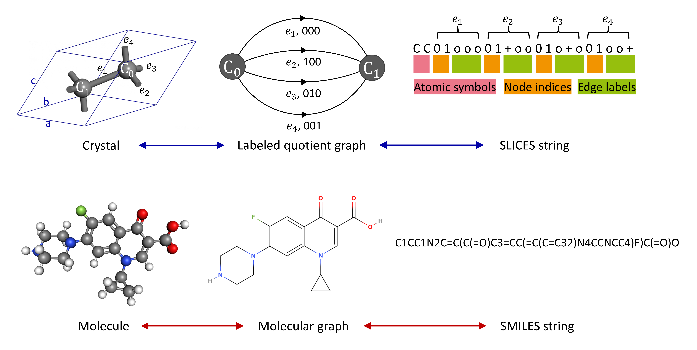
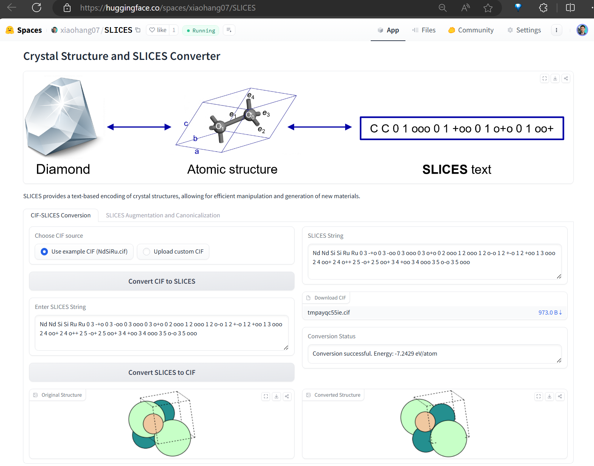
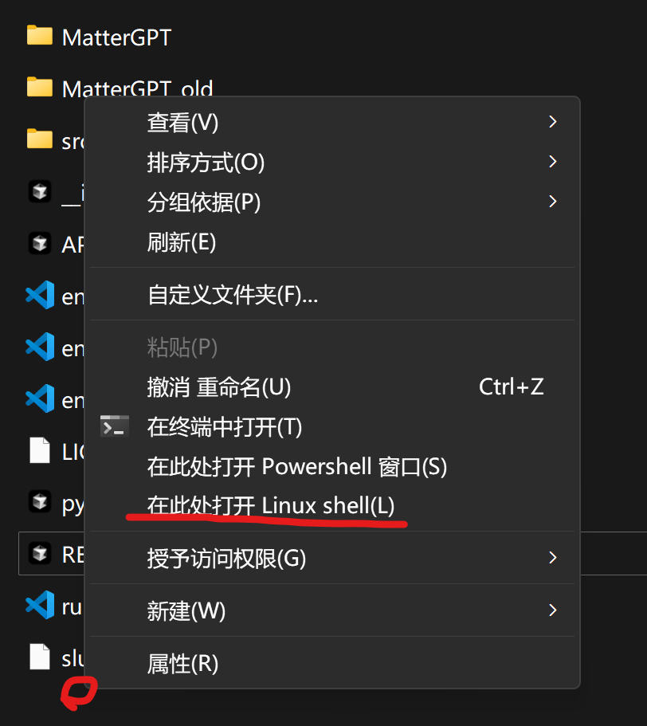

# Simplified Line-Input Crystal-Encoding System (SLICES)

**SLICES** (v4.0.2) is an invertible, translation-, rotation-, and permutation-invariant text representation for three-dimensional periodic crystal structures. It encodes crystals into token sequences via labeled quotient graphs and reconstructs 3D atomic structures through topology-only GFN-FF geometry targets, ZL\* lattice optimization, and NequIP-OAM force-field relaxation.



## Publications and External Resources

- **SLICES Paper (*Nature Communications*, 2023):** [doi:10.1038/s41467-023-42870-7](https://www.nature.com/articles/s41467-023-42870-7)
- **SLICES-PLUS Paper (Space-Group Encoding, 2024):** [arXiv:2410.22828](https://arxiv.org/abs/2410.22828)
- **Online SLICES / CIF Converter:** [Hugging Face Space](https://huggingface.co/spaces/xiaohang07/SLICES)
- **Published Datasets and Benchmark Results:** [Figshare (22707472)](https://doi.org/10.6084/m9.figshare.22707472)
- **Materials Project Novelty & Competing-Phase Library:** [Figshare (28645331)](https://doi.org/10.6084/m9.figshare.28645331)

[](https://huggingface.co/spaces/xiaohang07/SLICES "Online SLICES/CIF Converter")

---

## Key Capabilities

1. **Crystal Encoding & Augmentation:** Convert `pymatgen` `Structure` objects (CIF, POSCAR, JSON) into SLICES strings across Strategies 1–4 (default Strategy 4 with tokenized 230 space-group prefixes), automatic primitive-cell pre-reduction, random permutation augmentation (`structure2randomSLICES`, `structure2SLICESAug_atom_order`), and canonical reduction (`get_canonical_SLICES`).
2. **Invertible Structure Reconstruction:** Decode SLICES strings back to 3D crystal structures using the bundled open-source GFN-FF topology engine (`slices._vendor.gfnff`, LGPL-3.0 on Linux x86\_64; external `xtb` fallback on non-Linux hosts), Eon's barycentric net embedding, ZL\* L-BFGS-B optimization, and NequIP-OAM relaxation (`relax_model="auto"` -> `nequip-s+l` on CPU).
3. **Optional Multi-MLIP Support:** Built-in NequIP plans (`auto`, `nequip-s+l`, `nequip-m+l`, `nequip-l`, `none`) plus opt-in adapters in `slices.mlip_relaxer` for `chgnet`, `mattersim`, `orbv3`, `mace`, and legacy `m3gnet` when their respective packages are installed.
4. **Opt-In Robust Recovery Decoding:** Standalone multi-stage fallback pipeline (`SLICES.robust_SLICES2structure` / `slices decode --robust`) combining seeded multi-start ZL\* optimization, cycle-basis and covalent-radius fallbacks, and progressive relaxation without altering default v4.0.2 decoding determinism.
5. **Command-Line Interface & Safe Batch Utilities:** Unified `slices` CLI (`encode`, `decode`, `validate`, `canonicalize`) and scoped local/SLURM batch execution utilities (`slices.utils`).

---

## Installation

### Requirements

- **Python:** `>= 3.10` (locked environment targets Python `3.10` via `.python-version` and `uv.lock`).
- **Primary Platform:** Linux x86\_64 (including Windows 11 WSL2 Ubuntu), where the bundled `libgfnff.so` shared library runs in memory with zero external binaries.
- **Non-Linux Platforms (macOS / Windows native):** Encoding, validation, canonicalization, and optional MLIP adapters work natively. Decoding requires building the modified `xtb` binary (`xtb_noring_nooutput_nostdout_noCN`) and setting `SLICES_XTB_PATH` (see [Cross-Platform Notes](#cross-platform-notes)).

### Local Installation with `uv` (Recommended)

Environment management uses [uv](https://docs.astral.sh/uv/) with exact versions pinned in `uv.lock`.

1. Install `uv` if not already available:
   ```bash
   curl -LsSf https://astral.sh/uv/install.sh | sh
   ```

2. Clone the repository and sync dependencies for your hardware (`--extra cpu`, `--extra cu126` for NVIDIA GPUs through RTX 40 series, or `--extra cu128` for CUDA 12.8 / RTX 50 series):
   ```bash
   git clone https://github.com/xiaohang007/SLICES.git
   cd SLICES

   # Select one PyTorch build extra: cpu, cu126, or cu128
   uv sync --extra cpu
   source .venv/bin/activate
   ```
   - Optional developer tools (`pytest`, `pytest-cov`, `ruff`): add `--group dev` (included by default in `uv sync` unless `--no-dev` is passed).
   - Optional faster CUDA NequIP kernels on NVIDIA GPUs: add `--extra oeq` alongside `--extra cu126` or `--extra cu128`.
   - `pyproject.toml` configures the Tsinghua PyPI mirror (`tuna`) as default so `uv.lock` resolves identically across machines (`uv sync --locked`). Outside China, `UV_DEFAULT_INDEX=https://pypi.org/simple` may be used when re-resolving.

3. Pre-compile and cache the default NequIP force-field models before launching parallel decoding jobs:
   ```bash
   python -m slices.relax_backends --prepare
   ```
   Compiled artifacts are stored in `~/.cache/slices/nequip` (configurable via `SLICES_MODEL_CACHE`). Weights are downloaded from `nequip.net` (Zenodo) with automatic timeout retries; for offline setups, download the `.nequip.zip` archive manually and set `SLICES_NEQUIP_MODEL_S` / `SLICES_NEQUIP_MODEL_M` / `SLICES_NEQUIP_MODEL_L`.

4. Verify the installation:
   ```bash
   python tools/validate_installation.py --quick
   ```

### Library-Only Installation (`uv pip` / `pip`)

If you only need the `slices` library for crystal encoding and decoding in an existing Python 3.10+ Linux x86\_64 environment:

```bash
uv venv && source .venv/bin/activate
uv pip install slices --torch-backend=auto
# Or from a local checkout:
uv pip install -e .
```

### Legacy Docker / SLURM Environment

Legacy container files are retained at [Dockerfile/Dockerfile](Dockerfile/Dockerfile), [Dockerfile/docker-compose.yml](Dockerfile/docker-compose.yml), and [rundocker.sh](rundocker.sh) for reproducing older SLURM/PBS workflows. Note that the prebuilt Docker image `xiaohang07/slices:v12` ships an older pre-v4 environment rather than the current `uv` + NequIP + GFN-FF stack.

```bash
# Adjust CPU core count in slurm.conf before starting the container
sed -i 's/CPUs=8/CPUs=16/' slurm.conf
chmod +x entrypoint_set_cpus.sh rundocker.sh

# Launch with the current directory mounted at /crystal (override via SLICES_DATA_DIR / SLICES_IMAGE)
./rundocker.sh
```

On Windows 11, enable WSL2 Ubuntu integration in Docker Desktop and run the commands from a WSL2 shell:



---

## Quickstart

### Python API

#### 1. Encode and Decode a Crystal Structure

```python
from pymatgen.core.structure import Structure
from slices import SLICES, check_SLICES

# Load a crystal structure (CIF, POSCAR, or JSON)
original = Structure.from_file("examples/NdSiRu.cif")

# Default relax_model="auto" resolves to CPU nequip-s+l
backend = SLICES()

# Encode to Strategy-4 SLICES (reduces to primitive cell if smaller)
slices_str = backend.structure2SLICES(original)
assert check_SLICES(slices_str, strategy=4)

# Decode back to a 3D crystal structure and predicted energy (eV/atom)
reconstructed, energy_per_atom = backend.SLICES2structure(slices_str)
print("SLICES:", slices_str)
print("Formula:", reconstructed.composition.reduced_formula)
print(f"Predicted energy: {energy_per_atom:.6f} eV/atom")
```

For encoding, validation, or canonicalization without loading force-field models, pass `relax_model=None`:

```python
encoder = SLICES(relax_model=None, graph_method="econnn")
slices_str = encoder.structure2SLICES(original, strategy=4)
canonical = encoder.get_canonical_SLICES(slices_str, strategy=4)
```

#### 2. Data Augmentation and Canonicalization

```python
from pymatgen.core.structure import Structure
from slices import SLICES

structure = Structure.from_file("examples/Sr3Ru2O7.cif")
backend = SLICES(relax_model=None, graph_method="econnn")

# Permute atom ordering only (or use structure2randomSLICES for bond shuffling/flipping)
augmented = backend.structure2SLICESAug_atom_order(structure, strategy=4, num=50)
canonical_set = {backend.get_canonical_SLICES(s, strategy=4) for s in augmented}
print(f"Generated {len(augmented)} variants -> {len(canonical_set)} unique canonical form")
```

#### 3. Opt-In Robust Decoding and Optional MLIP Backends

```python
from slices import SLICES

# Multi-stage recovery decoding (standard v4.0.2 fast path + seeded multi-start fallback)
backend = SLICES(relax_model="auto")
structure, energy = backend.robust_SLICES2structure(slices_str, n_starts=3, seed=0)

# Higher-accuracy built-in NequIP plan (NequIP-OAM-M relaxation + NequIP-OAM-L energy)
backend_m = SLICES(relax_model="nequip-m+l")

# Optional external MLIP adapters (require separate installation, e.g. `pip install chgnet`)
# Supported names: "chgnet", "mattersim", "orbv3" ("orb-v3"), "mace" ("mace-mp"), "m3gnet"
# backend_opt = SLICES(relax_model="chgnet")
```

### Command-Line Interface (`slices`)

The package installs the `slices` entry point (also runnable as `python -m slices.cli`). Non-relaxing commands (`encode`, `validate`, `canonicalize`) run with `relax_model=None` and do not load force fields.

```bash
slices --version

# Encode CIF/POSCAR/JSON (or '-' for CIF on stdin)
slices encode examples/NdSiRu.cif -o NdSiRu.slices --strategy 4 --graph-method econnn

# Validate syntax and quotient-graph topology (exit 0 if VALID, 1 if INVALID)
slices validate NdSiRu.slices
slices validate NdSiRu.slices --check-duplicates

# Convert to canonical SLICES form
slices canonicalize NdSiRu.slices -o NdSiRu.canon.slices

# Decode to CIF / POSCAR / JSON (default: --relax-model auto -> nequip-s+l on CPU)
slices decode NdSiRu.slices -o reconstructed.cif --relax-model auto
slices decode NdSiRu.slices -o reconstructed_zl.cif --relax-model none
slices decode NdSiRu.slices -o reconstructed_robust.cif --robust --seed 0

# Pipeline via stdin/stdout
slices encode examples/NdSiRu.cif | slices validate -
```

---

## Default Relaxation Backend and MP-20 Benchmark Summary

`SLICES(relax_model="auto")` resolves to **`nequip-s+l` on CPU** on every machine (relaxation with `NequIP-OAM-S`, final energy with `NequIP-OAM-L`). Because CPU-side GFN-FF topology generation (~0.43 s) and ZL\* lattice optimization (~0.45 s) dominate single-structure decode time, GPU relaxation yields at most ~12% wall-clock speedup and is opt-in via `SLICES_DEVICE=cuda` (optionally paired with `relax_model="nequip-l"`).

Full benchmark on all **2,383** MP-20 non-metal structures ([data/mp20_nonmetal/mp20_v4_benchmark_2383.csv](data/mp20_nonmetal/mp20_v4_benchmark_2383.csv), CPU, identical `StructureMatcher` tolerances and formation-energy reference):

| Pipeline / Model | Succeeded | Standard Match | Loose Match | Median \|E\_form - DFT\| (eV/atom) | Relative CPU Time |
|---|---:|---:|---:|---:|---:|
| Legacy `xtb` + M3GNet | 2,291 / 2,383 | 88.67% | 91.23% | 0.048 | — |
| **`nequip-s+l` (`auto` default)** | **2,374 / 2,383** | **93.79%** | **95.97%** | **0.025** | **1.0x** |
| `nequip-m+l` | 2,374 / 2,383 | 94.80% | 96.18% | 0.021 | ~2.0x |
| MatterSim-1M (same ZL\* starts) | 2,374 / 2,383 | 94.67% | 96.01% | 0.050 | — |

Run local relaxation benchmarks directly with:

```bash
python examples/3.benchmark_relax_models.py --n 32 --models auto nequip-m+l
python tools/benchmarks/run_comparison_test.py --n 16 --models auto chgnet mace
```

---

## Cross-Platform Notes

- **Non-Linux GFN-FF Fallback (`SLICES_XTB_PATH`):** When the bundled Linux x86\_64 `libgfnff.so` shared library cannot be loaded (`ImportError` / `OSError`), `slices.gfnff_helper.run_gfnff_helper` searches `SLICES_XTB_PATH`, `XTB_MOD_PATH`, and `PATH` for `xtb_noring_nooutput_nostdout_noCN`, executing it in an isolated temporary directory without `shell=True`.
- **Forcing Local Batch Execution (`SLICES_FORCE_LOCAL`):** Set `SLICES_FORCE_LOCAL=1` to bypass SLURM detection in `slices.utils.is_slurm_available()`. Local worker tracking is strictly scoped to processes launched by the current session.
- **POSIX Signal Timeouts:** `function_timeout` uses `signal.SIGALRM` only on POSIX main threads; worker threads and Windows execute the wrapped call directly without raising signal errors.
- **Optional PyTorch MLIP Device Selection:** `SLICES_DEVICE` accepts `cpu` or `cuda` for built-in NequIP models, and additionally accepts `mps` (Apple Silicon) for optional PyTorch MLIP adapters in `slices.mlip_relaxer`.

---

## Repository Layout

| Path | Description |
|---|---|
| `src/slices/` | Core library: `core.py`, `tobascco_net.py`, `gfnff_helper.py`, `relax_backends.py`, `mlip_relaxer.py`, `decoding_strategies.py`, `cli.py`, `exceptions.py`, `utils.py`, `utils_wyckoff.py`, `config.py`, and vendored `_vendor/gfnff/` |
| `examples/` | Runnable scripts (`2.1structure2SLICES_SLICES2structure.py`, `2.2data_augmentation_get_canonical_slices.py`, `3.benchmark_relax_models.py`, `test.py`) and sample CIFs (`NdSiRu.cif`, `Sr3Ru2O7.cif`) |
| `tools/` | Installation validation (`validate_installation.py`), unified test/lint runner (`run_tests.py`), workstation script (`workstation_check.sh`), and MLIP comparison benchmark (`benchmarks/run_comparison_test.py`) |
| `tests/` | Unified test suite: `baseline/` (89 frozen v4.0.2 golden equivalence tests at `atol=1e-12`), `unit/`, `integration/`, and `regression/` |
| `HTS/` | High-throughput inverse-design workflow scripts and archived datasets |
| `benchmark/` | Reproducibility benchmarks for MP-20, MP-21-40, QMOF-21-40, and RNN validity/success studies ([benchmark/benchmarks.md](benchmark/benchmarks.md)) |
| `data/` | Benchmark datasets, including `data/mp20_nonmetal/mp20_v4_benchmark_2383.csv` and `chemPotMP.json` |
| `Dockerfile/` | Legacy Docker image and compose definitions (`Dockerfile`, `docker-compose.yml`, SLURM entrypoints) |
| `docs/` | Documentation index, API reference (`docs/api/`), and migration audit records (`docs/migration/`) |

---

## Testing, Linting, and Validation

The repository enforces Google Python style via `ruff` and maintains a unified `pytest` suite (`250 passed, 5 skipped, 0 failed`, where the 5 skips correspond to uninstalled optional MLIP packages):

```bash
# Validate environment, GFN-FF helper, NequIP config, CLI, and quick round-trip
python tools/validate_installation.py --quick

# Run ruff static checks only
python tools/run_tests.py --lint-only

# Run fast unit tests with reproducible PYTHONHASHSEED=0 and OMP_NUM_THREADS=1
python tools/run_tests.py --unit

# Run frozen v4.0.2 golden baseline equivalence tests (89 tests, atol=1e-12)
python tools/run_tests.py --baseline

# Run full lint + pytest suite
python tools/run_tests.py --lint --verbose
```

---

## Documentation

- [Documentation Index](docs/README.md)
- [Technical Architecture Guide](TECHNICAL.md) — encoding strategies, net embedding, GFN-FF, ZL\* optimization, NequIP relaxer benchmarks, optional MLIPs, and baseline freeze invariant
- [Changelog](CHANGELOG.md) — upstream v1.0–v4.0.2 history and `slices-4-personal` migration releases
- **API Reference:**
  - [Core Encoder/Decoder & Exceptions](docs/api/API_CORE.md)
  - [Relaxation Backends & Optional MLIPs](docs/api/API_MLIP.md)
  - [Opt-In Robust Decoding Strategies](docs/api/API_DECODING_STRATEGIES.md)
  - [Periodic Net Topology, GFN-FF & Wyckoff Utilities](docs/api/API_GRAPH.md)
  - [Batch Job Utilities & CLI](docs/api/API_UTILITIES.md)
  - [Configuration, Constants & Environment Variables](docs/api/API_CONFIG.md)
- [Deferred Core / Algorithm Register](docs/migration/DEFERRED_CORE_REGISTER.md) — formal log of frozen v4.0.2 math/algorithm behaviors preserved for baseline equivalence

---

## Citation

If you use SLICES or SLICES-PLUS in academic work, please cite:

```bibtex
@article{xiao2023invertible,
  title={An invertible, invariant crystal representation for inverse design of solid-state materials using generative deep learning},
  author={Xiao, Hang and Li, Rong and Shi, Xiaoyang and Chen, Yan and Zhu, Liangliang and Chen, Xi and Wang, Lei},
  journal={Nature Communications},
  volume={14},
  number={1},
  pages={7027},
  year={2023},
  publisher={Nature Publishing Group UK London}
}

@misc{wang2024slicespluscrystalrepresentationleveraging,
  title={SLICES-PLUS: A Crystal Representation Leveraging Spatial Symmetry},
  author={Baoning Wang and Zhiyuan Xu and Zhiyu Han and Qiwen Nie and Hang Xiao and Gang Yan},
  year={2024},
  eprint={2410.22828},
  archivePrefix={arXiv},
  primaryClass={physics.comp-ph},
  url={https://arxiv.org/abs/2410.22828}
}
```

---

## License and Acknowledgements

SLICES is licensed under the **GNU Lesser General Public License v2.1** ([LICENSE](LICENSE)). The bundled open-source GFN-FF library (`src/slices/_vendor/gfnff`) is licensed under the **GNU Lesser General Public License v3.0** ([src/slices/_vendor/gfnff_extra/LICENSE](src/slices/_vendor/gfnff_extra/LICENSE)).

SLICES builds upon open-source scientific libraries including [pymatgen](https://github.com/materialsproject/pymatgen), [ASE](https://gitlab.com/ase/ase), [NequIP](https://github.com/mir-group/nequip), [gfnff](https://github.com/pprcht/gfnff), [tobascco](https://github.com/peteboyd/tobascco), [xtb](https://github.com/grimme-lab/xtb), [CHGNet](https://github.com/CederGroupHub/chgnet), and [M3GNet](https://github.com/materialsvirtuallab/m3gnet).

## Contact

- **Upstream Author:** Hang Xiao ([hangxiao@ln.edu.hk](mailto:hangxiao@ln.edu.hk))
- **Discussions & Issues:** [GitHub Discussions](https://github.com/xiaohang007/SLICES/discussions/categories/general)
