# Stage 2A Audit Report: Personal Fork Diff & Portability Audit (`cea17da..backup/v3-personal`)

**Date:** 2026-11-25  
**Auditor:** `auditor-fork` (Slice 2A)  
**Personal Fork Branch:** `backup/v3-personal` (`origin/main` at `301c75fcdfb2d553b616c30178ccc7b0161b1fe7`)  
**Personal Fork-Base:** `cea17da95be2cd9d17f6c71765895dbb5cb64958` (verified bit-identical tree `e36d7ff08bd4a9a8f9a5dcbeb6471d1249b2b5d9` to upstream `142298be4f83ab161d51298c82e74e94c3319891`)  
**Upstream Target Baseline:** `slices-4-personal` / `upstream/main` at `94ef8e079b69c37138159805e3c701b8df87a5d7` (tag `v4.0.2`)  
**Governing Plan:** [PLAN.md](file:///home/ordillo/tests/SLICES/docs/migration/PLAN.md)

---

## 1. Executive Summary & Quantitative Overview

Between the verified fork-base `cea17da` (`== upstream 142298b`) and `backup/v3-personal` (`301c75f`), the personal fork accumulated **30 commits** (28 regular commits and 2 merge commits) affecting **1,377 net file-diff entries** (`git diff --name-status -M cea17da..backup/v3-personal`):

- **127 non-bulk entries** across `src/slices/`, root CLI/config/packaging files, `tests/`, `tools/`, `docs/`, `configs/`, `docker/`, and `tutorial/`.
- **1,250 bulk entries** across `benchmark/` (`1,199` directory-rename moves, `39` deletions, `6` additions), `HTS/` (`3` workflow script edits), `MatterGPT/` (`1` workflow script edit), and `MatterGPT_no_flash/` (`2` workflow script edits).

### 1.1 Commit DAG Topology (`cea17da..301c75f`)

```mermaid
flowchart LR
    B["cea17da (Fork Base)"] --> C1["01: 665b042"]
    C1 --> C2["02: bd242ad"]
    C2 --> C3["03: 54fd2c1"]
    C3 --> C4["04: b59d31b"]
    C4 --> C5["05: 3d20f0b"]
    C5 --> C7["07: 57c23ff"]
    C2 --> C8["08: 03cc621 (Merge)"]
    C7 --> C8
    C2 --> C6["06: 31c7217 (os-agnostic)"]
    C8 --> C9["09: ea35217 (Merge)"]
    C6 --> C9
    C9 --> C10["10..22: 8bedf5f..e37ce5e"]
    C10 --> C23["23: 0379d6a (bench/bin reorg)"]
    C23 --> C24["24..26: CI disable"]
    C24 --> C27["27: 70635d9 (CLI + tools)"]
    C27 --> C28["28..29: 883dff4..58ff66c"]
    C28 --> C30["30: 301c75f (pyc + xtb)"]
```



### 1.2 Five-Bucket Classification Summary

| Bucket | Role in SLICES v4.0.2 Migration | Key Fork Artifacts |
|---|---|---|
| `PORT_ADDITIVE` | Safe new modules, opt-in APIs, CLI, structured exceptions, package exports, and adapted test suite | `src/slices/exceptions.py` (extracted), `src/slices/mlip_relaxer.py` (adapted), `src/slices/decoding_strategies.py` (opt-in only), `SLICES.robust_SLICES2structure`, `SLICES.structure2SLICESAug_atom_order`, `Net.clear_cache`, `src/slices/cli.py` (from `slices_cli.py`), `src/slices/__init__.py`, `tests/**`, `pytest.ini` -> `pyproject.toml`, selected `tools/` |
| `PORT_CROSS_PLATFORM` | OS-agnostic filesystem/process handling and non-POSIX / non-Linux fallbacks that leave Linux v4.0.2 untouched | `shutil`/`pathlib` cleanup & copy in [utils.py](file:///home/ordillo/tests/SLICES/src/slices/utils.py) (merged with upstream `_SUBMITTED_SLURM_JOBS`), POSIX main-thread `SIGALRM` + safe non-POSIX fallback in `function_timeout`, optional external-`xtb` fallback in [gfnff_helper.py](file:///home/ordillo/tests/SLICES/src/slices/gfnff_helper.py) when `libgfnff.so` cannot load on macOS/Windows (zero committed binaries) |
| `PORT_STYLE_DOCS` | 100% English translation, Google-style docstrings, type hints, section headers, API/technical docs, `.gitignore` | English translations in `core.py` & `utils.py`, factual scientific tone (`fbfb536`), `# === Section ===` dividers, `TECHNICAL.md`, `CHANGELOG.md`, `docs/api/*.md`, directory-scoped `.gitignore` (`e37ce5e` pattern, updated for kept `benchmark/`/`HTS/`/`data/`) |
| `DEFER_CORE_FREEZE` | Behavioral edits to frozen math, graph basis construction, `ZL*` optimization, `from_SLICES` parsing, or default relaxation | **12 distinct items (`FC-01`..`FC-12`)**: `Net.get_lattice_basis` (`CycleBasisOptimizer` + `LatticeBasisError`), `Net.is_integral` (`tolerance=1e-6`), `Net.iter_cycles` (BFS `deque` + `max_depth=100`), `to_structures()` auto-injection of `MultiStartOptimizer`, `AdaptiveConvergence`, and `ProgressiveRelaxer`, `get_inner_p_target` inline `BondParameterFallback`, `from_SLICES` strategy-4 header error swallowing, `relax_large_cell2` `fmax`/`steps` kwargs, import-time root logger `CRITICAL` & `tf_keras` monkey-patching |
| `DROP_OBSOLETE` | Binary bloat, build caches, obsolete M3GNet-default packaging, broken submodule, scratch files, and destructive `benchmark/` renames/deletions | `src/slices/__pycache__/*.pyc` (6 files), `src/slices.egg-info/*` (5 files), `src/slices/bin/{linux,macos,windows}/xtb*` (71.0 MB), `xtb` broken gitlink (`160000`), `test.slices`, `pyproject.toml` (`v2.0.12` / `m3gnet==0.2.4`), `SLICES.__init__` silent fallback to `m3gnet`, `MatterGPT*` edits, 39 `benchmark/` CSV/JSON deletions, 1,199 `benchmark/` directory-rename moves, `examples/` -> `tutorial/` rename |

---

## 2. Exhaustive Commit-by-Commit Audit Ledger (All 30 Commits)

Every commit in `cea17da..backup/v3-personal` (`git log --reverse cea17da..backup/v3-personal`) was inspected against its parent(s):

| # | Short SHA | Full SHA | Date | Type | Subject | Files Changed (vs `p0`) | Bucket Classification(s) | Migration Disposition & Notes |
|---|---|---|---|---|---|---|---|---|
| 01 | `665b042` | `665b0429486f05900ce95b57163cf1e6834668b7` | 2025-11-26 | Normal | Add macOS compatibility, MLIP integration, and XTB binary support | 25 (11 non-bulk, 14 bulk) | `PORT_ADDITIVE`, `PORT_CROSS_PLATFORM`, `DEFER_CORE_FREEZE`, `DROP_OBSOLETE` | Introduced `mlip_relaxer.py` (`PORT_ADDITIVE`), `function_timeout` fallback & `subprocess.run(..., timeout=...)` (`PORT_CROSS_PLATFORM`), `.gitignore` (`PORT_STYLE_DOCS`); also replaced Linux xtb with macOS ARM64 xtb (`DROP_OBSOLETE`) and altered `from_SLICES` / `relax_large_cell2` (`DEFER_CORE_FREEZE`). |
| 02 | `bd242ad` | `bd242ad12e831fac2847c34e56883b4b8cb18b79` | 2025-11-26 | Normal | Update documentation | 4 | `PORT_STYLE_DOCS`, `PORT_ADDITIVE` | Updated `README.md`, `core.py` docstrings, and early encoding/round-trip test scripts. |
| 03 | `54fd2c1` | `54fd2c1db53b15831100a728266a1bbade3f70a3` | 2025-11-27 | Normal | Save current working state before testing/organization refactor | 10 | `PORT_ADDITIVE`, `DEFER_CORE_FREEZE`, `PORT_STYLE_DOCS` | Added structured exception classes (`SLICESError` hierarchy) and `Net.clear_cache()` (`PORT_ADDITIVE`); replaced `Net.iter_cycles` recursion with `deque.popleft()` + `max_depth=100` and `Net.get_lattice_basis` `-1` return with `LatticeBasisError`, plus `root_logger.setLevel(logging.CRITICAL)` (`DEFER_CORE_FREEZE`). |
| 04 | `b59d31b` | `b59d31b5d90c6545ee88049dc284423a484a4723` | 2025-11-27 | Normal | Complete testing and organization implementation | 28 | `PORT_ADDITIVE`, `PORT_STYLE_DOCS`, `DROP_OBSOLETE` | Created `tests/{unit,integration,regression}/`, `tests/conftest.py`, `pytest.ini`, `# SECTION` headers in `core.py`, and `.github/workflows/tests.yml`. Also downgraded `pyproject.toml` to M3GNet `2.0.12` and moved `examples/*.py` into `examples/{basic,advanced}/` (`DROP_OBSOLETE` on example moves). |
| 05 | `3d20f0b` | `3d20f0b799c479f33507fa155afc97dea297e36f` | 2025-12-01 | Normal | Complete all missing files from plan | 15 | `PORT_ADDITIVE`, `PORT_STYLE_DOCS`, `DROP_OBSOLETE` | Added `test_mlip_relaxer.py`, `test_utils.py`, `test_graph_topology.py`, `test_xtb_integration.py`, `test_mp20_samples.py`, `scripts/validate_installation.py`, `scripts/run_tests.py` (`PORT_ADDITIVE`); added `PUSH_TO_GITHUB.md` (later deleted; `DROP_OBSOLETE`). |
| 06 | `31c7217` | `31c7217c1d4291a4ff2c97759f2e79771124584a` | 2025-12-01 | Normal | OS-agnostic compatibility | 4 (vs `bd242ad`) | `PORT_CROSS_PLATFORM`, `PORT_STYLE_DOCS` | Side-branch commit replacing `os.system('rm -rf ...')` / `os.system('cp -r ...')` with `shutil.rmtree` / `shutil.copytree` and translating Chinese strings in `utils.py` to English; added Windows `.exe` xtb detection in `core.py`. |
| 07 | `57c23ff` | `57c23ffa2b3499d94b0bc70f8aac9bed3d1aea05` | 2025-12-04 | Normal | Add decoding enhancements module | 47 (vs `3d20f0b`) | `PORT_ADDITIVE`, `DEFER_CORE_FREEZE`, `DROP_OBSOLETE` | Added `decoding_improvements.py` (later renamed `decoding_strategies.py`) and `robust_SLICES2structure` (`PORT_ADDITIVE` as opt-in), **but** auto-injected `MultiStartOptimizer`, `AdaptiveConvergence`, `ProgressiveRelaxer`, `BondParameterFallback`, `CycleBasisOptimizer`, and `is_integral(tolerance=1e-6)` into default `to_structures()`, `get_inner_p_target()`, and `Net.get_lattice_basis()` (`DEFER_CORE_FREEZE`). Moved root Docker/SLURM scripts into `config/` (`DROP_OBSOLETE` on root moves). |
| 08 | `03cc621` | `03cc62179fbf85d2f7dddeca3e174ae77f10cac2` | 2025-12-12 | Merge | Merge: LLL algorithm references (`bd242ad` + `57c23ff`) | 90 (vs `bd242ad`) | `PORT_STYLE_DOCS`, `PORT_ADDITIVE`, `DEFER_CORE_FREEZE` | Merged `57c23ff` line into `bd242ad` with LLL/Pauling/Nocedal literature citations in `decoding_improvements.py`. |
| 09 | `ea35217` | `ea352175a4f363af237e99228ef72b6597494dab` | 2025-12-12 | Merge | Merge os-agnostic-fixes: Add Windows/macOS/Linux cross-platform compatibility (`03cc621` + `31c7217`) | 4 (vs `03cc621`) | `PORT_CROSS_PLATFORM` | Merged `31c7217` OS-agnostic `utils.py` and `core.py` changes with adaptive timeout logic from `03cc621`. |
| 10 | `8bedf5f` | `8bedf5ff50011e3b26859bf84137457eb34f01e7` | 2025-12-12 | Normal | Add decoding enhancements | 3 | `DROP_OBSOLETE` | Removed transient `docs/investigations/PGFNFF_*.md` scratch notes. |
| 11 | `3a0f57c` | `3a0f57ce9e8c229962fdbdd33dc96fff974c20d3` | 2025-12-12 | Normal | Add benchmark documentation | 4 | `PORT_ADDITIVE`, `PORT_STYLE_DOCS` | Added `plot_formation_energy_comparison.py` and temporary energy docs (later consolidated into `TECHNICAL.md`). |
| 12 | `75ddf8b` | `75ddf8b6922b34fad8e46a920a5915645ac4ce73` | 2025-12-13 | Normal | Organize codebase structure | 121 | `PORT_STYLE_DOCS`, `PORT_ADDITIVE`, `DROP_OBSOLETE` | Consolidated `TECHNICAL.md`, `CHANGELOG.md`, `docs/api/API_*.md`, `src/slices/__init__.py` exports, and renamed `decoding_improvements.py` -> `decoding_strategies.py` (`PORT_ADDITIVE` / `PORT_STYLE_DOCS`). Also renamed `Dockerfile/` -> `docker/`, deleted legacy Sphinx `docs/_static/*` and `benchmark/benchmarks.md` (`DROP_OBSOLETE` on `benchmark/benchmarks.md` deletion). |
| 13 | `62a4265` | `62a4265c929693eda43afcc527e08c7ff700b52f` | 2025-12-13 | Normal | Fix version and default MLIP model | 5 | `DROP_OBSOLETE`, `PORT_STYLE_DOCS` | Set `__version__ = "2.0.12"` and default `m3gnet` in `mlip_relaxer.py` / docs (`DROP_OBSOLETE`; v4.0.2 uses `__version__ = "4.0.2"` and `relax_model="auto"` -> `nequip-s+l`). |
| 14 | `f7a648f` | `f7a648ff55f423d01f55590b206c5412ce96d3be` | 2025-12-13 | Normal | Update .gitignore and simplify CI workflow | 2 | `PORT_STYLE_DOCS`, `DROP_OBSOLETE` | Simplified `.github/workflows/tests.yml`; added overly broad `*.csv` / `*.json` ignores to `.gitignore` (`DROP_OBSOLETE` — fixed in `e37ce5e`, then regressed in `0379d6a`). |
| 15 | `538fab8` | `538fab863f5def66db4e6fd717b76162bf9ceacd` | 2025-12-13 | Normal | Improve README organization and GitHub UI readability | 1 | `PORT_STYLE_DOCS` | Clean markdown structure, collapsible `<details>` sections, and tables in `README.md`. |
| 16 | `756e6f4` | `756e6f4fcd9251c84531a000d95a729535e2ff18` | 2025-12-13 | Normal | Add augmentation and canonicalization section to README | 2 | `PORT_ADDITIVE`, `PORT_STYLE_DOCS` | Added `SLICES.structure2SLICESAug_atom_order()` convenience wrapper around `structure2randomSLICES` (`PORT_ADDITIVE`) and clear canonicalization/augmentation docs (`PORT_STYLE_DOCS`). |
| 17 | `0431e8e` | `0431e8e2d255a5ac1e87e13be55d87f23c870dfc` | 2025-12-13 | Normal | Improve docstrings for augmentation and canonicalization methods | 1 | `PORT_STYLE_DOCS` | Expanded Google-style docstrings on `get_canonical_SLICES`, `structure2randomSLICES`, and `structure2SLICESAug_atom_order` in `core.py` (translating Chinese docstring/comments to English). |
| 18 | `fbfb536` | `fbfb53698257131f6b380605a1171df430546c30` | 2025-12-13 | Normal | Ensure consistent factual language across codebase | 4 | `PORT_STYLE_DOCS` | Replaced subjective/promotional wording (`"best result"`, `"better performance"`, `"best available"`) with precise factual descriptions across `core.py`, `decoding_strategies.py`, `tobascco_net.py`, and `utils.py`. Direct standard for Stages 4–6. |
| 19 | `67d73f6` | `67d73f6032823f15708f2fdc96ca5f5a4990b6cc` | 2025-12-13 | Normal | Fix .gitignore to preserve important CSV/JSON files | 2 | `PORT_STYLE_DOCS` | Replaced blanket `*.csv`/`*.json` ignore rules; updated Python version comments in `.github/workflows/tests.yml`. |
| 20 | `9ea684d` | `9ea684deb415d281577ea33a51e7618a64112ed6` | 2025-12-13 | Normal | Fix .gitignore: replace blanket CSV/JSON ignore with specific patterns | 1 | `PORT_STYLE_DOCS` | Iterative refinement of directory-scoped `.gitignore` patterns. |
| 21 | `cb3f4b0` | `cb3f4b068351da22e973d6b8d69836b6ee8d81d1` | 2025-12-13 | Normal | Fix .gitignore: replace blanket CSV/JSON ignore with specific directory patterns | 1 | `PORT_STYLE_DOCS` | Iterative refinement of `.gitignore` exceptions (`!data/**/*.csv`). |
| 22 | `e37ce5e` | `e37ce5e5065f8081c598015f69da0cc5e6a169bc` | 2025-12-13 | Normal | Fix .gitignore: replace blanket CSV/JSON ignore with specific patterns | 1 | `PORT_STYLE_DOCS` | Cleanest `.gitignore` revision in fork history (must be adapted so `benchmark/` and `HTS/` tracked CSV/JSON files are also preserved). |
| 23 | `0379d6a` | `0379d6aaa7092a2311df5157f51a0b19380b5155` | 2025-12-13 | Normal | Organize benchmark outputs and update documentation | 1,252 | `DROP_OBSOLETE`, `PORT_ADDITIVE`, `PORT_STYLE_DOCS` | Added `test_all_mlips.py` & `test_mlip_encoding_decoding.py` (`PORT_ADDITIVE`), **but**: (1) committed 3 platform `xtb` binaries under `src/slices/bin/{linux,macos,windows}/` (~71 MB), (2) deleted 38 `benchmark/` CSV/JSON/pyc files, (3) renamed 1,203 `benchmark/` paths (`1_Match_rate_MP-20` -> `match_rate_mp20`, etc.), and (4) accidentally reverted `.gitignore` back to blanket `*.csv`/`*.json` (`DROP_OBSOLETE`). |
| 24 | `01ee0dc` | `01ee0dcbcc520efdf4009447d7aa01a44978ae9b` | 2025-12-13 | Normal | Make CI workflow continue on test failures | 1 | `DROP_OBSOLETE` | Added `continue-on-error: true` to `.github/workflows/tests.yml` (anti-pattern; CI must run deterministic tests without swallowing failures). |
| 25 | `c5534e2` | `c5534e29ff59348d18a728e2d24a7f31dbf696` | 2025-12-13 | Normal | Update CI to use continue-on-error for test failures | 1 | `DROP_OBSOLETE` | Adjusted `continue-on-error` placement in `.github/workflows/tests.yml`. |
| 26 | `3162c99` | `3162c99a4b597a5fcf5b0cc172a7047c9e9d3867` | 2025-12-13 | Normal | Disable CI workflow - tests require external dependencies not available in CI | 1 | `DROP_OBSOLETE` | Commented out `on:` trigger in `.github/workflows/tests.yml` (unnecessary in v4.0.2 where `libgfnff.so` is bundled and encoding/validation/mocked-MLIP tests need zero external downloads). |
| 27 | `70635d9` | `70635d94014f10a6f5214a5539ff5f94ea642753` | 2025-12-15 | Normal | Update README and add CLI tools for SLICES | 32 | `PORT_ADDITIVE`, `DROP_OBSOLETE` | Added `slices_cli.py`, `tools/benchmarks/encode_decode_benchmark.py`, `tools/benchmarks/run_encode_decode_benchmark.py`, and moved `scripts/*` -> `tools/*` (`PORT_ADDITIVE`); also added scratch `test.slices` at root and renamed `examples/` -> `tutorial/` (`DROP_OBSOLETE` on `test.slices` and `examples/` rename). |
| 28 | `883dff4` | `883dff42c0a26074268afefaa2756728cf355557` | 2025-12-15 | Normal | update README.md | 1 | `PORT_STYLE_DOCS` | Minor path/formatting polish in `README.md`. |
| 29 | `58ff66c` | `58ff66c891e0bd6002b4214780e80957abc7f852` | 2026-01-08 | Normal | Enhance TensorFlow and Keras integration in core.py and mlip_relaxer.py | 11 | `PORT_ADDITIVE`, `DEFER_CORE_FREEZE`, `DROP_OBSOLETE` | Added MatterSim/ORBv3 initialization tests and improved `M3GNetRelaxer` error guidance (`PORT_ADDITIVE`); added import-time `TF_USE_LEGACY_KERAS` & `sys.modules['keras'] = tf_keras` monkey-patching in `core.py` and `mlip_relaxer.py` (`DEFER_CORE_FREEZE` — isolate strictly inside `M3GNetRelaxer.__init__`); dirtied `src/slices.egg-info/*` (`DROP_OBSOLETE`). |
| 30 | `301c75f` | `301c75fcdfb2d553b616c30178ccc7b0161b1fe7` | 2026-01-08 | Normal | Update binary files in `__pycache__` and Windows executable | 7 | `DROP_OBSOLETE` | Modified 5 `src/slices/__pycache__/*.cpython-39.pyc` files, replaced `src/slices/bin/windows/xtb_noring_nooutput_nostdout_noCN.exe` (5.5 MB), and added broken gitlink `xtb` (`160000 commit 0fcba9ee...` without `.gitmodules`). Drop 100%. |

---

## 3. Complete File & Feature Inventory by Bucket

All **1,377 net changed paths** between `cea17da` and `backup/v3-personal` are accounted for below.

### 3.1 `PORT_ADDITIVE` (New Modules, Opt-In Capabilities, CLI & Tests)

| Fork Path(s) | Target Path in `slices-4-personal` | Summary & Stage 4/5 Porting Rules |
|---|---|---|
| `src/slices/core.py` (`L228-L258`) & `src/slices/tobascco_net.py` (`L15-L27`) | `src/slices/exceptions.py` (re-exported in `slices`, `slices.core`, `slices.tobascco_net`, `slices.relax_backends`) | Define structured hierarchy: `SLICESError(Exception)` -> `SLICESEncodingError`, `SLICESDecodingError`, `GraphTopologyError(SLICESError)` -> `LatticeBasisError(GraphTopologyError)`, `CocycleBasisError(GraphTopologyError)`, `GFNFFExecutionError(SLICESError)` (with alias `XTBExecutionError = GFNFFExecutionError`), `MLIPRelaxationError(SLICESError)`, `TimeoutException(SLICESError)`. Make `RelaxBackendError(SLICESError, RuntimeError)` and `ModelDownloadError(SLICESError, RuntimeError)` dual-inherit so upstream `RuntimeError` handlers and `SLICESError` handlers both work. **Do not** alter frozen `core.py`/`tobascco_net.py` return-code/bool contracts (`get_lattice_basis() -> -1`, `check_SLICES -> bool`, `to_structures -> ([std, opt], 0)`). |
| `src/slices/mlip_relaxer.py` (`356` lines) | `src/slices/mlip_relaxer.py` + thin dispatch hook in [relax_backends.py](file:///home/ordillo/tests/SLICES/src/slices/relax_backends.py) | Port optional multi-MLIP adapters (`CHGNetRelaxer`, `MatterSimRelaxer`, `ORBv3Relaxer`, new `MACERelaxer`, and optional legacy `M3GNetRelaxer`) strictly behind lazy imports and exact `NequIPRelaxer` return-dict compatibility. Remove top-level `TF_USE_LEGACY_KERAS` / `sys.modules['keras']` side effects. Full contract in **Section 4**. |
| `src/slices/decoding_strategies.py` (`312` lines) & `SLICES.robust_SLICES2structure` (`core.py:2606-2690`) | `src/slices/decoding_strategies.py` & opt-in `SLICES.robust_SLICES2structure` in [core.py](file:///home/ordillo/tests/SLICES/src/slices/core.py) | Port strictly as **explicit opt-in** (`robust_SLICES2structure` / `slices decode --robust`). **Zero** imports or calls from default `to_structures()`, `SLICES2structure()`, `get_inner_p_target()`, or `Net.get_lattice_basis()`. Fix 5 fork bugs (`scipy` `iprint`/`disp`, global RNG, `is_approximately_integral` elementwise OR, 1-based supercell index in `BondParameterFallback`, `strategy=2` crash). Full specification in **Section 5.2**. |
| `SLICES.structure2SLICESAug_atom_order` (`core.py:1206-1238`) | `SLICES.structure2SLICESAug_atom_order` in [core.py](file:///home/ordillo/tests/SLICES/src/slices/core.py) | Pure 1-call convenience wrapper delegating to `self.structure2randomSLICES(structure=structure, strategy=strategy, num=num, shuffle_atom_order=True, shuffle_bond_order=False, flip_bonds=False)`. Zero impact on frozen methods. |
| `Net.clear_cache` (`tobascco_net.py:229-261`) & `Net.nodes_iter` NX 2.x fix (`tobascco_net.py:269`) | `Net.clear_cache` & `Net.nodes_iter` in [tobascco_net.py](file:///home/ordillo/tests/SLICES/src/slices/tobascco_net.py) | `clear_cache()` is an explicit memory-cleanup helper never called internally during encode/decode (omit `gc.collect()` inside tight loops or make `collect: bool = False` optional). In `nodes_iter` (dead method never called internally), `self._graph.node[node]` crashes on `networkx>=2.4` (`networkx==3.4.2` in v4.0.2); updating to `self._graph.nodes[node]` fixes external NetworkX 3.x callers with zero algorithmic impact. |
| `slices_cli.py` (`185` lines) | `src/slices/cli.py` + `[project.scripts] slices = "slices.cli:main"` in [pyproject.toml](file:///home/ordillo/tests/SLICES/pyproject.toml) | Port `encode`, `decode`, `validate`, `canonicalize` subcommands into `slices.cli` with `relax_model="auto"` default on `decode`, `relax_model=None` on `encode`/`validate`/`canonicalize`, proper exit codes (`1` on invalid SLICES), and full typing. Full specification in **Section 5.1**. |
| `src/slices/__init__.py` (`10` lines) & deleted root `__init__.py` | [src/slices/__init__.py](file:///home/ordillo/tests/SLICES/src/slices/__init__.py) | Export `SLICES`, `__version__ = "4.0.2"`, structured exceptions from `slices.exceptions`, and convenience `check_SLICES` wrapper if required by `benchmark/` scripts (coordinate with Slice 2B). Root `__init__.py` was already removed upstream in v4.0.2. |
| `tests/**` (16 files: `conftest.py`, 2 CIF fixtures, 6 `unit/`, 5 `integration/`, 3 `regression/`) & `pytest.ini` | `tests/{baseline,unit,integration,regression}/**` + `[tool.pytest.ini_options]` in [pyproject.toml](file:///home/ordillo/tests/SLICES/pyproject.toml) | Port test architecture in Stage 5 (coordinated with Slice 2C): remove top-level `TF_USE_LEGACY_KERAS` in `conftest.py`, replace `m3gnet` defaults with `relax_model="auto"` (`nequip-s+l`) or `relax_model=None` for encoding/topology unit tests, convert `test_xtb_integration.py` -> `test_gfnff_helper.py`, and mark optional external MLIP tests with `@pytest.mark.mlip`. |
| `tools/{validate_installation.py, benchmarks/*.py, tests/*.py}` (13 files) | `tools/validate_installation.py` & selected `tools/benchmarks/` scripts (preserving upstream `tools/workstation_check.sh`!) | Keep upstream `tools/workstation_check.sh` and [examples/3.benchmark_relax_models.py](file:///home/ordillo/tests/SLICES/examples/3.benchmark_relax_models.py) as primary v4.0.2 benchmarks; port `tools/validate_installation.py` updated to verify Python 3.10+, `slices._vendor.gfnff`, `gfnff_helper`, `torch`, `nequip`, and optional MLIP availability. Drop redundant M3GNet/ORBv3 one-off scripts (`git_checkpoint.sh`, `test_failed_structures.py` tied to deleted `encode_decode_orbv3.log`). |

### 3.2 `PORT_CROSS_PLATFORM` (OS-Agnostic Operations & Non-Linux Fallbacks)

| Fork Path(s) | Target Path in `slices-4-personal` | Detailed Analysis & Porting Specification |
|---|---|---|
| `src/slices/utils.py` (`splitRun`, `splitRun_csv`, `splitRun_sample`, `collect_json`, `collect_csv`, `collect_csv_filter`) | [src/slices/utils.py](file:///home/ordillo/tests/SLICES/src/slices/utils.py) | **Careful 3-way merge required:** Fork replaced `os.system('rm -rf job_* ...')` and `os.system('cp -r ./workflow/. ...')` with `shutil.rmtree`, `os.remove`, and `shutil.copytree('./workflow', job_dir, dirs_exist_ok=True)`. However, fork branched from `cea17da` *before* upstream v4.0.2 added `_SUBMITTED_SLURM_JOBS`, `_submit_slurm_job()`, and `_run_local_job()` (`subprocess.Popen([sys.executable, script], ...)`). Stage 4 MUST port fork's `shutil`/`pathlib` file cleanup/copy and English translations **onto upstream v4.0.2's `utils.py`**, preserving `_SUBMITTED_SLURM_JOBS`, `_submit_slurm_job()`, and `_run_local_job()` intact. |
| `src/slices/core.py` (`function_timeout`, `L260-L307`) | [src/slices/core.py](file:///home/ordillo/tests/SLICES/src/slices/core.py) (`L44-L72`) | **Bug found in fork's `threading.Timer` fallback:** Fork checked `if platform.system() != 'Darwin' and hasattr(signal, 'SIGALRM'):` and otherwise started a `threading.Timer` whose callback ran `raise TimeoutException("Timed out!")`. Two flaws: (1) macOS (`Darwin`) *does* support `signal.SIGALRM` on the main thread; (2) raising an exception inside `threading.Timer`'s background thread only terminates the timer thread (`threading.excepthook`) and **never interrupts `func(*args, **kwargs)` on the caller thread**! **Stage 4 fix:** Use `signal.SIGALRM` whenever `hasattr(signal, "SIGALRM") and threading.current_thread() is threading.main_thread()` (100% identical to upstream v4.0.2 on Linux and macOS main threads!). When `SIGALRM` is unavailable (Windows or non-main worker threads), execute directly (or use `_thread.interrupt_main()` only when on main thread on Windows, with clear docstring noting POSIX `SIGALRM` enforcement) without dead background exception threads. |
| `src/slices/core.py` (`XTB_MOD_PATH` & `subprocess.run`, `L48-L134, L1452-L1650`) | [src/slices/gfnff_helper.py](file:///home/ordillo/tests/SLICES/src/slices/gfnff_helper.py) (optional non-Linux fallback only) | On x86_64 Linux, upstream's ctypes `slices._vendor.gfnff` (`libgfnff.so.0.1.1` + `legacy86_overlay`) is the **100% untouched default** — zero subprocesses, zero `/dev/shm` temp files, zero import-time `XTB_MOD_PATH` prints! On platforms where `slices._vendor.gfnff` raises `OSError` when loading `libgfnff.so.0.1.1` (macOS ARM64/x86_64, Windows, non-glibc Linux), `run_gfnff_helper(nbf_text)` can fall back to an external modified `xtb` binary if configured via `SLICES_XTB_PATH` / `XTB_MOD_PATH` or `shutil.which("xtb_noring_nooutput_nostdout_noCN")`, using fork's safe `subprocess.run([xtb_bin, "--gfnff", ...], shell=False, timeout=30)` and `txt.replace("********", "       0")` JSON parser, raising `GFNFFExecutionError` with build instructions if unavailable. **Zero binaries committed to git.** |
| `HTS/` (3 files) & `benchmark/` (6 workflow `0_run.py`/`script.py` files) | Review with Slice 2B | Fork replaced `os.system("timeout ... python -B script.py")` with `subprocess.run(["python", "-B", "script.py"], timeout=..., check=True)`. Coordinate with Slice 2B on whether `HTS/`/`benchmark/` scripts remain untouched historical artifacts or get `sys.executable` / English comments. |

### 3.3 `PORT_STYLE_DOCS` (English Prose, Docstrings, Typing, Docs & `.gitignore`)

| Fork Path(s) | Target Path in `slices-4-personal` | Summary & Stage 4–6 Porting Rules |
|---|---|---|
| `src/slices/core.py` & `src/slices/utils.py` English translations + `# SECTION` headers + docstrings | `src/slices/*.py` | Port fork's clean English translations of `structure2randomSLICES` (`core.py`), LJ unit comments (`# inner_p units are Angstrom squared`), and all `utils.py` docstrings/comments/status prints, plus `# === Section ===` organization and factual scientific prose (`fbfb536`). Update all fork docstrings that say `"M3GNet"` / `"XTB"` / `"strategy defaults to 3"` to match v4.0.2 (`relax_model="auto"` -> `nequip-s+l`, `gfnff_helper`, `strategy=4`). |
| `TECHNICAL.md` (`445` lines), `CHANGELOG.md` (`90` lines), `docs/README.md`, `docs/api/API_{CORE,MLIP,DECODING_STRATEGIES,GRAPH,UTILITIES,CONFIG}.md` (8 files) | `TECHNICAL.md`, `CHANGELOG.md`, `docs/README.md`, `docs/api/*.md`, `README.md` | Port clean modular API documentation structure in Stage 6, rewritten for SLICES v4.0.2: document `relax_backends.py` (`NequIPRelaxer`, `SLICES_RELAX_MODEL`, `SLICES_DEVICE`, `SLICES_MODEL_CACHE`), `gfnff_helper.py` (`legacy86_overlay` vs `modern`), `utils_wyckoff.py`, primitive-cell reduction (`to_primitive_if_smaller`), opt-in `mlip_relaxer.py` (`chgnet`, `mattersim`, `orbv3`, `mace`, `m3gnet`), opt-in `decoding_strategies.py` / `robust_SLICES2structure`, and `slices` CLI. Remove claims in fork `TECHNICAL.md:423-427` that decoding strategies are "automatically used" by `SLICES2structure()`. |
| `.gitignore` (`e37ce5e` vs regressed `0379d6a`) | `.gitignore` | **Important catch:** Fork commits `67d73f6..e37ce5e` fixed `.gitignore` to avoid blanket `*.csv`/`*.json` ignores, **but commit `0379d6a` accidentally overwrote `.gitignore` back to blanket `*.csv`, `*.json`, and `*.pth`!** In `slices-4-personal`, port the clean Python/IDE/OS/pytest/ruff/venv rules from `e37ce5e`, **without** blanket-ignoring `*.csv` or `*.json` (and only ignoring transient `job_*/`, `*.egg-info/`, `__pycache__/`, `.pytest_cache/`, `.ruff_cache/`, `.coverage`, `htmlcov/`), so tracked `data/`, `benchmark/`, and `HTS/` datasets are never masked. |
| `.github/workflows/tests.yml` | `.github/workflows/tests.yml` (optional in Stage 7) | If retained for local/CI reference, update from Python `3.9, 3.10` + `pip install -e ".[dev]"` + `continue-on-error: true` to Python `3.10+` + `uv sync --locked --extra cpu` + `ruff check` + `pytest -m "not slow and not mlip"` with strict failure reporting (`continue-on-error: false`). |

### 3.4 `DEFER_CORE_FREEZE` (Frozen Core/Math/Algorithm Modifications)

All **12 behavioral changes** to frozen modules found in `backup/v3-personal` (`src/slices/tobascco_net.py` and `src/slices/core.py`) are **strictly blocked from altering default v4.0.2 behavior** and are cataloged in full detail in **Section 6** (`FC-01` through `FC-12`) for inclusion in `docs/migration/DEFERRED_CORE_REGISTER.md`.

### 3.5 `DROP_OBSOLETE` (Binaries, Bytecode, Legacy Packaging, Broken Submodule & Benchmark Deletions/Renames)

| Fork Artifact / Diff Group | Size / Count | Commit(s) | Reason for Dropping |
|---|---|---|---|
| `src/slices/bin/linux/xtb_noring_nooutput_nostdout_noCN` | `60,821,160 B` (58.0 MB) | `0379d6a` | Replaced on Linux by upstream v4.0.2's bundled `src/slices/_vendor/gfnff/libgfnff.so.0.1.1` (in-memory ctypes topology library). Never re-commit 60+ MB binaries. |
| `src/slices/bin/macos/xtb_noring_nooutput_nostdout_noCN` | `4,659,120 B` (4.4 MB) | `665b042`, `0379d6a` | Unneeded binary bloat; non-Linux fallback uses user-supplied `SLICES_XTB_PATH` if needed. |
| `src/slices/bin/windows/xtb_noring_nooutput_nostdout_noCN.exe` | `5,513,952 B` (5.3 MB) | `0379d6a`, `301c75f` | Unneeded binary bloat (fork README even noted earlier versions were placeholders). |
| `xtb` (repo root gitlink `160000 commit 0fcba9eee32ebebefd6f0640b915f40bba6b4da2`) | 1 broken submodule | `301c75f` | Accidental uninitialized git submodule entry without `.gitmodules`; breaks `git submodule` commands. |
| `src/slices/__pycache__/*.cpython-39.pyc` | 6 files (`175 KB`) | `301c75f` | Compiled Python 3.9 bytecode tracked in git (already deleted upstream in v4.0.2). |
| `src/slices.egg-info/{PKG-INFO,SOURCES.txt,requires.txt,...}` | 5 files (`1.1 KB`) | `665b042`, `58ff66c` | Editable build metadata artifacts; already removed upstream in v4.0.2. |
| `test.slices` (repo root) | 1 file (`308 B`) | `70635d9` | Scratch `NdSiRu` SLICES string committed at repo root; belongs in `tests/` fixtures only. |
| `pyproject.toml` (`version = "2.0.12"`, `requires-python = ">=3.9"`, `m3gnet==0.2.4`, `smact==2.5.5`, `MP-2021.2.8-EFS`) | 1 file | `b59d31b` | Obsolete pre-v4.0 packaging. Keep upstream v4.0.2 [pyproject.toml](file:///home/ordillo/tests/SLICES/pyproject.toml) (`version = "4.0.2"`, `requires-python = ">=3.10"`, `torch` + `nequip==0.17.1` + `_vendor/gfnff*`) and add only `[project.scripts]`, optional extras (`dev`, `mlip`), `[tool.ruff]`, and `[tool.pytest.ini_options]`. |
| `SLICES.__init__` silent fallback to `m3gnet` (`core.py:416-420`) | 5 lines | `665b042`, `75ddf8b` | Caught `(ImportError, ValueError)` and silently overwrote `self.relax_model = "m3gnet"`, masking invalid model names and crashing when `m3gnet` isn't installed. |
| `benchmark/` deletions (`D benchmark/...`) | 39 files (35 CSV/JSONs, 3 `.pyc`, `benchmarks.md`) | `75ddf8b`, `0379d6a` | Fork deleted essential historical baseline data (`1_Match_rate_MP-20/benchmark_result.csv`, `qmof.csv`, `cifs.json`, `chemPotMP.json` copies, RNN results, `benchmarks.md`). **Governing scope rule mandates keeping `benchmark/` intact.** |
| `benchmark/` bulk renames (`1_Match_rate_MP-20` -> `match_rate_mp20`, `2_Match_rate_MP-21-40` -> `match_rate_mp21_40`, `Match_rate_QMOF-21-40` -> `match_rate_qmof`, `Validity_rate_ucRNN__Success_rate_cRNN` -> `validity_rate_rnn`) & `benchmark/results/*` | 1,199 renames + 6 additions | `0379d6a`, `70635d9` | Breaks upstream benchmark script paths and historical reproducibility. Keep upstream `benchmark/` directory names intact; drop fork's M3GNet/ORBv3 PNG/txt outputs in `benchmark/results/`. |
| `examples/` -> `tutorial/` rename, `Dockerfile/` -> `docker/` rename, root scripts -> `configs/` move, `docs/_static/*` & `src/slices/README.rst` deletions | 63 entries | `57c23ff`, `75ddf8b`, `70635d9` | Upstream v4.0.2 keeps `examples/` (`NdSiRu.cif`, `Sr3Ru2O7.cif`, `2.1...`, `2.2...`, `3.benchmark_relax_models.py`) and `Dockerfile/`. Renaming `examples/` -> `tutorial/` breaks `examples/` paths in scripts and tests. Coordinate any doc/Docker cleanup (`docs/*.pdf`, `MatterGPT.jpg`, `entrypoint_set_cpus_gradio.sh`) with Slice 2B. |
| `MatterGPT/` (1 file) & `MatterGPT_no_flash/` (2 files) | 3 files | `665b042` | `MatterGPT_no_flash/` was already removed upstream; `MatterGPT/` will be removed in Stage 4 Refactor. |

---

## 4. Clean Integration Contract: `relax_backends.py` + `mlip_relaxer.py`

### 4.1 Comparison of Upstream `relax_backends.py` vs Fork `mlip_relaxer.py`

| Aspect | Upstream [src/slices/relax_backends.py](file:///home/ordillo/tests/SLICES/src/slices/relax_backends.py) (v4.0.2) | Fork `backup/v3-personal:src/slices/mlip_relaxer.py` | Required Unified v4.0.2 + Additive Contract |
|---|---|---|---|
| Entry points used by `core.py` | `make_relaxer(relax_model="auto", optimizer="BFGS") -> (relaxer \| None, resolved_name)` | `get_relaxer(model_name="m3gnet", **kwargs) -> MLIPRelaxer` | Keep `make_relaxer` & `resolve_relax_model` in `relax_backends.py` as primary factory; keep `get_relaxer` in `mlip_relaxer.py` for direct callers/tests (defaulting `model_name="auto"` or delegating NequIP names to `make_relaxer`). |
| Default `relax_model` | `"auto"` -> `"nequip-s+l"` on CPU (or `SLICES_RELAX_MODEL`; GPU opt-in via `SLICES_DEVICE=cuda`) | `"m3gnet"` (with silent fallback to `"m3gnet"` on error) | **100% untouched v4.0.2:** `"auto"` -> `"nequip-s+l"` (or `SLICES_RELAX_MODEL`), `None` / `"none"` -> `(None, "none")`, `"nequip-s+l"`, `"nequip-m+l"`, `"nequip-l"` execute unmodified `NequIPRelaxer`. Never silently fall back on `ImportError`/`ValueError`. |
| Supported optional models | None (`"m3gnet"` raises `ValueError` at L106–108) | `m3gnet`, `chgnet`, `mattersim`, `orbv3` | Opt-in `OPTIONAL_RELAX_MODELS = ("chgnet", "mattersim", "orbv3", "mace", "m3gnet")` (plus canonical aliases `"orb-v3"` -> `"orbv3"`, `"mace-mp"` -> `"mace"`). |
| Import-time side effects | **Zero** (`torch`/`nequip` imported lazily inside functions) | Sets `os.environ["TF_USE_LEGACY_KERAS"] = "1"` and monkey-patches `sys.modules["keras"] = tf_keras` at module top level (L23–34)! | **Zero module-level deep-learning imports or env/sys.modules mutations.** Check `importlib.util.find_spec(...)` first; isolate `TF_USE_LEGACY_KERAS` / `tf_keras` strictly inside `M3GNetRelaxer.__init__`. |
| `relax()` signature | `relax(self, structure, fmax=0.1, steps=500, **kwargs)` *(Note: `core.py:relax_large_cell2` calls `self.relaxer.relax(struc)` with NO `fmax`/`steps` kwargs!)* | `relax(self, structure, fmax=0.2, steps=100)` (no `**kwargs`) | `relax(self, structure: Structure, fmax: float = 0.2, steps: int = 100, **kwargs: Any) -> RelaxResultDict` on optional `MLIPRelaxer` subclasses (`NequIPRelaxer.relax` keeps its exact frozen `fmax=0.1, steps=500` defaults!). |
| `relax()` return dictionary | `{"final_structure": final, "trajectory": SimpleNamespace(energies=[total_energy_eV]), "steps": n_steps, "preoptimized": pre["applied"], "retry": retry}` | `{"final_structure": ..., "trajectory": Trajectory([energy])}` (inconsistent `steps`/`preoptimized`; `CHGNet` fallback `result.get("energy", 0.0)` risked wrong units/zeros) | Every optional adapter MUST return the exact `NequIPRelaxer` dict keys (`final_structure`, `trajectory` with `.energies` list of **total potential energies in eV** as `float`, `steps`, `preoptimized`, `retry`). |
| Relaxer attributes inspected by [3.benchmark_relax_models.py](file:///home/ordillo/tests/SLICES/examples/3.benchmark_relax_models.py) & CLI `--prepare` | `relaxer.name`, `relaxer.device`, `relaxer.optimizer`, `relaxer.description` | None (`getattr` fell back to `""` / `"cpu"`) | Every `MLIPRelaxer` subclass MUST set `self.name: str`, `self.device: str`, `self.optimizer: str`, and `self.description: str`. |
| Optimizer & cell filter (`ASE` adapters) | `OPTIMIZERS = ("BFGS", "LBFGS", "FIRE", "FIRE+BFGS")`, `_cell_filter` (`ExpCellFilter`), `_optimize(..., logfile=None)` | Hardcoded `BFGS(UnitCellFilter(atoms))` with default `logfile="-"` (stdout spam), ignoring `optimizer` arg! | Reuse `relax_backends._cell_filter`, `relax_backends._optimize`, `relax_backends.preoptimize`, and `relax_backends._collapse_guard` across all ASE-based optional MLIPs (`mattersim`, `orbv3`, `mace`), supporting all 4 `OPTIMIZERS` cleanly and quietly (`logfile=None`). |

### 4.2 Exact Dispatch Hook in `src/slices/relax_backends.py`

To guarantee **100% mathematical and behavioral invariance** for all upstream v4.0.2 `relax_model` values while supporting opt-in MLIPs seamlessly (including in `SLICES(...)`, `python -m slices.relax_backends --relax-model chgnet --prepare`, and `examples/3.benchmark_relax_models.py --models auto chgnet orbv3 mace`):

1. **Keep `NEQUIP_MODEL_IDS`, `NEQUIP_PLANS`, `RELAX_MODELS = ("auto", "none") + tuple(NEQUIP_PLANS)`, `OPTIMIZERS`, `choose_device`, `NequIPRelaxer`, `preoptimize`, `remove_overlaps`, and `_collapse_guard` 100% untouched** (aside from removing the 1 Chinese line in `_download_model` error string at `relax_backends.py:251`, owned by Slice 2B).
2. **In `resolve_relax_model(relax_model)` (`relax_backends.py:99-118`):**
   - Preserve exact handling of `None` -> `("none", None)` and `"auto"` -> `os.environ.get("SLICES_RELAX_MODEL", "auto")`.
   - When `name in RELAX_MODELS`: execute the **exact untouched upstream lines** (`"auto"` -> `"nequip-s+l"`, `nequip_available()` check, `choose_device()`).
   - **Only when `name not in RELAX_MODELS`:** call `from slices.mlip_relaxer import OPTIONAL_MLIP_ALIASES, resolve_optional_mlip`:
     - If `name in OPTIONAL_MLIP_ALIASES`: return `resolve_optional_mlip(name)` -> `(canonical_name, device)` (which validates package installation via `importlib.util.find_spec(...)` and raises a clear `ImportError` with exact install command if the optional package is missing — including for `"m3gnet"`, explaining that NequIP-OAM (`relax_model="auto"`) replaced M3GNet in v4.0.2 and showing how to install optional legacy `m3gnet` + `tf_keras` if explicitly needed).
     - Otherwise raise `ValueError(f"Unknown relax_model {relax_model!r}; choose from {RELAX_MODELS + OPTIONAL_MLIP_MODELS}")`.
3. **In `make_relaxer(relax_model="auto", optimizer="BFGS")` (`relax_backends.py:120-135`):**
   - `name, device = resolve_relax_model(relax_model)`
   - If `name == "none"`: return `None, "none"` (untouched).
   - If `name in NEQUIP_PLANS`: execute the **exact untouched `NequIPRelaxer` construction + CUDA->CPU fallback + `_announce`**!
   - Otherwise (`name in OPTIONAL_MLIP_MODELS`): call `from slices.mlip_relaxer import make_optional_relaxer; relaxer = make_optional_relaxer(name, device=device, optimizer=optimizer)`, call `_announce(f"relax_model={name} on {relaxer.device} ({relaxer.description})")`, and return `relaxer, name`.

### 4.3 Per-Model Specification for `src/slices/mlip_relaxer.py`

All optional adapters inherit `MLIPRelaxer(ABC)` and enforce:
- **Device selection (`choose_mlip_device()`):** Reads `SLICES_DEVICE` (`"cpu"` default, `"cuda"` if `torch.cuda.is_available()`, `"mps"` if `hasattr(torch.backends, "mps") and torch.backends.mps.is_available()`, falling back to `"cpu"` with `_announce` if requested accelerator is unavailable).
- **Total-energy invariant:** `res["trajectory"].energies[-1]` is ALWAYS `float(total_potential_energy_in_eV)` so `core.py`'s `relax_results['trajectory'].energies[-1] / len(struc)` produces exact `eV/atom`.

| Canonical `relax_model` | Aliases | Required Package (`find_spec`) | Missing-Package `ImportError` Message | Underlying Calculator / Optimizer Execution |
|---|---|---|---|---|
| `"chgnet"` | — | `chgnet` | `"relax_model='chgnet' requires the optional 'chgnet' package; install with 'pip install chgnet' or use relax_model='auto'."` | `from chgnet.model import CHGNet, StructOptimizer`: pass `optimizer_class=optimizer` (mapping `"FIRE+BFGS"` -> `"FIRE"` or using `CHGNetCalculator` + shared ASE `_optimize` + `preoptimize` + `_collapse_guard` so all 4 `OPTIMIZERS` work identically!). Using `CHGNet().to(device)` + `CHGNetCalculator` (or `StructOptimizer(use_device=device)`) ensures exact `float(atoms.get_potential_energy())` total energy in eV. |
| `"mattersim"` | — | `mattersim` | `"relax_model='mattersim' requires the optional 'mattersim' package; install with 'pip install mattersim' or use relax_model='auto'."` | `from mattersim.forcefield import MatterSimCalculator`: `calc = MatterSimCalculator(device=device)` (honoring optional `SLICES_MATTERSIM_MODEL` load path if set); runs shared ASE `preoptimize` + `_collapse_guard` + `_cell_filter` + `_optimize(optimizer, fmax, steps)`. |
| `"orbv3"` | `"orb-v3"` | `orb_models` | `"relax_model='orbv3' requires the optional 'orb-models' package; install with 'pip install orb-models' or use relax_model='auto'."` | `from orb_models.forcefield import pretrained; from orb_models.forcefield.calculator import ORBCalculator`: loads `SLICES_ORBV3_MODEL` (default `"orb-v3-conservative-inf-omat"` if available in installed `ORB_PRETRAINED_MODELS`, else `"orb-v3-direct-inf-mpa"`), creates `ORBCalculator(model, device=device)`, runs shared ASE safety + `_optimize`. |
| `"mace"` | `"mace-mp"`, `"mace_mp"` | `mace` | `"relax_model='mace' requires the optional 'mace-torch' package; install with 'pip install mace-torch' or use relax_model='auto'."` | `from mace.calculators import mace_mp`: loads `mace_mp(model=os.environ.get("SLICES_MACE_MODEL", "medium"), device=device, default_dtype="float32")`; runs shared ASE `preoptimize` + `_collapse_guard` + `_cell_filter` + `_optimize`. |
| `"m3gnet"` | — | `m3gnet` (+ `tensorflow`) | `"relax_model='m3gnet' was replaced by NequIP-OAM (relax_model='auto') in SLICES v4.0. To use legacy M3GNet opt-in, install 'm3gnet' and 'tf_keras' in a compatible environment."` | Sets `os.environ.setdefault("TF_USE_LEGACY_KERAS", "1")` and `tf_keras` shim **only inside `M3GNetRelaxer.__init__`**, loads `m3gnet.models.Relaxer(optimizer=optimizer)`, runs `preoptimize(structure)` then `self.relaxer.relax(structure, fmax=fmax, steps=steps)`, normalizing `trajectory.energies` to `[float(res["trajectory"].energies[-1])]`. |

---

## 5. Stage 4 Porting Specifications: `cli.py` and `decoding_strategies.py`

### 5.1 CLI Porting Specification (`backup/v3-personal:slices_cli.py` -> `src/slices/cli.py`)

Inspection of `backup/v3-personal:slices_cli.py` (185 lines) identified five adaptations required for SLICES v4.0.2:

1. **Package Module & Console Script Entry Point:**
   - Place module at `src/slices/cli.py` (removing root `slices_cli.py` and its `sys.path.insert(0, ...)` hack).
   - Register in [pyproject.toml](file:///home/ordillo/tests/SLICES/pyproject.toml):
     ```toml
     [project.scripts]
     slices = "slices.cli:main"
     ```
2. **Zero-Overhead Non-Relaxing Subcommands (`encode`, `validate`, `canonicalize`):**
   - Fork's `encode_structure` passed `relax_model='m3gnet'`, and `validate_slices` / `canonicalize_slices` called `SLICES()` (which in v4.0.2 defaults to `relax_model="auto"`, loading PyTorch + compiled NequIP calculators even though none of these three operations ever relaxes a structure!).
   - **Adaptation:** `encode_structure`, `validate_slices`, and `canonicalize_slices` MUST instantiate `SLICES(relax_model=None, graph_method=graph_method)` so CLI encoding, validation, and canonicalization run in milliseconds without requiring PyTorch/NequIP weights.
   - Add `--strategy {1,2,3,4}` (default: `4`) and `--graph-method {econnn,crystalnn,brunnernn,mininn}` (default: `econnn`) options to `encode`, `validate`, and `canonicalize` (`validate` also accepts `--check-duplicates` and `--no-graph-rank-check`).
3. **`decode` Subcommand Defaults & Full v4.0.2 Backend Choices:**
   - Change `--model` / `-m` default from `'m3gnet'` to `'auto'`.
   - Allow all valid `relax_model` choices: `("auto", "none", "nequip-s+l", "nequip-m+l", "nequip-l", "chgnet", "mattersim", "orbv3", "mace", "m3gnet")`.
   - Expose `--optimizer {BFGS,LBFGS,FIRE,FIRE+BFGS}` (default: `"BFGS"`), `--fmax` (default: `0.2`), `--steps` (default: `100`), `--strategy {1,3,4}` (default: `4`), `--fmt` (inferred from `--output` suffix `.cif` / `.vasp` / `POSCAR`, default `'cif'`), and `--robust` (`action="store_true"`, invoking `backend.robust_SLICES2structure(...)`).
4. **Exit-Code Bug Fix & Clean Error Reporting:**
   - **Bug in fork `slices_cli.py:76-90, 169-170`:** `validate_slices()` returned `False` for invalid SLICES strings, **but `main()` discarded the return value and exited with `0`!**
   - **Fix:** `main(argv: Sequence[str] | None = None) -> int` MUST return `0` when valid and `1` when `validate_slices()` returns `False` or when `decode_slices()` fails. Replace Unicode checkmarks (`✓`/`✗`) with plain ASCII (`VALID` / `INVALID`) for universal terminal/locale safety, and print concise error messages to `sys.stderr` (showing full tracebacks only with `--verbose`).
5. **Google Python Style & Full Type Hints:**
   - Add `from __future__ import annotations`, complete PEP 604 type annotations on all functions (`Path | str`, `tuple[Structure, float]`), and Google-style docstrings.

### 5.2 Opt-In Decoding Strategies Specification (`src/slices/decoding_strategies.py` & `robust_SLICES2structure`)

Inspection of `backup/v3-personal:src/slices/decoding_strategies.py` (312 lines) and `backup/v3-personal:src/slices/core.py:2606-2690` uncovered **five concrete bugs** alongside the freeze-boundary violation:

1. **Strict Freeze Isolation (Mandatory):**
   - Remove ALL imports of `slices.decoding_strategies` from `Net.get_lattice_basis()`, `SLICES.get_inner_p_target()`, and `SLICES.to_structures()`.
   - Default `SLICES.to_structures()` and `SLICES.SLICES2structure()` remain **100% untouched v4.0.2**.
   - Expose enhanced recovery strictly via:
     - `SLICES.robust_SLICES2structure(self, SLICES: str, strategy: int = 4, fix_duplicate_edge: bool = True, n_starts: int = 3, seed: int = 0) -> tuple[Structure, float]` (delegating to `slices.decoding_strategies.robust_decode(...)`), and
     - Direct classes/functions in `slices.decoding_strategies`.
2. **Five Fork Bugs to Fix During Stage 4 Port of `decoding_strategies.py`:**
   - **Bug 1 (`scipy>=1.15` `fmin_l_bfgs_b` deprecated kwargs):** Fork passed `iprint=-1, disp=None` into `MultiStartOptimizer.optimize` -> `fmin_l_bfgs_b` (`core.py:2491, 2494`), which upstream v4.0.2 already removed (`core.py:1884`) because `scipy 1.15+` deprecated `iprint`/`disp` in L-BFGS-B. **Fix:** Never pass `iprint` or `disp` to `fmin_l_bfgs_b`.
   - **Bug 2 (Global `np.random` state mutation):** `MultiStartOptimizer.optimize` (`L560`) and `CycleBasisOptimizer.select_optimal_cycle_basis` (`L416`) called `np.random.normal` and `np.random.shuffle` on global NumPy RNG, making callers non-deterministic and perturbing downstream RNG state. **Fix:** Accept `seed: int | None = 0` and use local `rng = np.random.default_rng(seed)`.
   - **Bug 3 (`CycleBasisOptimizer.is_approximately_integral` logic bug, `L445-L448`):** Fork wrote `np.all(fractional_parts < tolerance) or np.all(fractional_parts > 1 - tolerance)`. For any vector mixing positive and negative near-integer errors (e.g., `[1.0 + 1e-8, 2.0 - 1e-8]`, whose `mod(..., 1)` is `[1e-8, 1 - 1e-8]`), BOTH `np.all(...)` clauses evaluate to `False`! **Fix:** Use elementwise OR: `bool(np.all((fractional_parts < tolerance) | (fractional_parts > 1.0 - tolerance))) and not bool(np.all(np.abs(vect) < tolerance))`.
   - **Bug 4 (`CycleBasisOptimizer.select_optimal_cycle_basis` rank-invariance no-op, `L414-L425`):** Row-permuting `cycle_rep[inds]` never changes `np.linalg.matrix_rank(shuffled)` (row rank is permutation-invariant), so `rank > best_rank` only ever matched `attempt == 0`! What actually helps edge-case lattice-basis search is trying distinct row orderings directly in SymPy nullspace pivoting when an earlier ordering fails integrality. **Fix:** Implement `find_lattice_basis_with_retries(net, max_attempts=20, tolerance=1e-6, seed=0)` inside `decoding_strategies.py` without touching `tobascco_net.py`.
   - **Bug 5 (`BondParameterFallback` 1-based supercell index bug & `strategy=2` `from_SLICES` crash):**
     - In fork `core.py:1693-1694`, `blist_original[i]` holds **1-based `3x3x3` supercell indices** (`1 .. 27*n_atom - removed`), yet fork indexed `atom_symbols[blist_original[i][0]]` where `len(atom_symbols) == n_atom`, causing `IndexError`! Furthermore, in v4.0.2 `gfnff_helper` (`libgfnff.so`) already handles Z=1..103 without crashing. Keep `BondParameterFallback` (using `pymatgen.analysis.local_env.CovalentRadius` and proper supercell symbol lookup) strictly as an opt-in fallback inside `decoding_strategies.robust_decode` if `get_inner_p_target` ever returns `None`.
     - In fork `core.py:2639`, `robust_SLICES2structure` iterated `for alt_strategy in [3, 2, 1]:` and called `self.SLICES2structure(alt_slices, strategy=alt_strategy)`. However, `from_SLICES` only implements strategies `1`, `3`, and `4` — passing `strategy=2` raises `UnboundLocalError: local variable 'edge_indices' referenced before assignment`! **Fix:** Never pass `strategy=2` to `from_SLICES`; furthermore, re-encoding parsed `self.edge_indices` to strategy 1 or 3 produces the exact same graph topology, so fallback attempts in `robust_decode` should instead run: (Stage 1) standard `SLICES2structure` (exact v4.0.2 fast path) -> (Stage 2, on topology/ZL*/relax failure) opt-in `MultiStartOptimizer` (`n_starts=n_starts`, `seed=seed`) + `ProgressiveRelaxer` (`FIRE+BFGS` / progressive `fmax` tiers restoring `self.fmax`/`self.steps` in a `try...finally` block) -> (Stage 3) return `ZL*`-optimized `structures[1]` (or rescaled `structures[0]`) with `energy=0.0` if MLIP relaxation still fails, raising `SLICESDecodingError` only if graph parsing/embedding itself is unrecoverable.

---

## 6. Deferred Core / Algorithm Candidates (For `DEFERRED_CORE_REGISTER.md`)

Every frozen-core modification discovered in `cea17da..backup/v3-personal` is documented below with exact file, line numbers, introducing commit(s), rationale for deferral under the Stage 1 Math/Algorithm Freeze Boundary, and impact/bug risk for `@scribe` to merge into `docs/migration/DEFERRED_CORE_REGISTER.md`:

| Candidate ID | Fork Location & Commit(s) | Upstream v4.0.2 Frozen Target | Category | Observed Fork Change | Why Deferred under Freeze Boundary & Identified Risks |
|---|---|---|---|---|---|
| **FC-01** | `backup/v3-personal:src/slices/tobascco_net.py:627-704` (`54fd2c1`, `57c23ff`, `75ddf8b`) | [tobascco_net.py](file:///home/ordillo/tests/SLICES/src/slices/tobascco_net.py#L511-L541) `Net.get_lattice_basis` | Graph / Math / API Contract | Replaced unused `np.random.shuffle(inds)` + unshuffled `self.cycle_rep.copy()` with `CycleBasisOptimizer.select_optimal_cycle_basis(..., max_attempts=50)` and reordered `cycle_rep = self.cycle_rep[inds]`; also changed failure return `-1` to `raise LatticeBasisError` and success return `1` to `None`. | Reordering `cycle_rep` alters SymPy `nullspace()` pivot choice and resulting `lattice_basis` / `metric_tensor` on multi-cycle graphs; consumes 50 global `np.random` draws instead of 1; changing return `1`/`-1` breaks callers checking `get_lattice_basis() == -1`. *(Note: `select_optimal_cycle_basis` also had a rank-invariance bug — see Section 5.2 Bug 4.)* |
| **FC-02** | `backup/v3-personal:src/slices/tobascco_net.py:985-1006` (`57c23ff`) | [tobascco_net.py](file:///home/ordillo/tests/SLICES/src/slices/tobascco_net.py#L814-L816) `Net.is_integral` | Math / Graph | Added `tolerance=1e-6` approximate-integer fallback (`fractional_parts < tolerance` or `> 1 - tolerance`) after exact `np.mod(vect, 1) == 0` check. | Alters which nullspace combinations are accepted in `get_lattice_basis()` and `Net.kernel` (`eon_projection`), shifting lattice geometry on borderline float vectors; also contained a non-elementwise `np.all(...) or np.all(...)` bug (Section 5.2 Bug 3). |
| **FC-03** | `backup/v3-personal:src/slices/tobascco_net.py:500-591` (`54fd2c1`) | [tobascco_net.py](file:///home/ordillo/tests/SLICES/src/slices/tobascco_net.py#L413-L476) `Net.iter_cycles` | Graph | Replaced recursive DFS generator (and mutable default args `cycle=[]`) with `deque` `append` + `popleft()` traversal and `max_depth=100` cutoff. | `append` + `popleft()` converts DFS into **BFS**, changing cycle yield order in `Net.get_cycle_basis()`, and `max_depth=100` silently drops longer cycles. Keep `tobascco_net.py` frozen; log mutable-default-arg & iterative-DFS (`pop()` not `popleft()`) cleanup for post-baseline evaluation. |
| **FC-04** | `backup/v3-personal:src/slices/core.py:2459-2501` (`57c23ff`, `75ddf8b`) | [core.py](file:///home/ordillo/tests/SLICES/src/slices/core.py#L1878-L1885) `SLICES.to_structures` | Optimization (`ZL*`) | Auto-injected `AdaptiveConvergence.get_convergence_params(num_nodes)` (loosening `factr`/`pgtol` for `>10` atoms) and `MultiStartOptimizer.optimize(..., n_starts=3)` with random `N(0, 0.1)` perturbations into default `to_structures()`. | Breaks numerical determinism of `to_structures()` / `SLICES2structure()`, alters `ZL*` local-minimum selection, loosens L-BFGS-B tolerances on `>10`-atom cells, ~3x's `ZL*` CPU cost, and passed deprecated `iprint`/`disp` kwargs. Expose strictly via opt-in `robust_SLICES2structure()`. |
| **FC-05** | `backup/v3-personal:src/slices/core.py:2518-2566` (`57c23ff`, `75ddf8b`) | [core.py](file:///home/ordillo/tests/SLICES/src/slices/core.py#L1900-L1910) `SLICES.to_structures` | Relaxation | Auto-injected `ProgressiveRelaxer` loop (`tight` `fmax=0.1, steps=200` -> `standard` `0.2/100` -> `loose` `0.3/80` -> `very_loose` `0.5/50`), overriding `self.fmax` and `self.steps` even on the first attempt! | Silently overrides caller-configured `SLICES(fmax=0.2, steps=100)` with `fmax=0.1, steps=200` on every structure, altering all relaxed coordinates, energies, and runtimes relative to v4.0.2. Expose strictly via opt-in `robust_SLICES2structure()`. |
| **FC-06** | `backup/v3-personal:src/slices/core.py:1685-1705, 1758-1769, 2393-2395` (`57c23ff`, `75ddf8b`) | [core.py](file:///home/ordillo/tests/SLICES/src/slices/core.py#L1165-L1167) & [L1225-L1226](file:///home/ordillo/tests/SLICES/src/slices/core.py#L1225-L1226) `SLICES.get_inner_p_target` | Optimization / Topology | Injected covalent-radius `BondParameterFallback` when `blist_original[i]` is missing from `blist_super`, and changed exception return from `None` to `(None, None, None)`. | Alters `inner_p_target` diagonal and `colattice_weights` normalization when a bond is unmatched, had an `IndexError` bug on 1-based supercell indices (`blist_original[i] >= n_atom`), and changes return value on failure (`None` vs 3-tuple). |
| **FC-07** | `backup/v3-personal:src/slices/core.py:595-635` (`665b042`, `54fd2c1`) | [core.py](file:///home/ordillo/tests/SLICES/src/slices/core.py#L280-L294) `SLICES.from_SLICES` | Validation / Parsing | Swallowed `get_space_group_num_from_letter_enc(letter_enc)` failure (`space_group_num = None` instead of raising `Exception("Error: space_group_num = None")`) and inferred `num_atoms` when no numeric edge-index token exists. | Causes `from_SLICES`, `check_SLICES`, and `check_SLICES_basic` to **accept invalid/corrupted strategy-4 space-group headers** that upstream v4.0.2 rejects. Keep upstream `from_SLICES` validation logic intact! |
| **FC-08** | `backup/v3-personal:src/slices/core.py:2763-2782` (`665b042`) | [core.py](file:///home/ordillo/tests/SLICES/src/slices/core.py#L1994-L2013) `SLICES.relax_large_cell2` | Relaxation | Changed `self.relaxer.relax(struc)` in `relax_large_cell2` (`num_nodes > 40`) to `self.relaxer.relax(struc, fmax=self.fmax, steps=self.steps)`. | In upstream v4.0.2, `relax_large_cell2` omits `fmax`/`steps` so `NequIPRelaxer.relax` runs with its tighter/longer defaults (`fmax=0.1, steps=500`) on `>40`-atom cells instead of `0.2, 100`. Passing `self.fmax, self.steps` would alter large-cell relaxation results; defer to Register. |
| **FC-09** | `backup/v3-personal:src/slices/core.py:483-540` (`665b042`) | [core.py](file:///home/ordillo/tests/SLICES/src/slices/core.py#L165-L200) `cif2structure_graph` & `structure2structure_graph` | Compatibility | Retained deprecated `StructureGraph.with_local_env_strategy` and duplicated `if self.graph_method == ...` dispatch across both methods. | Upstream v4.0.2 already migrated to `StructureGraph.from_local_env_strategy` (required for modern `pymatgen`) and deduplicated `cif2structure_graph`. Keep upstream v4.0.2. |
| **FC-10** | `backup/v3-personal:src/slices/core.py:1044-1071` (`54fd2c1`) | [core.py](file:///home/ordillo/tests/SLICES/src/slices/core.py#L666-L722) `structure2SLICES` & `_run_with_primitive_fallback` | Encoding / Crystallography | Added `if len(structure) == 0: raise ValueError(...)` on pre-v4.0 `structure2SLICES` (without primitive-cell reduction). | Upstream v4.0.2 routes `structure2SLICES`, `structure2randomSLICES`, and `from_cif` through `to_primitive_if_smaller` / `_run_with_primitive_fallback`. Keep upstream v4.0.2 primitive-cell reduction untouched; log explicit empty-`Structure` validation for post-baseline review. |
| **FC-11** | `backup/v3-personal:src/slices/core.py:698-759, 806-829` (`665b042`, `54fd2c1`) | [core.py](file:///home/ordillo/tests/SLICES/src/slices/core.py#L345-L402) `get_slices1..3` & [L449-L470](file:///home/ordillo/tests/SLICES/src/slices/core.py#L449-L470) `check_structural_validity` | API Contract | Removed `space_group_num=None` 4th parameter from `get_slices1..3` and added `TypeError` check if `check_structural_validity(str1)` receives a non-`Structure`. | Removing `space_group_num=None` breaks uniform 4-arg dispatch in `get_slices_by_strategy` and external 4-arg callers; keep upstream 4-arg signatures on `get_slices1..3`. Defer `check_structural_validity` `AttributeError` -> `TypeError` change if strict exception-type parity is desired. |
| **FC-12** | `backup/v3-personal:src/slices/core.py:10-43, 164-232` & `mlip_relaxer.py:22-35` (`54fd2c1`, `58ff66c`) | [core.py](file:///home/ordillo/tests/SLICES/src/slices/core.py#L4-L9) & [relax_backends.py](file:///home/ordillo/tests/SLICES/src/slices/relax_backends.py) | Runtime / Global State | Mutated global root logger `logging.getLogger().setLevel(logging.CRITICAL)` and injected import-time `TF_USE_LEGACY_KERAS="1"`, `sys.modules["keras"] = tf_keras`, and `tf.config.list_physical_devices('GPU')` in `core.py`. | Silences all host-application Python logging below `CRITICAL` globally upon `import slices` and loads TensorFlow on import! Do NOT port to `core.py`; isolate `tf_keras` strictly inside opt-in `M3GNetRelaxer.__init__`. |

---

## 7. Actionable Stage 3 / Stage 4 Checklist from Slice 2A

1. **Stage 3 Review Sign-Off:** Confirm `FC-01`..`FC-12` are recorded in `DEFERRED_CORE_REGISTER.md` and excluded from `src/slices/{core.py,tobascco_net.py}` behavioral code.
2. **Stage 4 Additive Module Creation:**
   - Create `src/slices/exceptions.py` with dual-inheriting `RelaxBackendError`/`ModelDownloadError` and re-export in `src/slices/__init__.py` (`__version__ = "4.0.2"`).
   - Port `src/slices/mlip_relaxer.py` (`chgnet`, `mattersim`, `orbv3`, `mace`, optional `m3gnet`) with zero import-time side effects, `relaxer.{name,device,optimizer,description}`, shared ASE safety (`preoptimize`, `_collapse_guard`, `_cell_filter`, `_optimize`), and exact `NequIPRelaxer` return dict; wire into `relax_backends.py` **only** when `name not in RELAX_MODELS`.
   - Port `src/slices/decoding_strategies.py` + `SLICES.robust_SLICES2structure` strictly opt-in with all 5 fork bugs fixed (`scipy` `iprint`/`disp` removed, `default_rng(seed)`, elementwise integrality OR, supercell symbol lookup, no `strategy=2` call).
   - Port `SLICES.structure2SLICESAug_atom_order` (`core.py`) and `Net.clear_cache` + `Net.nodes_iter` NX 2.x fix (`tobascco_net.py`).
   - Port `slices_cli.py` -> `src/slices/cli.py` + `[project.scripts] slices = "slices.cli:main"` (`relax_model="auto"` on `decode`, `relax_model=None` on `encode`/`validate`/`canonicalize`, exit code `1` on invalid SLICES).
   - Merge `shutil`/`pathlib` file ops and English strings into [src/slices/utils.py](file:///home/ordillo/tests/SLICES/src/slices/utils.py) while keeping upstream `_SUBMITTED_SLURM_JOBS`, `_submit_slurm_job`, and `_run_local_job`.
   - Fix `function_timeout` in `core.py` (`SIGALRM` on POSIX main thread, safe non-POSIX fallback) and add optional non-Linux external-`xtb` fallback in `gfnff_helper.py` only when `libgfnff.so` raises `OSError`.
   - Keep `examples/`, `data/`, `benchmark/`, and `HTS/` directory structures and CSV/JSON datasets intact; never commit `xtb` binaries, `.pyc` files, `egg-info`, or `test.slices`.
