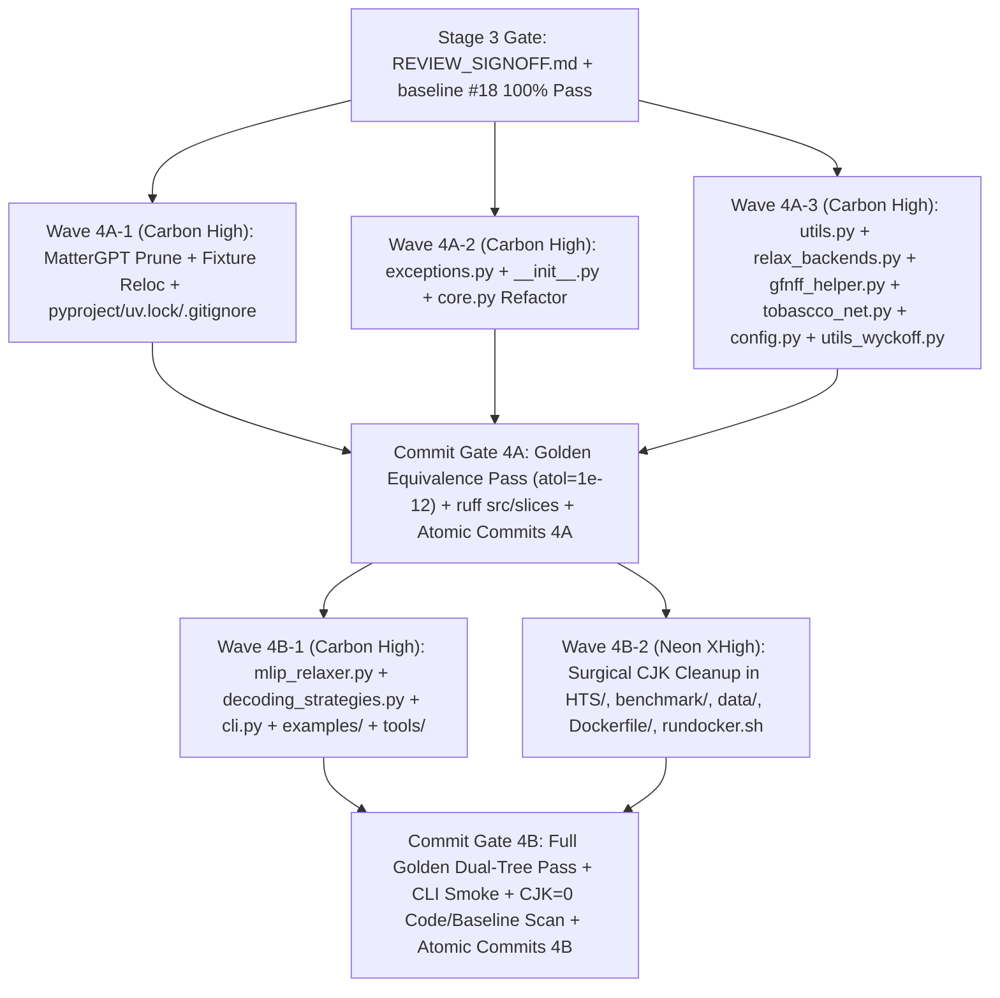

# Stage 3 Independent Architectural Review & Freeze Sign-Off

**Date:** 2026-11-25  
**Reviewer:** `reviewer` (Carbon High — Independent Stage 3 Reviewer & Verifier)  
**Target Working Branch:** `slices-4-personal` (`94ef8e079b69c37138159805e3c701b8df87a5d7`, tag `v4.0.2`)  
**Immutable Reference Worktree:** `/home/ordillo/tests/SLICES-upstream-baseline` (`94ef8e0`, detached, locked, `chmod -R a-w`)  
**Personal Fork Reference:** `backup/v3-personal` (`301c75fcdfb2d553b616c30178ccc7b0161b1fe7`; fork-base `cea17da` == upstream `142298b`)  
**Reviewed Artifacts:**
1. [PLAN.md](file:///home/ordillo/tests/SLICES/docs/migration/PLAN.md)
2. [AUDIT_FORK_DIFF.md](file:///home/ordillo/tests/SLICES/docs/migration/AUDIT_FORK_DIFF.md) (Slice 2A — `#13`)
3. [AUDIT_UPSTREAM_STYLE.md](file:///home/ordillo/tests/SLICES/docs/migration/AUDIT_UPSTREAM_STYLE.md) (Slice 2B — `#9`)
4. [AUDIT_BASELINE_HARNESS.md](file:///home/ordillo/tests/SLICES/docs/migration/AUDIT_BASELINE_HARNESS.md) (Slice 2C — `#16`)
5. [DEFERRED_CORE_REGISTER.md](file:///home/ordillo/tests/SLICES/docs/migration/DEFERRED_CORE_REGISTER.md) (`DEF-001`–`DEF-027` — `#20`)

---

## 1. Stage 3 Sign-Off Verdict

> [!IMPORTANT]
> **VERDICT: `APPROVED FOR STAGE 4` (Subject to `baseline` Golden Harness Gate Completion in `#18` and Mandatory Compliance with Cross-Audit Modifications `CA-01`–`CA-09` & Rulings `RUL-01`–`RUL-08` Below)**

### Pre-Stage-4 Entry Gate Checklist
Stage 4 Wave 4A workers MAY be dispatched immediately once all four conditions below hold:
1. `baseline` posts `[done]` on `#18` confirming `PYTHONHASHSEED=0 pytest tests/baseline/test_golden_equivalence.py` passes **100%** against both `PYTHONPATH=/home/ordillo/tests/SLICES-upstream-baseline/src` and unmodified `PYTHONPATH=/home/ordillo/tests/SLICES/src`, with `ruff check tests/baseline/` clean (`0` errors).
2. `git -C /home/ordillo/tests/SLICES diff upstream/main` is empty (only untracked `docs/migration/` and `tests/baseline/` exist prior to the pre-Stage-4 baseline harness commit or Wave 4A start).
3. `/home/ordillo/tests/SLICES-upstream-baseline` remains locked and read-only at `94ef8e079b69c37138159805e3c701b8df87a5d7`, and `/` free disk space remains `>= 9.0 GB`.
4. Every Stage 4 worker brief incorporates the binding interface contracts (Section 4) and strictly disjoint file-ownership boundaries (Section 5) established in this document.

---

## 2. Independent Cross-Audit of Slices 2A, 2B, and 2C

Independent primary-source verification across `upstream/main` (`94ef8e0`), `backup/v3-personal` (`301c75f`), and the three Stage 2 audit reports uncovered **nine cross-slice contradictions, missed failure traps, and subtle baseline-drift risks** (`CA-01`–`CA-09`). Each resolution below supersedes any conflicting recommendation in individual Stage 2 reports.

| ID | Severity | Cross-Slice Conflict / Missed Risk | Primary-Source Evidence | Binding Stage 4 Resolution |
|---|---|---|---|---|
| **CA-01** | **High** (File-path conflict) | **Docker & root config directory contradiction:** Slice 2A ([AUDIT_FORK_DIFF.md](file:///home/ordillo/tests/SLICES/docs/migration/AUDIT_FORK_DIFF.md#L148)) classified `Dockerfile/ -> docker/` and root scripts `-> configs/` as `DROP_OBSOLETE`, whereas Slice 2B ([AUDIT_UPSTREAM_STYLE.md](file:///home/ordillo/tests/SLICES/docs/migration/AUDIT_UPSTREAM_STYLE.md#L184)) proposed moving `Dockerfile/* -> docker/` and root configs `-> configs/`. | Upstream keeps [Dockerfile/](file:///home/ordillo/tests/SLICES/Dockerfile) (which already contains its own `slurm.conf` and `entrypoint_set_cpus.sh`), while `HTS/0_get_json_mp_api/0_run.py` references `/crystal/APIKEY.ini`. | **Keep `Dockerfile/` at its upstream path** (do NOT rename to `docker/` or create `configs/`). Delete root `__init__.py` (`1 B`), `entrypoint_set_cpus_gradio.sh`, `HANDOFF_workstation.md`, and `src/slices/README.rst`; translate/clean `Dockerfile/*`, `rundocker.sh`, `entrypoint_set_cpus.sh`, `slurm.conf`, and `APIKEY.ini` in place. |
| **CA-02** | **Critical** (Baseline lock drift) | **`pyproject.toml` index & optional-MLIP extras lockfile trap:** Slice 2B ([AUDIT_UPSTREAM_STYLE.md](file:///home/ordillo/tests/SLICES/docs/migration/AUDIT_UPSTREAM_STYLE.md#L176-L178)) proposed evaluating removal of `default = true` on `tuna` and adding `chgnet`, `mace`, `mattersim`, `orb` to `[project.optional-dependencies]`, then refreshing `uv.lock`. | All 170 packages in [uv.lock](file:///home/ordillo/tests/SLICES/uv.lock) bind `source = { registry = "https://pypi.tuna.tsinghua.edu.cn/simple" }`, while `numpy`, `scipy`, `pymatgen`, `ase`, `networkx`, `sympy` are unpinned in `pyproject.toml`. Removing `default = true` forces full PyPI re-resolution (risking core version upgrades that break `atol=1e-12` parity). Adding conflicting MLIPs (`m3gnet`, `mattersim`, `orb-models`) to `[project.optional-dependencies]` breaks `uv lock`'s universal Python `>=3.10` / multi-OS solver. | **Keep `[[tool.uv.index]] name = "tuna"` `default = true`** in `pyproject.toml`; remove `"einops"` and `gui = ["gradio"]`; add `[project.scripts] slices = "slices.cli:main"`; place `dev` tools under PEP 735 `[dependency-groups]` (NOT `[project.optional-dependencies]` for external MLIPs). Empirically verified in `/dev/shm`: `uv lock` removes 39 Gradio/MatterGPT packages while keeping **all 10 core scientific packages 100% version-identical**. |
| **CA-03** | **Critical** (Data loss hazard) | **`mp20_eform_bandgap_nonmetal.csv` filename collision:** Shorthand instructions to relocate `MatterGPT/0_dataset/mp20_eform_bandgap_nonmetal.csv` into `data/mp20_nonmetal/` collide with an existing, different file of the same name. | `MatterGPT/0_dataset/mp20_eform_bandgap_nonmetal.csv` has `2,383` Strategy-4 rows (`formation_energy_per_atom` column, SHA256 `07fee712...`), whereas `data/mp20_nonmetal/mp20_eform_bandgap_nonmetal.csv` has `14,303` non-SG rows (`eform` column, SHA256 `2a1866f7...`). | Relocate with explicit rename: `MatterGPT/0_dataset/mp20_eform_bandgap_nonmetal.csv` -> **`data/mp20_nonmetal/mp20_v4_benchmark_2383.csv`**, and `MatterGPT/2_decode/workflow/chemPotMP.json` -> **`data/mp20_nonmetal/chemPotMP.json`**. Leave existing `data/mp20_nonmetal/mp20_eform_bandgap_nonmetal.csv` untouched. |
| **CA-04** | **High** (Broken opt-in MLIP) | **Pre-check in `relax_backends.py:106-108` blocks `"m3gnet"` before optional dispatch:** Slice 2A ([AUDIT_FORK_DIFF.md](file:///home/ordillo/tests/SLICES/docs/migration/AUDIT_FORK_DIFF.md#L175)) specified dispatching to `mlip_relaxer` at `L109` (`if name not in RELAX_MODELS:`), overlooking `L106-108`. | [relax_backends.py](file:///home/ordillo/tests/SLICES/src/slices/relax_backends.py#L106-L110) executes `if name == "m3gnet": raise ValueError("M3GNet support has been removed...")` *before* `if name not in RELAX_MODELS:`. | Delete the hardcoded `if name == "m3gnet":` block at `L106-108` so `"m3gnet"` reaches `mlip_relaxer.resolve_optional_mlip("m3gnet")` (raising a clear `ImportError` with v4.0.2 NequIP guidance when uninstalled, or loading `M3GNetRelaxer` when installed). |
| **CA-05** | **High** (Import side-effect leak) | **Eager `from slices.core import SLICES` in `src/slices/__init__.py`:** Both Slices 2A and 2B proposed re-exporting `SLICES` and `check_SLICES` in `src/slices/__init__.py` without lazy loading. | Running `python -m slices.relax_backends --prepare` or `from slices.exceptions import SLICESError` executes `slices/__init__.py` first. Eagerly importing `slices.core` triggers `core.py:5-9` (`OMP_NUM_THREADS="1"`, `warnings.filterwarnings`) — overriding `OMP_NUM_THREADS` before `relax_backends._set_cpu_threads()` (`L300`) reads it — and loads `pymatgen`/`scipy`/`matplotlib`/`sympy`. | Use **PEP 562 lazy module `__getattr__`** in `src/slices/__init__.py` for `SLICES` and `check_SLICES` (paired with `if TYPE_CHECKING:` for static analyzers), while importing only `__version__ = "4.0.2"` and `slices.exceptions` eagerly (`< 1 ms`, zero side effects). |
| **CA-06** | **Medium** (Incomplete fix) | **`DEF-013` also affects `to_4structures()` and non-main threads:** Slice 2B (`DEF-UP-007`) flagged `to_structures()` (`core.py:1900-1910`) for `relax_model=None`, missing `to_4structures()` (`core.py:1944-1949`). | Both `to_structures()` and `to_4structures()` invoke `@function_timeout` `self.relax(...)` when `self.relaxer is None`, printing `'NoneType' object has no attribute 'relax'` twice in `to_4structures()` and raising `ValueError` if called off the main thread. | Short-circuit `if self.relaxer is None:` in **both** `to_structures()` (`return [structure_recreated_std, structure_recreated_opt], 0`) and `to_4structures()` (`return structures, final_energy_per_atom`). `SLICES.__init__` already unifies `None` and `"none"`. |
| **CA-07** | **Medium** (Baseline script drift) | **Fork edits to 3 `HTS/` scripts (`665b042`):** Slice 2A ([AUDIT_FORK_DIFF.md](file:///home/ordillo/tests/SLICES/docs/migration/AUDIT_FORK_DIFF.md#L118)) left open whether to port fork changes to `HTS/{3_inverse,5_symmetry_filter_refine}/workflow/{0_run.py,script.py}`. | Fork's edit to `HTS/5_symmetry_filter_refine/workflow/script.py` injected the broken `threading.Timer` `SystemExit` anti-pattern (`platform.system() != 'Darwin'`). | **Block all 3 fork `HTS/` workflow edits.** Restrict `HTS/` edits strictly to the 9 CJK comment/docstring files plus the 1-character `SyntaxError` fix in `HTS/0_get_json_mp_api/2_filter_prior_3d/1_run.py:5`. |
| **CA-08** | **High** (Lint-induced math drift) | **`ruff` `E402` trap on `core.py:5-9` & `_vendor/`/`error.py` collection:** Stage 5 targets `0` `ruff` errors, while `core.py:5-9` sets `OMP_NUM_THREADS="1"` before 30 module imports (`E402`). | Moving `core.py` imports above line 8 to appease `E402` initializes NumPy/OpenBLAS thread pools *before* `OMP_NUM_THREADS="1"` is set, violating `DEF-005` and risking `DEF-014` symmetry-branch flips on 32-core hardware. Scanning `benchmark/` hits `error.py` (`SyntaxError`). | Configure `[tool.ruff.lint.per-file-ignores] "src/slices/core.py" = ["E402"]`, `extend-exclude = ["src/slices/_vendor", "HTS", "benchmark", "data", "docs"]`, and `norecursedirs` in `[tool.pytest.ini_options]`. |
| **CA-09** | **Low–Medium** (Path coupling) | **Golden fixture path & `docs/` image retention:** Slice 2C wrote `tests/baseline/golden_*.{json,npz}` whereas brief `#18` specified `tests/baseline/fixtures/golden_*.{json,npz}`; `README.md:28` links `./docs/SLICES_demo.png`. | `grep` on `README.md` shows `SLICES_demo.png` (and `figure_intro.png`, `win11_wsl2.png`) are SLICES assets, whereas `MatterGPT.jpg`, `gui_snapshot.png`, `huggingface_space.png`, and the CJK `.pdf` are MatterGPT assets. | Treat `tests/baseline/**` as opaque to Stage 4 (invoke via `pytest tests/baseline/test_golden_equivalence.py` only). In Wave 4A, delete only MatterGPT/CJK `docs/` assets, preserving `SLICES_demo.png` and `figure_intro.png` for Stage 6 docs. |

---

## 3. Binding Stage 3 Rulings on Borderline Decisions

### RUL-01: `DEF-007` (`core.py:60` Undefined `TimeoutException` `F821`) & `function_timeout`
- **Ruling:** **MODIFY & APPROVE**
- **Technical Justification:**
  1. Upstream commit `119afaf` deleted `TimeoutException` while leaving `raise TimeoutException("Timed out!")` inside `signal_handler` at [core.py](file:///home/ordillo/tests/SLICES/src/slices/core.py#L60) (`ruff` `F821`). On every non-timed-out execution, `signal_handler` is never invoked; defining `class TimeoutException(SLICESError): pass` in `src/slices/exceptions.py` and importing it in `core.py` guarantees **100.0% normal-path numerical, RNG, and timing invariance** while replacing an unintended `NameError` crash with a structured `TimeoutException` on timeout (which `to_structures()` at `L1908` `except Exception as e:` catches identically, returning `([std, opt], 0)`).
  2. **Mandatory Modification vs Fork (`backup/v3-personal`):** Do **NOT** port the fork's `platform.system() != 'Darwin'` check or `threading.Timer` callback (raising inside a background timer thread only triggers `threading.excepthook` and never interrupts the caller thread, while macOS natively supports `SIGALRM` on the main thread). Implement `time_limit` to use `signal.SIGALRM` whenever `hasattr(signal, "SIGALRM") and threading.current_thread() is threading.main_thread()`, and otherwise `yield` directly without raising `ValueError: signal only works in main thread of the main interpreter`.

### RUL-02: `DEF-013` (`relax_model=None` vs `relax_model="none"` Short-Circuit)
- **Ruling:** **APPROVE (`to_structures` & `to_4structures` Short-Circuit; `SLICES.__init__` Verified Unified)**
- **Technical Verification & Justification:**
  - **Verified Behavior in `relax_backends.py` and `SLICES.__init__`:**
    - In [relax_backends.py](file:///home/ordillo/tests/SLICES/src/slices/relax_backends.py#L99-L124), `resolve_relax_model(None)` returns `("none", None)` (`L101-102`) and `resolve_relax_model("none")` (case-insensitive, as well as `relax_model="auto"` when `SLICES_RELAX_MODEL=none`) returns `("none", None)` (`L117`). `make_relaxer` (`L123-124`) returns `(None, "none")` in all cases without importing `torch`/`nequip` or emitting `_announce` logs.
    - In [core.py](file:///home/ordillo/tests/SLICES/src/slices/core.py#L114), `SLICES.__init__` assigns `self.relaxer, self.relax_model = make_relaxer(relax_model, optimizer)`, resulting in `self.relaxer is None` and `self.relax_model == "none"` identically for both `None` and `"none"`. No change to `SLICES.__init__` is needed.
  - **Verified Defect in `to_structures()` (`L1900-1910`) & `to_4structures()` (`L1944-1949`):**
    - When `self.relaxer is None`, `to_structures()` enters `@function_timeout` `self.relax(...)`, arming `SIGALRM`, failing on `None.relax(...)` with `AttributeError`, printing `'NoneType' object has no attribute 'relax'` to stdout (`L1909`), and returning `[structure_recreated_std, structure_recreated_opt], 0`. `to_4structures()` repeats the same `AttributeError` a second time on `structures[0]`. Meanwhile, `to_relaxed_structure()` (`L1934-1937`) checks `if len(structures) == 3:` and still raises `Exception("relax failed")` as intended.
  - **Approved Edit:** Insert `if self.relaxer is None: return [structure_recreated_std, structure_recreated_opt], 0` before `try:` at `core.py:1900` and `if self.relaxer is None: return structures, final_energy_per_atom` before `try:` at `core.py:1944`. Return values are bit-identical for both `None` and `"none"`.

### RUL-03: `DEF-004` (`tobascco_net.py:359,514` Dead `np.random` Draws) & `DEF-005` (`core.py:5-9` Env/Warning Side Effects)
- **Ruling:** **BLOCK / DEFER (Strict Freeze Confirmed)**
- **Technical Justification:**
  - **`DEF-004` ([tobascco_net.py](file:///home/ordillo/tests/SLICES/src/slices/tobascco_net.py#L359) & [L514](file:///home/ordillo/tests/SLICES/src/slices/tobascco_net.py#L514)):** Preserve both `st_vtx = np.random.choice(range(self.graph.order()))` (`L359`, add `# noqa: F841` for `ruff`) and `inds = list(range(self.cycle_rep.shape[0])); np.random.shuffle(inds)` (`L513-514`) verbatim so process-global legacy `np.random` state advances identically to upstream v4.0.2.
  - **`DEF-005` ([core.py](file:///home/ordillo/tests/SLICES/src/slices/core.py#L5-L9)):** Preserve lines 5–9 (`TF_CPP_MIN_LOG_LEVEL="3"`, `DeprecationWarning`/`FutureWarning` filters, `OMP_NUM_THREADS="1"`, `PYTHONWARNINGS="ignore"`) verbatim **above** all scientific library imports, and add `"src/slices/core.py" = ["E402"]` in `[tool.ruff.lint.per-file-ignores]`. Removing or delaying `OMP_NUM_THREADS="1"` risks multi-threaded BLAS non-determinism in `np.linalg.cholesky` / `fmin_l_bfgs_b` that can flip exact float equality in `core.py:1868-1877` (`DEF-014`).

### RUL-04: `src/slices/utils.py` Workstation Safety, OS-Agnostic File Ops & SLURM Parity
- **Ruling:** **APPROVE (Mandatory Safety Fix + 3-Way Merge)**
- **Technical Specification:**
  1. **Eliminate `pgrep -f python` + `kill -9` Hazard (`L364-428`, `L461-526`):** Remove **every** `pgrep -f "python"` / `pgrep -f "pt_main_thread"` / indiscriminate `kill` call. Add `_SUBMITTED_LOCAL_PROCS: dict[str, subprocess.Popen[bytes]] = {}` alongside upstream's `_SUBMITTED_SLURM_JOBS: list[str] = []`. Clear `_SUBMITTED_LOCAL_PROCS` at the start of `splitRun` and `splitRun_csv`. In `_run_local_job`, launch `subprocess.Popen([sys.executable, script], stdout=out, stderr=err, env=env, start_new_session=(os.name != "nt"))` and register the `Popen` handle under the current `job_i` directory name.
  2. **Scoped Monitoring & Cancellation:**
     - `is_slurm_available()`: honor `os.environ.get("SLICES_FORCE_LOCAL", "").strip() in ("1", "true", "yes")` returning `False` (cleanly replacing deleted `docs/utils_<CJK>.py`), else check `shutil.which("sinfo")` / `shutil.which("squeue")`.
     - `show_progress()`: preserve upstream SLURM `_SUBMITTED_SLURM_JOBS` tracking (`L218-220, 248-253`); on local runs, poll registered `Popen` handles via `proc.poll() is None` (falling back to guarded `ps`/`pwdx` with `except Exception:` only if `_SUBMITTED_LOCAL_PROCS` is empty from an external caller). Remove the duplicate `finally:` completion message (`L449-451`).
     - `cancel_all_jobs()` & `show_progress()` (`KeyboardInterrupt`): on SLURM, cancel `_SUBMITTED_SLURM_JOBS` when non-empty (else `scancel -u <user>`); on local, send `SIGTERM` (and process-group `os.killpg` on POSIX where `start_new_session=True`), wait up to `5 s`, then `SIGKILL` **only** surviving PIDs in `_SUBMITTED_LOCAL_PROCS`.
  3. **Filesystem & CWD Safety:** Replace all 11 `os.system('rm ...')` / `os.system('cp -r ...')` calls with `shutil.rmtree(..., ignore_errors=True)`, `Path.unlink(missing_ok=True)`, and `shutil.copytree("./workflow", job_dir, dirs_exist_ok=True)`. Wrap job submission in `splitRun`, `splitRun_csv`, and `splitRun_sample` inside `with temporaryWorkingDirectory(job_dir):`.
  4. **Signature & Binning Invariance:** Preserve all 10 public function names and parameter signatures (`temporaryWorkingDirectory`, `split_list`, `is_slurm_available`, `splitRun`, `splitRun_csv`, `splitRun_sample`, `show_progress`, `cancel_all_jobs`, `collect_json`, `collect_csv`, `collect_csv_filter`, `exclude_elements_json`, `determine_bin_count`, `adaptive_dynamic_binning`, `parallel_process_json`, `parallel_process_csv`). In `adaptive_dynamic_binning`, use `data_cleaned = data.dropna(subset=[target_column]).copy()` and list accumulation before `pd.concat` to silence `pandas` warnings while keeping identical quantile edges and `random_state` shuffles.

### RUL-05: `MatterGPT/` Removal, Fixture Relocation & Packaging (`pyproject.toml` + `uv.lock`)
- **Ruling:** **MODIFY & APPROVE**
- **Technical Specification:**
  1. **Fixture Relocation Before `MatterGPT/` Deletion:**
     - Move `MatterGPT/0_dataset/mp20_eform_bandgap_nonmetal.csv` (`2,383` rows, Strategy 4, `formation_energy_per_atom` header) -> **`data/mp20_nonmetal/mp20_v4_benchmark_2383.csv`** (`CA-03` — do NOT overwrite the existing 14,303-row `data/mp20_nonmetal/mp20_eform_bandgap_nonmetal.csv`).
     - Move `MatterGPT/2_decode/workflow/chemPotMP.json` -> **`data/mp20_nonmetal/chemPotMP.json`**.
     - Delete `MatterGPT/` (`8.9 MB`), `entrypoint_set_cpus_gradio.sh`, `HANDOFF_workstation.md`, root `__init__.py`, `src/slices/README.rst`, `docs/MatterGPT.jpg`, `docs/gui_snapshot.png`, `docs/huggingface_space.png`, `docs/SLICES-MatterGPT_*.pdf` (`6.3 MB`), and `docs/utils_*.py`.
  2. **Consumer Repointing:**
     - [examples/3.benchmark_relax_models.py](file:///home/ordillo/tests/SLICES/examples/3.benchmark_relax_models.py#L49-L50): set `--csv` default to `os.path.join(ROOT, "data/mp20_nonmetal/mp20_v4_benchmark_2383.csv")` and `--chem-pot` default to `os.path.join(ROOT, "data/mp20_nonmetal/chemPotMP.json")`; update module docstring to remove `MatterGPT` references.
     - [src/slices/gfnff_helper.py](file:///home/ordillo/tests/SLICES/src/slices/gfnff_helper.py#L17) (`L17, 119`): update provenance reference to `data/mp20_nonmetal/mp20_v4_benchmark_2383.csv`.
     - [tools/workstation_check.sh](file:///home/ordillo/tests/SLICES/tools/workstation_check.sh): strip MatterGPT Steps 4–5 (`L79-124`), `TRAIN_EPOCHS`, `DECODE_THREADS`, and `flash_attn` check; retain Steps 1–3 (`uv sync`, `torch_info`, `relax_backends --prepare`, `examples/3.benchmark_relax_models.py`) and Step 6 resource summary.
  3. **`pyproject.toml` & `uv.lock` (`CA-02`):**
     - Update `[project].description` to remove MatterGPT; remove `"einops"` from `dependencies` and `gui = ["gradio"]` from `[project.optional-dependencies]`.
     - Retain `[[tool.uv.index]] name = "tuna"` with `default = true` so `uv.lock` preserves exact upstream package resolutions.
     - Add `[project.scripts] slices = "slices.cli:main"` and `[dependency-groups] dev = ["pytest>=8.0", "pytest-cov>=5.0", "ruff>=0.9"]`. Do **not** add external optional MLIPs to `[project.optional-dependencies]`.
     - Add `[tool.ruff]` and `[tool.pytest.ini_options]` per `CA-08`.
     - Refresh `uv.lock` with `UV_CACHE_DIR=/dev/shm/ordillo-uv-cache /home/ordillo/tests/.tools/bin/uv lock` (cleaning `/dev/shm/ordillo-uv-cache` immediately afterward) and verify zero version drift across `torch`, `nequip`, `pymatgen`, `ase`, `scipy`, `numpy`, `networkx`, `spglib`, `matscipy`, `e3nn`.
     - Update `.gitignore` following `backup/v3-personal` commit `e37ce5e` (directory-scoped transient ignores `job_*/`, `.pytest_cache/`, `.ruff_cache/`, `.coverage`, `htmlcov/`, `*.egg-info/` — **never** blanket `*.csv` or `*.json`).

### RUL-06: `HTS/`, `benchmark/`, and `data/` Policy
- **Ruling:** **APPROVE (Strict Surgical Policy)**
- **Technical Specification:**
  1. **Zero Algorithmic, CLI, Path, or Data Drift:** Preserve 100% of folder names, filenames, CSV/JSON/ZIP/PKL/CKPT datasets, numerical parameters, CLI flags, and algorithmic statements in `HTS/`, `benchmark/`, and `data/`. Block all `backup/v3-personal` `benchmark/` renames/deletions and `HTS/` script edits (`CA-07`).
  2. **30-File CJK Comment/Docstring/Print Translation Only:** Translate only CJK comments, module-top docstrings, `#SBATCH` comments, and human-facing `print(...)` labels in the exact 30 files inventoried in [AUDIT_UPSTREAM_STYLE.md Section 2.4](file:///home/ordillo/tests/SLICES/docs/migration/AUDIT_UPSTREAM_STYLE.md#L76-L90) (`9` in `HTS/`, `18` in `benchmark/`, `3` in `data/`).
  3. **`HTS/0_get_json_mp_api/2_filter_prior_3d/1_run.py:5` (`BC-3`):** **Approve** deleting the stray `* ` syntax error (`from slices.utils import splitRun, show_progress, collect_json, collect_csv`).
  4. **`benchmark/Validity_rate_ucRNN__Success_rate_cRNN/2_conditioned_RNN/2_train_sample/error.py` (`BC-5`):** **Preserve untouched** as a historical experimental stderr artifact; exclude `benchmark/` and `HTS/` from `ruff` and `pytest` collection (`CA-08`) and pass `-x 'error\.py'` whenever running `python -m compileall`.

### RUL-07: `src/slices/__init__.py` Public Exports & Lazy Loading
- **Ruling:** **MODIFY & APPROVE (PEP 562 Lazy `SLICES` / `check_SLICES`)**
- **Technical Justification & Specification:**
  - Exporting `__version__ = "4.0.2"`, `SLICES`, `check_SLICES`, and the `SLICESError` exception hierarchy in `src/slices/__init__.py` resolves `BC-1` (`from slices import check_SLICES` in RNN training scripts) and aligns with `backup/v3-personal` usability.
  - Per **`CA-05`**, `src/slices/__init__.py` MUST NOT eagerly execute `from slices.core import SLICES` at module top level. Instead:
    - Import all exception classes eagerly from `slices.exceptions` (`zero` third-party dependencies).
    - Guard `from slices.core import SLICES` under `if TYPE_CHECKING:`.
    - Implement `__getattr__(name: str)` to lazily import `SLICES` from `slices.core` on first access and provide `check_SLICES(slices_str: str, strategy: int = 4, dupli_check: bool = False, graph_rank_check: bool = True) -> bool` delegating to `SLICES(relax_model=None).check_SLICES(slices_str, strategy=strategy, dupli_check=dupli_check, graph_rank_check=graph_rank_check)`.
    - Implement `__dir__()` returning `sorted(set(globals()) | set(__all__))`.

### RUL-08: Optional MLIP Adapter Contract & Non-Linux GFN-FF/`xtb` Fallback Boundary
- **Ruling:** **MODIFY & APPROVE**
- **Technical Specification:**
  1. **Dual-Inheritance Exception Invariant:** In `src/slices/exceptions.py`, define `class RelaxBackendError(SLICESError, RuntimeError): ...` and `class ModelDownloadError(SLICESError, RuntimeError): ...` as **sibling** classes (`not issubclass(ModelDownloadError, RelaxBackendError)`), preserving `relax_backends.get_calculator` (`L348`) so network download failures never write permanent `.failed` compilation markers.
  2. **`relax_backends.py` Hook (`CA-04` Fixed):** Keep `RELAX_MODELS = ("auto", "none") + tuple(NEQUIP_PLANS)` and all NequIP code 100% untouched (removing only CJK line `L251`). Delete `if name == "m3gnet": raise ValueError(...)` (`L106-108`). When `name not in RELAX_MODELS`, lazily import and delegate to `slices.mlip_relaxer.resolve_optional_mlip(name)` and `make_optional_relaxer(name, device=device, optimizer=optimizer)`.
  3. **`mlip_relaxer.py` Protocol:** Support canonical names `OPTIONAL_MLIP_MODELS = ("chgnet", "mattersim", "orbv3", "mace", "m3gnet")` (plus aliases `"orb-v3" -> "orbv3"`, `"mace-mp" / "mace_mp" -> "mace"`). Zero module-level imports of `torch`/`tensorflow`/MLIP packages and zero module-level `TF_USE_LEGACY_KERAS` or `sys.modules["keras"]` mutations (`M3GNetRelaxer.__init__` only). Reuse `relax_backends.{OPTIMIZERS, preoptimize, _collapse_guard, _cell_filter, _optimize, CellCollapse}` across ASE-backed adapters (`chgnet` via `CHGNetCalculator`, `mattersim`, `orbv3`, `mace`), populate `.name`, `.device`, `.optimizer`, `.description`, and return `{"final_structure": final, "trajectory": SimpleNamespace(energies=[float(total_eV)]), "steps": int(n_steps), "preoptimized": bool(pre["applied"]), "retry": int(retry)}`.
  4. **Non-Linux GFN-FF/`xtb` Boundary (`gfnff_helper.py`):** On Linux x86_64 where `from slices._vendor import gfnff` loads `libgfnff.so.0.1.1`, execute the **exact untouched v4.0.2 in-memory ctypes path**. Catch `(ImportError, OSError)` on the `_vendor.gfnff` load **only** to invoke `_run_external_xtb_fallback(nbf_text)`, checking `SLICES_XTB_PATH`, `XTB_MOD_PATH`, or `shutil.which("xtb_noring_nooutput_nostdout_noCN")` (`subprocess.run(..., shell=False, timeout=30)` in `tempfile.TemporaryDirectory()` with `"********" -> "       0"` sanitization), raising `GFNFFExecutionError` with actionable setup guidance if absent. **Zero binaries committed to git.**

### Master Disposition Summary Across All 27 Register Entries (`DEF-001`–`DEF-027`)

| Register ID(s) | Ruling | Summary & Stage 4 Action |
|---|---|---|
| `DEF-007` | **APPROVE (Stage 4)** | Define `TimeoutException(SLICESError)` in `exceptions.py`, import in `core.py`, guard `SIGALRM` with POSIX main-thread check (`RUL-01`). |
| `DEF-013` | **APPROVE (Stage 4)** | Short-circuit `if self.relaxer is None:` before `self.relax(...)` in `core.py` `to_structures()` and `to_4structures()` (`RUL-02`, `CA-06`). |
| `DEF-016`, `DEF-017`, `DEF-020` | **BLOCK (Do Not Port)** | Never port fork's `from_SLICES` header error swallowing, deprecated `with_local_env_strategy`, root-logger `CRITICAL` silencing, or eager `tf_keras` monkey-patching. |
| `DEF-001`–`DEF-006`, `DEF-008`–`DEF-012`, `DEF-014`–`DEF-015`, `DEF-018`–`DEF-019`, `DEF-021`–`DEF-027` | **DEFER (Strict Freeze)** | Keep all 22 core math, LJ mixing, default `to_structures`/`Net` algorithms, dead `np.random` draws (`DEF-004`), `core.py:5-9` env header (`DEF-005`), `check_element < 87` (`DEF-006`), `relax_large_cell2` kwargs (`DEF-008`), `ExpCellFilter` (`DEF-009`), `np.matrix.I` (`DEF-011`), `lattice_type` float `set` (`DEF-014`), `check_SLICES` `-1` handling (`DEF-021`), `PYTHONHASHSEED` set order (`DEF-022`), `SLICES2space_group_number` (`DEF-023`), `from_SLICES` (`DEF-024`), `check_structural_validity` (`DEF-025`), `graph_method` branch (`DEF-026`), and `func_check` (`DEF-027`) **100% frozen at upstream v4.0.2**. Document behavior accurately in Stage 5/6 docstrings. |

---

## 4. Pinned Cross-Wave Interface Contracts (Enabling Zero-Overlap Wave 4A / 4B Execution)

To ensure Wave 4A (`core.py`, `relax_backends.py`, `exceptions.py`, `__init__.py`) and Wave 4B (`mlip_relaxer.py`, `decoding_strategies.py`, `cli.py`) never edit the same file, all workers MUST implement these exact module contracts:

1. **`src/slices/exceptions.py` (Created in Wave 4A by `4A-2`):**
   ```python
   class SLICESError(Exception): ...
   class SLICESEncodingError(SLICESError): ...
   class SLICESDecodingError(SLICESError): ...
   class GraphTopologyError(SLICESError): ...
   class LatticeBasisError(GraphTopologyError): ...
   class CocycleBasisError(GraphTopologyError): ...
   class GFNFFExecutionError(SLICESError): ...
   XTBExecutionError = GFNFFExecutionError
   class MLIPRelaxationError(SLICESError): ...
   class TimeoutException(SLICESError): ...
   class RelaxBackendError(SLICESError, RuntimeError): ...
   class ModelDownloadError(SLICESError, RuntimeError): ...  # NOT a subclass of RelaxBackendError
   ```
2. **`src/slices/relax_backends.py` -> `src/slices/mlip_relaxer.py` Lazy Hook (Wired in Wave 4A by `4A-3`, Implemented in Wave 4B by `4B-1`):**
   - In `relax_backends.resolve_relax_model(relax_model)` when `name not in RELAX_MODELS`:
     ```python
     try:
         from slices.mlip_relaxer import resolve_optional_mlip
     except ModuleNotFoundError:
         raise ValueError(f"Unknown relax_model {relax_model!r}; choose from {RELAX_MODELS}") from None
     return resolve_optional_mlip(name)  # returns (canonical_name: str, device: str) or raises ValueError / ImportError
     ```
   - In `relax_backends.make_relaxer(relax_model="auto", optimizer="BFGS")` when `name not in NEQUIP_PLANS` (after `if name == "none": return None, "none"`):
     ```python
     from slices.mlip_relaxer import make_optional_relaxer
     relaxer = make_optional_relaxer(name, device=device, optimizer=optimizer)
     _announce(f"relax_model={name} on {relaxer.device} ({relaxer.description})")
     return relaxer, name
     ```
   - `mlip_relaxer.py` exports: `OPTIONAL_MLIP_MODELS: tuple[str, ...] = ("chgnet", "mattersim", "orbv3", "mace", "m3gnet")`, `OPTIONAL_MLIP_ALIASES: dict[str, str]`, `resolve_optional_mlip(name: str) -> tuple[str, str]`, `make_optional_relaxer(name: str, device: str | None = None, optimizer: str = "BFGS") -> MLIPRelaxer`, `get_relaxer(model_name: str = "auto", **kwargs: Any) -> Any`.
3. **`src/slices/core.py` -> `src/slices/decoding_strategies.py` Lazy Hook (Wired in Wave 4A by `4A-2`, Implemented in Wave 4B by `4B-1`):**
   - In `SLICES.robust_SLICES2structure(self, SLICES: str, strategy: int = 4, fix_duplicate_edge: bool = True, n_starts: int = 3, seed: int = 0) -> tuple[Structure, float]`:
     ```python
     from slices.decoding_strategies import robust_decode
     return robust_decode(
         self,
         slices_str=SLICES,
         strategy=strategy,
         fix_duplicate_edge=fix_duplicate_edge,
         n_starts=n_starts,
         seed=seed,
     )
     ```

---

## 5. Authoritative Stage 4 Parallel Execution & Disjoint File-Ownership Matrix

### 5.1 Operational & Disk-Safety Rules for All Stage 4 Workers
- **Workspace Mode (`workspace: "inherit"`):** Because root `/` has only `~9.7 GB` free and `data/` + `benchmark/` + `HTS/` occupy ~180 MB per checkout, Stage 4 workers run in `workspace: "inherit"` with **100% mathematically disjoint file ownership**.
- **Git Index Rule (Zero `.git/index.lock` Races):** Workers perform normal filesystem edits (`write_file`, `edit_file`, `mv`, `rm`) ONLY on their assigned paths and **MUST NOT run `git add`, `git mv`, `git rm`, or `git commit`** while sibling workers in the same wave are active. Git staging and atomic commits happen exclusively at the Wave 4A and Wave 4B barriers!
- **Environment Rule:** Always activate `/home/ordillo/tests/.venv-upstream` with `PYTHONDONTWRITEBYTECODE=1`, `NEQUIP_CACHE_DIR=/home/ordillo/tests/.cache/nequip_raw`, `SLICES_MODEL_CACHE=/home/ordillo/tests/.cache/slices/nequip`, and `UV_CACHE_DIR=/dev/shm/ordillo-uv-cache`.

### 5.2 Dependency Graph & Commit Boundaries



### 5.3 Wave-by-Wave Disjoint File-Ownership Table

| Wave & Worker | Model Tier | Exclusive File Ownership (Read/Write/Move/Delete) | Explicitly Forbidden Paths | Deliverable Summary |
|---|---|---|---|---|
| **Wave 4A-1** (`refactor-pkg`) | **Carbon High** | `MatterGPT/**` (delete after `mv`), `data/mp20_nonmetal/mp20_v4_benchmark_2383.csv` (moved), `data/mp20_nonmetal/chemPotMP.json` (moved), `pyproject.toml`, `uv.lock`, `.gitignore`, root `__init__.py` (delete), `entrypoint_set_cpus_gradio.sh` (delete), `HANDOFF_workstation.md` (delete), `src/slices/README.rst` (delete), `docs/{MatterGPT.jpg,gui_snapshot.png,huggingface_space.png,SLICES-MatterGPT_*.pdf,utils_*.py}` (delete) | All `src/slices/*.py`, `src/slices/_vendor/**`, `examples/**`, `tools/**`, `Dockerfile/**`, `HTS/**`, `benchmark/**`, existing `data/**` files, `tests/**`, `docs/migration/**` | Relocate 2,383-row benchmark CSV & `chemPotMP.json`, prune `MatterGPT/` + obsolete clutter (~17 MB saved), update `pyproject.toml`/`.gitignore`, refresh `uv.lock` with 0 core version drift (`RUL-05`). |
| **Wave 4A-2** (`refactor-core`) | **Carbon High** | `src/slices/exceptions.py` (new), `src/slices/__init__.py`, `src/slices/core.py` | `src/slices/{utils,relax_backends,gfnff_helper,tobascco_net,config,utils_wyckoff}.py`, `src/slices/_vendor/**`, all files outside `src/slices/` | Structured dual-inheriting exception hierarchy; PEP 562 lazy `__init__.py` (`RUL-07`); `core.py` English translation (34 CJK lines), `DEF-007` + `DEF-013` fixes, `except Exception:`, stale docstring & typing cleanup, additive `structure2SLICESAug_atom_order` & lazy `robust_SLICES2structure` (`RUL-01`–`RUL-03`). |
| **Wave 4A-3** (`refactor-backends-utils`) | **Carbon High** | `src/slices/utils.py`, `src/slices/relax_backends.py`, `src/slices/gfnff_helper.py`, `src/slices/tobascco_net.py`, `src/slices/config.py`, `src/slices/utils_wyckoff.py` | `src/slices/{core,exceptions,__init__}.py`, `src/slices/_vendor/**` (strictly read-only!), all files outside `src/slices/` | `utils.py` 182-line English translation + `_SUBMITTED_LOCAL_PROCS` replacing `pgrep` hazard + `shutil`/`temporaryWorkingDirectory` (`RUL-04`); `relax_backends.py` CJK fix + `m3gnet` unblock + lazy `mlip_relaxer` hook (`RUL-08`); `gfnff_helper.py` non-Linux fallback (`RUL-08`); `tobascco_net.py` `clear_cache` + `nodes_iter` NX 3.x fix + frozen `DEF-004`/`DEF-011`; `config.py` & `utils_wyckoff.py` docstrings/typing. |
| **Gate & Commit 4A** (`coordinator` / `verifier`) | **Carbon High** | `.git` staging & commits on `slices-4-personal` (only after `4A-1`, `4A-2`, `4A-3` all finish) | Source mutations without worker re-run | Run `ruff check src/slices/`, verify `0` CJK hits in `src/slices/`, run `PYTHONHASHSEED=0 pytest tests/baseline/test_golden_equivalence.py` (`100%` pass, `atol=1e-12`). Create **Commit 4A-a** (`chore: prune MatterGPT and relocate MP-20 benchmark fixtures`) and **Commit 4A-b** (`refactor(slices): clean core modules, exceptions, and safe job utilities`). |
| **Wave 4B-1** (`port-additive`) | **Carbon High** | `src/slices/mlip_relaxer.py` (new), `src/slices/decoding_strategies.py` (new), `src/slices/cli.py` (new), `examples/{2.1structure2SLICES_SLICES2structure.py,2.2data_augmentation_get_canonical_slices.py,3.benchmark_relax_models.py,test.py}`, `tools/{workstation_check.sh,validate_installation.py,run_tests.py}`, `tools/benchmarks/run_comparison_test.py` | All Wave 4A `src/slices/*.py` files, `src/slices/_vendor/**`, `Dockerfile/**`, `rundocker.sh`, `HTS/**`, `benchmark/**`, `data/**`, `tests/**`, `docs/**` | Implement optional multi-MLIP adapters (`RUL-08`), opt-in `decoding_strategies.py` with all 5 fork bugs fixed (`DEF-002`), `slices` CLI (`encode`/`decode`/`validate`/`canonicalize`), repointed `examples/3.benchmark_relax_models.py` (`RUL-05`), and cleaned `tools/`. |
| **Wave 4B-2** (`translate-baselines`) | **Neon XHigh** | 9 CJK files in `HTS/**` + `HTS/0_get_json_mp_api/2_filter_prior_3d/1_run.py` (`L5` stray `*`), 18 CJK files in `benchmark/**`, 3 CJK files in `data/**` (`0_run.sh` ×2 + `2_stratified_sampling_split.py`), `Dockerfile/{Dockerfile,docker-compose.yml,entrypoint_set_cpus.sh,entrypoint_set_cpus_jupyter.sh,slurm.conf}`, root `{rundocker.sh,entrypoint_set_cpus.sh,slurm.conf,APIKEY.ini}` | `src/**`, `examples/**`, `tools/**`, `pyproject.toml`, `uv.lock`, `.gitignore`, `benchmark/.../error.py`, all CSV/JSON/ZIP/PKL/CKPT data files, `tests/**`, `docs/**` | Surgical CJK-to-English translation of comments, docstrings, `#SBATCH` notes, and console labels across the 30 baseline files + Docker scripts (`RUL-06`), fixing `1_run.py:5` typo and parameterizing hardcoded host paths in `rundocker.sh` / `docker-compose.yml`. |
| **Gate & Commit 4B** (`coordinator` / `verifier`) | **Carbon High** | `.git` staging & commits on `slices-4-personal` (after `4B-1` & `4B-2` finish) | Source mutations without worker re-run | Run `ruff check src/ examples/ tools/`, run `PYTHONHASHSEED=0 pytest tests/baseline/test_golden_equivalence.py --dual-tree-full` (`100%` pass), smoke-test `python -m slices.cli {encode,validate,canonicalize,decode}`, verify `0` CJK hits across `src/`, `examples/`, `tools/`, `Dockerfile/`, `HTS/`, `benchmark/`, `data/`. Create **Commit 4B-a** (`feat(slices): add opt-in multi-MLIP relaxers, decoding strategies, and CLI`) and **Commit 4B-b** (`docs(baselines): translate CJK comments in HTS, benchmark, data, and Docker scripts`). |

### 5.4 Carbon High vs Neon XHigh Model-Tier Separation Across Stages 4–7

| Model Tier | Assigned Engineering & Scientific Responsibilities | Excluded Responsibilities |
|---|---|---|
| **Carbon High** (`refactor-*`, `port-additive`, `baseline`, `reviewer`) | **All executable Python/shell code refactoring, architecture, typing, testing, and verification:**<br>• Stage 4 Wave 4A (`4A-1`, `4A-2`, `4A-3`) & Wave 4B (`4B-1` additive modules, CLI, `examples/`, `tools/`).<br>• Stage 5 (`Refine`): Complete PEP 604 type annotations, `ruff` zero-diagnostic compliance, porting `tests/{conftest.py,unit/,integration/,regression/}` (fixing all 9 fork test bugs), and authoring the 6 new v4.0.2 unit suites (`test_relax_backends.py`, `test_gfnff_helper.py`, `test_utils_wyckoff.py`, `test_exceptions.py`, `test_cli.py`, `test_decoding_strategies.py`).<br>• Stages 4, 5, 7 Independent Gate Verification: Golden dual-tree `atol=1e-12` runs, `pytest` coverage, packaging/lockfile integrity, git commit hygiene. | Bulk prose authoring (`README.md`, `TECHNICAL.md`, `docs/api/*.md`, `CHANGELOG.md`, `LAB_LOG.md`) and pure comment-only CJK translation batches. |
| **Neon XHigh** (`scribe`, `translate-baselines`, `doc-writer`) | **All CJK-to-English comment/prose translation, API/technical documentation, and scientific lab logging:**<br>• Stage 4 Wave 4B (`4B-2`): Surgical CJK comment/docstring/print translation across the 30 `HTS/`/`benchmark/`/`data/` files and `Dockerfile/`/`rundocker.sh` (`1_run.py:5` 1-char syntax typo included).<br>• Stage 6 (`Document`): Writing 100% factual English `README.md`, `TECHNICAL.md` (incorporating v4.0.2 NequIP/GFN-FF benchmark data extracted from `94ef8e0:HANDOFF_workstation.md`), `CHANGELOG.md`, `docs/README.md`, and `docs/api/API_{CORE,MLIP,DECODING_STRATEGIES,GRAPH,UTILITIES,CONFIG}.md` (plus removing stale Sphinx HTML clutter in `docs/` while keeping `SLICES_demo.png`, `figure_intro.png`, and `docs/migration/`).<br>• Stages 3–7 Continuous Lab Log: Updating `docs/migration/LAB_LOG.md`, `docs/migration/DEFERRED_CORE_REGISTER.md` (`DEF-007` & `DEF-013` status updates), and `docs/migration/FINAL_REPORT.md`. | Editing any `src/slices/*.py` runtime logic, `tests/**/*.py`, `pyproject.toml`, or `uv.lock`. |
