# Empirical Re-Evaluation Master Synthesis & Execution Roadmap (`DEF-001`–`DEF-027` + `DEF-028`–`DEF-034`)

**Independent Verifier & Synthesizer:** `eval-verifier`  
**Date:** 2026-11-25  
**Target Codebase:** `/home/ordillo/tests/SLICES` at `HEAD=fa4cfc8` (`slices-4-personal`, clean working tree; upstream baseline `v4.0.2` @ `94ef8e0`)  
**Source Register:** [DEFERRED_CORE_REGISTER.md](file:///home/ordillo/tests/SLICES/docs/migration/DEFERRED_CORE_REGISTER.md) (`27` entries)  
**Domain Empirical Reports Synthesized & Spot-Verified:**
- **Math & Optimization (`6` items):** [REEVAL_MATH_OPT.md](file:///home/ordillo/tests/SLICES/docs/migration/reeval/REEVAL_MATH_OPT.md) (`eval-math`)
- **Graph, Quotient-Net & Relaxation (`8` items):** [REEVAL_GRAPH_RELAX.md](file:///home/ordillo/tests/SLICES/docs/migration/reeval/REEVAL_GRAPH_RELAX.md) (`eval-graph-relax`)
- **Runtime, Determinism, Parsing & Blocks (`11` items):** [REEVAL_RUNTIME_PARSE.md](file:///home/ordillo/tests/SLICES/docs/migration/reeval/REEVAL_RUNTIME_PARSE.md) (`eval-runtime-parse`)
- **Stage 4 Resolved Items Verified Intact (`2` items):** `DEF-007` (`RUL-01`), `DEF-013` (`RUL-02` / `CA-06`)

---

## 1. Executive Summary: Seven Paradigm Shifts from Static Audit to Empirical Testing

During Stages 1–7 of the SLICES v4.0.2 migration, `22` core/runtime items were strictly frozen (`atol=1e-12` across `89/89` golden tests), `2` non-math runtime defects were fixed (`DEF-007`, `DEF-013`), and `3` legacy fork hunks were blocked (`DEF-016`, `DEF-017`, `DEF-020`). First-principles mathematical analysis combined with large-scale non-destructive empirical experimentation (`125,174` SLICES strings, `18,093` MP-20 CIFs, `3,883` GFN-FF topology evaluations, and controlled CPU `NequIP-OAM-S/L` A/B benchmarks) overturned seven major static-audit assumptions:

1. **ASE's Recommended `FrechetCellFilter` Regresses SLICES Crystal Recovery (`DEF-009` -> `KEEP_FROZEN`):**
   Static auditing treated `ExpCellFilter` -> `FrechetCellFilter` as a routine ASE `>=3.23` modernization. Controlled 49-crystal CPU `nequip-s+l` A/B testing proved **`ExpCellFilter` outperforms `FrechetCellFilter`** on step count (`11.61` vs `12.45`), wall-clock speed (`8.3%` faster), lower final energy (`63.3%` vs `20.4%`), and **strict `StructureMatcher` recovery (`93.48%` [`43/46`] vs `89.13%` [`41/46`], `-4.35 pp` regression)** due to two coarse-tolerance (`fmax=0.2 eV/A`) failure modes verified directly: premature filter-force termination while Cartesian atomic forces still exceed `0.24 eV/A` (`G05`), and interlayer `c`-axis over-compression (`6.51 A -> 4.42 A`, `-35.32 meV/atom` wrong polymorph basin) on layered `G10` (`BaSn2`).
2. **`LJ_PARAMS_LIST` Stores `[4*sigma, sigma]` Lengths, Not `[r0, eps]` — And Fixing `DEF-001` Is Recovery-Neutral (`DEF-001` -> `VERSIONED_OPT_IN`):**
   Static register notes assumed column 1 of [config.py](file:///home/ordillo/tests/SLICES/src/slices/config.py#L49-L168) stored well depth $\varepsilon$ and proposed geometric mixing $\sqrt{c_i c_j}$. Direct inspection confirmed **both columns are lengths in Angstroms** (`col_0 == 4 * col_1` to `6.0e-5 A`; $\sigma = 2^{-1/6} \cdot 2 r_{\text{cov}}$; scalar well depth `vbond_param_ave = 0.01`; and `vbond_param_ave_covered == 0.0` across `core.py` and all `.ini` configs, making `get_covered_pair_lj()` a 100% default no-op). Arithmetic averaging on both columns **is** exact Lorentz–Berthelot mixing, restores atom-order permutation symmetry (`5.00x` $\sum \sigma^{12}$ swing eliminated on `G18`), and slashes MP-20 initial `f(x0)` `11.5x`, yet yields **`0` `match_check3` wins/losses (`62/68` strict, `63/68` loose)** because NequIP relaxation funnels `0.01..0.11` fractional shifts into the same physical minimum (`median |dE| = 5.06e-7 eV/atom`).
3. **`np.linalg.inv` Is Bit-Identical (`0` ULP) to `np.matrix.I` Without Waiting on `DEF-014` (`DEF-011` -> `SAFE_NOW`):**
   Stage 2 deferred `DEF-011` out of concern that replacing `np.matrix(...).I` would perturb `metric_tensor_std` by `1` ULP and flip `DEF-014`. Because all three inverted `Net` matrices (`cycle_cocycle`, `kernel @ kernel.T`, `la.T @ la`) are strictly square and `matrix.I` dispatches directly to `np.linalg.inv` (`dgesv`), `np.linalg.inv` achieves **`0.000e+00` max abs diff (`0` ULP, `0/2,366` `DEF-014` flips)** across all `2,374` MP-20 and `19` Golden crystals, whereas `np.linalg.pinv` (`dgesdd`) drifts up to `6.50e-11` and flips `DEF-014` on `231/2,366` (`9.76%`) crystals (`G12`, `G16`).
4. **Exact Float `set`/`==` Strips Symmetry Constraints from `73.3%` of MP-20 Crystals Across a 7-Decade Spectral Gap (`DEF-014` -> `HIGH_VALUE_AB`):**
   Across `2,366` active MP-20 crystals (`7,098` diagonal pairs of `metric_tensor_std`), **`1,734 / 2,366` (`73.29%`)** — including **`97.7%` of cubic (`565/576` miss `lt=1`)**, **`94.3%` of hexagonal**, **`94.5%` of trigonal**, and **`88.4%` of tetragonal** crystals (plus `15/18` active Golden Corpus crystals) — lose symmetry constraints due to `1.6e-16..1.0e-13` IEEE-754 rounding residuals, separated from genuine crystallographic anisotropy (`> 1e-6`) by an **empty 7-order-of-magnitude gap (`0` pairs in `(1e-13, 1e-9]`)**. Transitive `math.isclose(rel_tol=1e-9, abs_tol=1e-12)` cuts decode CPU time by **`-11.7%`** with `0` match regressions (`max |dE| = 0.274 meV/atom`).
5. **Element Support Is Three-Tiered, Non-Contiguous in `NequIP-OAM`, and Memory-Unsafe at `Z >= 104` in `libgfnff` (`DEF-006` + `DEF-028` + `DEF-029`):**
   Live probing across `Z = 1..118` revealed:
   - **`libgfnff.so.0.1.1` (`Z = 1..103`):** Passing `Z >= 104` (`Rf..Og`) triggers **unguarded out-of-bounds Fortran memory reads**, returning non-deterministic heap/BSS garbage (`Db` `Z=105`: `r0 = 969.63 Bohr` on call 1 vs **`-1,648,270,880.45 Bohr`** on call 2; `Rf` `Z=104`: subnormal `-2.095e-321`) -> **`DEF-028` (`SAFE_NOW` critical guard)**.
   - **`NequIP-OAM-S/L` (`89` elements `{1..83, 89..94}`):** Crashes with `KeyError` on `Po, At, Rn` (`Z = 84..86`, where `check_element()` returns `True`!), while reconstructing `6/6` (`100%`) real MP-20 `Ac..Pu` actinide crystals (`Z = 89..94`, where `check_element()` returns `False`!) -> **`DEF-029` (`VERSIONED_OPT_IN`)**.
6. **`DEF-023` Local `+0.5` Cocycle Proposal Would Regress Unstable-Net SG Accuracy (`56.25% -> 12.50%`), Whereas Deleting `L2100-L2103` Is `SAFE_NOW`:**
   Reusing a `SLICES` instance after any `unstable_graph=True` crystal (`16/2,374 = 0.67%` of MP-20, or Golden `G18`) collapses `SLICES2space_group_number` accuracy from **`91.62%` (`2,175/2,374`) to `4.68%` (`111/2,374`)** (`13/16` Golden CIFs corrupted). However, the register's original proposal to compute `unstable_graph` locally and apply `cocycle_rep = +0.5` breaks automorphism-equivariant barycentric symmetry (Delgado-Friedrichs–O'Keeffe theorem), collapsing unstable-subset SG accuracy from **`56.25%` (`9/16`) to `12.50%` (`2/16`)**. Simply deleting `core.py:2100-2103` and resetting `self.unstable_graph = False` in `from_SLICES` fixes 100% of reuse corruption at **`0.0` golden/fresh drift (`SAFE_NOW`)**.
7. **Smith Normal Form Unifies `DEF-003` Fallback & `DEF-021` Validation (`100%` Unimodular Rescue at `0.4 ms/net`):**
   Across `518` `Net.get_lattice_basis() == -1` cases in 6 datasets (`67,826` strings), `250` are 1D/2D (`d_3 = 0`), `87` are proper sublattices (`d_3 >= 2`), and **`180` are valid 3D unimodular nets (`SNF == (1, 1, 1)`)** where upstream's single-nullspace-vector test (`abs(nulv[0]) == 1`) had a false negative. While unconditional cycle reordering perturbs `69.1%` of passing nets (`KEEP_FROZEN`), an **exact `smith_normal_decomp` integer fallback** invoked strictly on `basis == -1` has `0.0` drift on passing nets, rescues **`100.0%` (`180/180`)** of unimodular nets (including `sampled.sli` `idx=709` missed by 20-shuffle `CycleBasisOptimizer`), and runs **`39x–112x` faster (`0.4 ms` vs `17–45 ms`)** on rejected 1D/2D graphs inside `check_SLICES(..., graph_rank_check=True)`.

---

## 2. Independent Verifier Stress-Test & Cross-Report Audit

Every headline claim across the three domain reports was independently cross-checked against primary source at `HEAD=fa4cfc8` and live execution probes in `/dev/shm/reeval-verify/` (cleaned post-run). Five critical nuances and cross-report couplings were identified and resolved:

| Stress-Test Target | Domain Report Claim | Independent Verifier Finding & Resolution |
|---|---|---|
| **`DEF-009` (`G10` `BaSn2` energy delta sign)** | `REEVAL_GRAPH_RELAX.md` (`L194`) wrote that `FrechetCellFilter` on `G10` left `"+35.32 meV/atom higher energy"` alongside a `2.09 A` `c`-axis error. | **Sign corrected; verdict strengthened:** Live re-run on `G10` confirmed `ExpCellFilter` (`c = 6.5101 A`, `E = -3.75244 eV/at`, `phys_fmax = 0.1004 eV/A`, `strict_match = True`) vs `FrechetCellFilter` (`c = 4.4191 A`, `E = -3.78776 eV/at`, `filter_fmax = 0.1952 < 0.2`, `phys_fmax = 0.2441 > 0.2`, `strict_match = False`). On `G10`, `FrechetCellFilter` over-compressed the interlayer `c`-axis by `-2.0910 A` into a wrong denser basin (`-35.32 meV/at` *lower* energy), whereas on `G05` (`CdPb2(ClO)2`) it under-relaxed (`+8.75 meV/at` *higher* energy, `strict_match = False`). Across all 49 crystals, `ExpCellFilter` still wins lower energy `31/49` (`63.3%`) and strict match `93.48%` vs `89.13%` -> **`KEEP_FROZEN` confirmed**. |
| **`DEF-024` Wave 1 vs Golden `E01`–`E05` Assertions** | `REEVAL_RUNTIME_PARSE.md` marked `DEF-024` Gaps 1, 2, 3b, 4 as `SAFE_NOW` raising `SLICESDecodingError`. | **Critical Wave 1 guardrail added:** [generate_golden.py](file:///home/ordillo/tests/SLICES/tests/baseline/generate_golden.py#L540-L545) and [test_golden_equivalence.py](file:///home/ordillo/tests/SLICES/tests/baseline/test_golden_equivalence.py#L347-L353) pin exact `f"{type(exc).__name__}: {exc}"` strings (`"Exception: Error: ..."`) on `E01`–`E05` (`""`, `"foo bar baz"`, `"q q q Si O 0 1 ooo"`, `"Si O 0 5 ooo"`, `"Si O 0 1 oox"`). To keep `89/89` golden tests green on `main`, Wave 1 **must keep `Exception("Error: ...")` on existing `E01`–`E05` branches** (including `idx < 0` raising `Exception("Error: wrong edge indices")` and `len(edge[2]) != 3` raising `Exception("Error: wrong edge label")`), while raising `SLICESDecodingError` on `strategy not in (1, 3, 4)` and zero-edge `"Si O"` (where `first_elem_idx is not None` previously hit `UnboundLocalError`). |
| **`DEF-003` Fallback <-> `DEF-021` Solver Choice** | `REEVAL_GRAPH_RELAX.md` tested `CycleBasisOptimizer(max_attempts=20)` (`179/180 = 99.4%` rescue). | **Upgraded to exact `smith_normal_decomp` (`180/180 = 100.0%`, `39x–112x` faster):** `CycleBasisOptimizer(20)` missed unimodular `sampled.sli` `idx=709` and spent `16.9–45.0 ms` (`60` SymPy nullspaces) per rejected 1D/2D net (`43.55 ms` on `E11` `TiBr3`). Exact `smith_normal_decomp` rescued `idx=709` (`5/5` on `sampled.sli`, `7/7` on `mp20_v4`) and rejected non-`(1,1,1)` nets in **`0.39–0.43 ms`** with zero RNG. |
| **`DEF-005` `0/19` `OMP` Flips vs `DEF-014` `15/18` Golden Flips** | `eval-runtime-parse` found `0/19` `DEF-014` flips across `OMP=1..32`; `eval-math` found `15/18` Golden flips under `isclose(1e-9)`. | **Reconciled:** Live inspection proved `0/18` active Golden nets sit at exact `0.0` diagonal difference on Xeon OpenBLAS (`15/18` already carry `1e-16..1e-13` noise at `OMP=1` and run at `lt=3`), and unit-cell matrices (`<= 42x42`) stay below OpenBLAS's multithreading threshold (`0` ULP diff across `OMP=1..32`). However, `216/7,098` (`3.04%`) MP-20 diagonal pairs sit at exact `0.0` (`11` cubic, `12` hexagonal), which remain vulnerable to 1-ULP cross-ISA/MKL/ARM64 BLAS drift until Wave 2 lands `DEF-014`. |
| **`DEF-025` + `DEF-019` + `DEF-018` in `check_structural_validity`** | Three separate reports proposed guards on `check_structural_validity` (`get_neighbor_list`, `isinstance(IStructure)`, `len == 0`). | **Unified cleanly in Wave 1:** Ordering `if not isinstance(str1, IStructure): raise TypeError(...)` -> `if len(str1) == 0: return False` -> `get_neighbor_list(r=0.5 + 1e-9)` satisfies all three items simultaneously (`0/59` Golden, `0/18,093` MP-20, `0/255` pytest drift; verified on sheared cell `D5` where `min(abc)=1.0 A` yet `\|a - b\|=0.2956 A`). |

---

## 3. Master Re-Evaluation Matrix (`DEF-001`–`DEF-027` + New `DEF-028`–`DEF-034`)

### 3.1 Original 27 Register Entries (`DEF-001`–`DEF-027`)

| ID | Category | Verified `HEAD=fa4cfc8` Coordinates | Stage 3–5 Register Status | New Empirical Verdict | Wave | Verified Headline Empirical Evidence |
|---|---|---|---|---|---|---|
| **`DEF-001`** | `Math`, `Opt` | [core.py](file:///home/ordillo/tests/SLICES/src/slices/core.py#L1550-L1595), [decoding_strategies.py](file:///home/ordillo/tests/SLICES/src/slices/decoding_strategies.py#L557-L558) | Frozen — Deferred | **`VERSIONED_OPT_IN`** | Wave 3 | `LJ_PARAMS_LIST` cols are `[4*sigma, sigma]` in A (`vbond_param_ave_covered=0.0`). Arithmetic Lorentz restores permutation invariance (`5.0x` swing on `G18` eliminated) & cuts `f(x0)` `11.5x`, but `0` `match_check3` flips (`62/68` strict, `63/68` loose); shifts `14/19` Golden `opt` up to `0.110` frac. |
| **`DEF-002`** | `Opt`, `Relax` | [core.py](file:///home/ordillo/tests/SLICES/src/slices/core.py#L2120-L2410), [decoding_strategies.py](file:///home/ordillo/tests/SLICES/src/slices/decoding_strategies.py#L307-L784) | Frozen — Deferred | **`KEEP_FROZEN`** *(default)* / **`VERSIONED_OPT_IN`** *(`robust_SLICES2structure`)* | Frozen / Wave 3 | Always-on 3-start ZL* + `AdaptiveConvergence` slows CPU decoding **`1.85x–2.09x`** (up to `2.96x`) for **`+0 / 47` net match gain** (`27/30` normal, `12/17` hard). Opt-in `robust_SLICES2structure` adds `0%` default overhead. |
| **`DEF-003`** | `Graph`, `Math` | [tobascco_net.py](file:///home/ordillo/tests/SLICES/src/slices/tobascco_net.py#L292-L429), [L456-L486](file:///home/ordillo/tests/SLICES/src/slices/tobascco_net.py#L456-L486), [L712-L714](file:///home/ordillo/tests/SLICES/src/slices/tobascco_net.py#L712-L714) | Frozen — Deferred | **Split:** **`HIGH_VALUE_AB`** *(`basis == -1` SNF fallback)*; **`KEEP_FROZEN`** *(unconditional reorder, `is_integral`, `iter_cycles`)* | Wave 2 / Frozen | Unconditional reorder perturbs `69.1%` (`1,640/2,374`) of valid nets & flips `DEF-014` on `10.95%`. Strictly on `basis == -1`, `CycleBasisOptimizer` rescues `179/180` (`99.4%`) and exact `smith_normal_decomp` rescues **`180/180` (`100%`)** in `0.4 ms` with `0.0` passing-net drift. SymPy `abs(nulv[0])==1` has `0` float failures; `iter_cycles` has `0` callers. |
| **`DEF-004`** | `Graph`, `Runtime` | [tobascco_net.py](file:///home/ordillo/tests/SLICES/src/slices/tobascco_net.py#L342), [L462-L464](file:///home/ordillo/tests/SLICES/src/slices/tobascco_net.py#L462-L464) | Frozen (`RUL-03`) | **`SAFE_NOW`** | Wave 1 | `0` repo consumers of legacy global `np.random`; removing dead `choice`/`shuffle` gives **`0.0` ULP drift** across `19/19` Golden & `89/89` golden tests and restores `np.random` purity. |
| **`DEF-005`** | `Runtime`, `Compat` | [core.py](file:///home/ordillo/tests/SLICES/src/slices/core.py#L17-L21) | Frozen (`RUL-03`, `CA-08`) | **`SAFE_NOW`** *(`setdefault("1")` + scoped warnings)* | Wave 1 | `GFN-FF`/`std`/`ZL*` have `0.0` drift across `OMP=1..32`; `OMP=8` gives `1.41x` single-process speedup (`2.42x` in `GFN-FF`), whereas `unset` spawns `32` threads and slows NequIP `2.71x`. `setdefault("OMP_NUM_THREADS", "1")` + scoping 3 `spglib`/`ase` warnings preserves `0.0` default drift (`89/89` green). |
| **`DEF-006`** | `Compat`, `Math` | [core.py](file:///home/ordillo/tests/SLICES/src/slices/core.py#L246-L260), [gfnff_helper.py](file:///home/ordillo/tests/SLICES/src/slices/gfnff_helper.py#L105-L135) | Frozen — Deferred | **`VERSIONED_OPT_IN`** *(+ **`SAFE_NOW`** `DEF-028` guard)* | Wave 3 (+ Wave 1) | `check_element` (`1..86`), `libgfnff` (`1..103`), `NequIP-OAM-S/L` (`89` elements `{1..83, 89..94}`). `6/6` MP-20 `Ac..Pu` actinide crystals reconstruct at `100%` strict match; default `Z <= 86` preserved for `G16`/`S03`, with opt-in `mode="nequip_oam"` / `"gfnff103"`. |
| **`DEF-007`** | `Runtime`, `Compat` | [core.py](file:///home/ordillo/tests/SLICES/src/slices/core.py#L102-L147), [exceptions.py](file:///home/ordillo/tests/SLICES/src/slices/exceptions.py#L64-L65) | **Resolved in Stage 4 (`49237f6`)** | **`RESOLVED_VERIFIED`** | Done | `TimeoutException(SLICESError)` + POSIX main-thread `SIGALRM` guard verified intact at `HEAD=fa4cfc8` (`tests/unit/test_exceptions.py`). |
| **`DEF-008`** | `Relax`, `Compat` | [core.py](file:///home/ordillo/tests/SLICES/src/slices/core.py#L2534-L2554) (`L2548, L2551`) | Frozen — Deferred | **`SAFE_NOW`** | Wave 1 | `0` structures `>40` atoms in MP-20 (`16,686`), QMOF (`928`), `HTS/`, or `89/89` golden tests (`0.0` drift). Forwarding `fmax=self.fmax, steps=self.steps` converges `10/10` `45–64`-atom supercells **`1.24x` faster** (`9/10 == 9/10` strict match, `mean \|dE\| = 0.37 meV/at`) and fixes `ProgressiveRelaxer`. |
| **`DEF-009`** | `Relax`, `Opt`, `Compat` | [relax_backends.py](file:///home/ordillo/tests/SLICES/src/slices/relax_backends.py#L539-L545) (`_cell_filter`) | Frozen — Deferred | **`KEEP_FROZEN`** *(+ Wave 1 local warning suppression)* | Frozen | Across `49` crystals (`nequip-s+l`), `ExpCellFilter` beats `FrechetCellFilter` on speed (`8.3%`), lower energy (`63.3%` vs `20.4%`), and strict match (`93.48%` vs `89.13%`, `-4.35 pp` loss on `G05`, `G10`, `M09`). Scope-suppress ASE `DeprecationWarning` inside `_cell_filter`. |
| **`DEF-010`** | `Graph`, `Runtime` | [tobascco_net.py](file:///home/ordillo/tests/SLICES/src/slices/tobascco_net.py#L385-L429), [L671-L706](file:///home/ordillo/tests/SLICES/src/slices/tobascco_net.py#L671-L706) | Frozen — Deferred | **`SAFE_NOW`** | Wave 1 | `0` external callers; `iter_cycles()` crashes on 2nd default call with `AssertionError` (`L402`), and dead `vertex_positions()` hits `RecursionError`. `None` guards restore statelessness (`94/94` golden+graph tests green). |
| **`DEF-011`** | `Math`, `Compat` | [tobascco_net.py](file:///home/ordillo/tests/SLICES/src/slices/tobascco_net.py#L433), [L832](file:///home/ordillo/tests/SLICES/src/slices/tobascco_net.py#L832), [L842](file:///home/ordillo/tests/SLICES/src/slices/tobascco_net.py#L842), [L875](file:///home/ordillo/tests/SLICES/src/slices/tobascco_net.py#L875) | Frozen — Deferred | **`SAFE_NOW`** *(`np.linalg.inv` only, NEVER `pinv`)* | Wave 1 | **`0.000e+00` (`0` ULP)** diff across `2,374/2,374` MP-20 and `19/19` Golden crystals (`0` `DEF-014` flips). `pinv` drifts `6.50e-11` and flips `231/2,366` (`9.76%`). |
| **`DEF-012`** | `Compat`, `Runtime` | [core.py](file:///home/ordillo/tests/SLICES/src/slices/core.py#L824-L848) (`SLICES2formula`) | Frozen — Deferred | **`SAFE_NOW`** | Wave 1 | Current regex emits **silent wrong formulas on `16/16` (`100%`) Strategy 1 strings** (`Nd2Si2Ru2 -> 'Nd1Si1'`), `None` on `10/16` Strategy 2, and `AttributeError` on `"Si O"`. Grammar-aware parser hits `100%` across Strategies 1–4 & `16,686/16,686` MP-20 strings. |
| **`DEF-013`** | `Relax`, `Runtime` | [core.py](file:///home/ordillo/tests/SLICES/src/slices/core.py#L2325-L2326), [L2487-L2488](file:///home/ordillo/tests/SLICES/src/slices/core.py#L2487-L2488) | **Resolved in Stage 4 (`49237f6`)** | **`RESOLVED_VERIFIED`** | Done | `if self.relaxer is None:` short-circuit verified intact with zero stdout noise (`tests/unit/test_decoding.py`). |
| **`DEF-014`** | `Math`, `Opt` | [core.py](file:///home/ordillo/tests/SLICES/src/slices/core.py#L2220-L2233) (`to_structures`) | Frozen — Deferred | **`HIGH_VALUE_AB`** | Wave 2 | `1,734/2,366` (`73.29%`) MP-20 crystals (`97.7%` cubic) lose symmetry constraints across a 7-decade empty gap `(1e-13, 1e-9]`. `isclose(1e-9, 1e-12)` cuts CPU time `-11.7%` with `0` match flips (`max \|dE\| = 0.274 meV/at`); shifts `5/48` `opt_lat` by `3.9e-8..2.75e-5 A`. |
| **`DEF-015`** | `Opt`, `Graph` | [core.py](file:///home/ordillo/tests/SLICES/src/slices/core.py#L1305-L1502), [decoding_strategies.py](file:///home/ordillo/tests/SLICES/src/slices/decoding_strategies.py#L219-L305), [L749-L756](file:///home/ordillo/tests/SLICES/src/slices/decoding_strategies.py#L749-L756) | Frozen — Deferred | **`VERSIONED_OPT_IN`** *(+ `DEF-030` `SAFE_NOW` & `DEF-031` `HIGH_VALUE_AB`)* | Wave 3 (+ Wave 1/2) | `libgfnff` returns `None` on `0/2,883` MP-20 crystals; drops hypervalent hydride bonds (`"Cannot find bond!!!"`) on `0.084%–0.80%` (`Sm(HO)3`, `NdH2ClO2`, `ThH2`, `PrH2`). Routing `robust_decode` to Stage 2 on `diag <= 0` **triples strict recovery (`25% -> 75%`)**. |
| **`DEF-016`** | `Compat`, `Graph` | [core.py](file:///home/ordillo/tests/SLICES/src/slices/core.py#L401-L408) (`from_SLICES`) | Blocked — Do Not Port | **`CLOSE_WONTFIX`** | Closed | Stage 3 block confirmed: malformed Strategy-4 prefix `"q q q Si O 0 1 ooo"` must reject (`E03_bad_sg_prefix`). |
| **`DEF-017`** | `Compat` | [core.py](file:///home/ordillo/tests/SLICES/src/slices/core.py#L54-L59), [L276-L315](file:///home/ordillo/tests/SLICES/src/slices/core.py#L276-L315) | Resolved Upstream (`2635bcc`) | **`CLOSE_WONTFIX`** | Closed | Stage 3 block confirmed: `from_local_env_strategy` + `BrunnerNNReciprocal` active; legacy `with_local_env_strategy` emits `FutureWarning` in `pymatgen==2025.10.7`. |
| **`DEF-018`** | `Compat`, `Runtime` | [core.py](file:///home/ordillo/tests/SLICES/src/slices/core.py#L851-L918) (`to_primitive_if_smaller`, `structure2SLICES`) | Frozen — Deferred | **`SAFE_NOW`** | Wave 1 | 0-site `Structure` swallows Spglib error and **silently returns `""` / `[""]`** in `structure2SLICES` / `structure2randomSLICES`. Early `len(structure) == 0` guard raising `(SLICESEncodingError, ValueError)` has `0` test drift. |
| **`DEF-019`** | `Compat`, `Runtime` | [core.py](file:///home/ordillo/tests/SLICES/src/slices/core.py#L471-L564), [L620-L637](file:///home/ordillo/tests/SLICES/src/slices/core.py#L620-L637) | Frozen — Deferred | **Split:** **`CLOSE_WONTFIX`** *(4-arg `get_slices1..3`)*; **`SAFE_NOW`** *(`IStructure` `TypeError`)* | Closed / Wave 1 | 4-arg `get_slices1..3(..., space_group_num=None)` is permanently required across 5 dispatch sites; `isinstance(str1, IStructure)` in `check_structural_validity` has `0` caller/test impact. |
| **`DEF-020`** | `Runtime`, `Compat` | [core.py](file:///home/ordillo/tests/SLICES/src/slices/core.py#L17-L21), [__init__.py](file:///home/ordillo/tests/SLICES/src/slices/__init__.py#L1-L102), [mlip_relaxer.py](file:///home/ordillo/tests/SLICES/src/slices/mlip_relaxer.py#L565-L577) | Blocked — Do Not Port | **`CLOSE_WONTFIX`** | Closed | Stage 3 block confirmed: root logger stays `WARNING` (`30`), `tensorflow`/`keras` absent from `sys.modules` on import, `TF_USE_LEGACY_KERAS` isolated to `M3GNetRelaxer.__init__`. |
| **`DEF-021`** | `Graph`, `Math`, `Compat` | [core.py](file:///home/ordillo/tests/SLICES/src/slices/core.py#L638-L736), [L2168-L2185](file:///home/ordillo/tests/SLICES/src/slices/core.py#L2168-L2185) | Frozen — Deferred | **`HIGH_VALUE_AB`** *(`check_SLICES` under `if graph_rank_check:`)* + **`SAFE_NOW`** *(`LatticeBasisError` in `to_structures`)* | Wave 2 (+ Wave 1) | False-positive `check_SLICES == True` rate is `0.38%–4.97%` (`401/38,244` in published cRNN `unique.sli`, **`0/401` survived `4_inverse`**). Must pair with `DEF-003` SNF fallback & gate on `if graph_rank_check:` for RL scripts (`E11` golden update). |
| **`DEF-022`** | `Runtime`, `Compat` | [core.py](file:///home/ordillo/tests/SLICES/src/slices/core.py#L962), [L1051-L1062](file:///home/ordillo/tests/SLICES/src/slices/core.py#L1051-L1062) | Frozen — Deferred | **`VERSIONED_OPT_IN`** *(or Wave 2 default w/ `golden_metadata.json` refresh)* | Wave 3 | `list(SLICES_set)` has `0/16` (`0%`) list-order invariance at `num=5` and `3/16` (`18.8%`) set invariance at `num=1` across `PYTHONHASHSEED`. Opt-in `seed: int \| None = None` (`dict` + isolated `Random(seed)`) gives `16/16` (`100%`) invariance without breaking `PYTHONHASHSEED=0` golden order. |
| **`DEF-023`** | `Graph`, `Runtime` | [core.py](file:///home/ordillo/tests/SLICES/src/slices/core.py#L206), [L337](file:///home/ordillo/tests/SLICES/src/slices/core.py#L337), [L2100-L2103](file:///home/ordillo/tests/SLICES/src/slices/core.py#L2100-L2103) | Frozen — Deferred | **`SAFE_NOW`** *(delete `L2100-L2103` + reset in `from_SLICES`)* | Wave 1 | Stale `self.unstable_graph=True` collapses SG accuracy **`91.62% -> 4.68%`** (`13/16` Golden corrupted); local `+0.5` cocycle regresses unstable nets **`56.25% -> 12.50%`**. Deleting `L2100-L2103` keeps `100%` (`89/89` + `2,374/2,374`) fresh parity and eliminates reuse corruption. |
| **`DEF-024`** | `Compat`, `Runtime` | [core.py](file:///home/ordillo/tests/SLICES/src/slices/core.py#L319-L459), [L521-L541](file:///home/ordillo/tests/SLICES/src/slices/core.py#L521-L541) | Frozen — Deferred | **Split:** **`SAFE_NOW`** *(Gaps 1, 2, 3b, 4 preserving `E01`–`E05`)*; **`VERSIONED_OPT_IN`** *(Gap 3a `strict=False`)* | Wave 1 / Wave 3 | Across `125,174` strings (`28` files): `0` rely on `strategy=2` decode (non-injective `mod 100` for `>100` atoms), zero-edge, `len(label)>3`, or `<0` idx; **but `13/999` (`1.30%`) PBE rows in `HTS/9_EAH_Band_gap_PBE/results_9_EAH_Band_gap_PBE.csv` have RNN-truncated trailing tokens and pass `check_SLICES` today**. |
| **`DEF-025`** | `Math`, `Compat` | [core.py](file:///home/ordillo/tests/SLICES/src/slices/core.py#L620-L636) (`check_structural_validity`) | Frozen — Deferred | **`SAFE_NOW`** *(via `get_neighbor_list(r=0.5+1e-9)`)* | Wave 1 | Catches 1-atom short cells (`a=0.3 A`), 2-atom short-axis cells, and **sheared cells where `min(abc)=1.0 A` yet `\|a - b\|=0.2956 A <= 0.5 A`** (which defeats naive `min(abc) > 0.5`) at `+47.6 us/call` with `0/59` Golden & `0/18,093` MP-20 flips. |
| **`DEF-026`** | `Runtime`, `Compat` | [core.py](file:///home/ordillo/tests/SLICES/src/slices/core.py#L160), [L297-L315](file:///home/ordillo/tests/SLICES/src/slices/core.py#L297-L315), [L1099-L1112](file:///home/ordillo/tests/SLICES/src/slices/core.py#L1099-L1112) | Frozen — Deferred | **`SAFE_NOW`** | Wave 1 | `20/20` `.ini` files & `100%` of callers use valid `("econnn", "crystalnn", "brunnernn", "mininn")`. Raising `ValueError` in `__init__` + `else:` branches eliminates stdout + `UnboundLocalError` with `0` test drift. |
| **`DEF-027`** | `Math`, `Runtime` | [core.py](file:///home/ordillo/tests/SLICES/src/slices/core.py#L1911-L2036) (`func_check`) | Frozen — Deferred | **`SAFE_NOW`** | Wave 1 | `0` calls when `check_results=False` and `0.0` diff at converged `x_opt`. Fixes `4 * 0.0 * inf -> nan` and `0.0 / 0.0 -> nan` reproduced on Golden `G18` (`YHO2`) at `cocycle=0`. |

### 3.2 Newly Discovered Defects During Empirical Re-Evaluation (`DEF-028`–`DEF-034`)

| New ID | Parent Investigation | Verified `HEAD=fa4cfc8` Coordinates | Empirical Failure Mode | Verdict | Wave |
|---|---|---|---|---|---|
| **`DEF-028`** | `DEF-006` (`eval-math`, verified live) | [gfnff_helper.py](file:///home/ordillo/tests/SLICES/src/slices/gfnff_helper.py#L105-L135) (`parse_nbf_text`) | Passing `Z >= 104` (`Rf..Og`, valid in `pymatgen` & `config.py`) into `libgfnff.so.0.1.1` indexes past the 103-element Fortran parameter tables without bounds checking, returning non-deterministic heap/BSS memory garbage (`Db` `Z=105`: `r0 = 969.63 Bohr` vs **`-1.648e9 Bohr`** across two consecutive calls; `Rf` `Z=104`: subnormal `-2.095e-321`). | **`SAFE_NOW`** *(Critical memory-safety guard)* | Wave 1 |
| **`DEF-029`** | `DEF-006` (`eval-math`, verified live) | [core.py](file:///home/ordillo/tests/SLICES/src/slices/core.py#L246-L260), [relax_backends.py](file:///home/ordillo/tests/SLICES/src/slices/relax_backends.py#L454-L462) | `NequIP-OAM-S/L` supports the 89-element OAM vocabulary `{1..83, 89..94}`: `Po, At, Rn` (`Z = 84..86`) pass `check_element()` (`Z < 87`) and `libgfnff`, then crash `NequIPRelaxer` with raw `KeyError`, while `Ac..Pu` (`89..94`) are rejected by `check_element()` despite `100%` (`6/6`) end-to-end reconstruction accuracy. | **`VERSIONED_OPT_IN`** *(`mode="nequip_oam"` + clear `RelaxBackendError` pre-check)* | Wave 3 |
| **`DEF-030`** | `DEF-015` (`eval-graph-relax`) | [core.py](file:///home/ordillo/tests/SLICES/src/slices/core.py#L1374), [L1474](file:///home/ordillo/tests/SLICES/src/slices/core.py#L1474) (`get_inner_p_target`) | Unguarded `math.cos(data["vangl"][i][0])` raises `ValueError: math domain error` when `libgfnff` outputs a `NaN` equilibrium angle (`1/1,000` cRNN strings, `idx 609`), lacking the `np.isnan` check already applied to `vbond` at `L1435`. | **`SAFE_NOW`** *(Skip/guard `np.isnan(vangl)`)* | Wave 1 |
| **`DEF-031`** | `DEF-015` (`eval-graph-relax`) | [core.py](file:///home/ordillo/tests/SLICES/src/slices/core.py#L1388-L1391), [L1488-L1490](file:///home/ordillo/tests/SLICES/src/slices/core.py#L1488-L1490); [decoding_strategies.py](file:///home/ordillo/tests/SLICES/src/slices/decoding_strategies.py#L749-L756) | When `"Cannot find bond!!!"` skips $k$ edges (`0.084%` `mp20_v4`, `0.80%` `mp20/test` hydrides `Sm(HO)3`, `NdH2ClO2`, `ThH2`, `PrH2`), `for i in range(len(bond_weight)): colattice_inds[0].append(i)` attaches bond weights to `0..E-k-1` instead of the matched edge indices, and `robust_decode` returns Stage 1's distorted crystal instead of entering Stage 2 `BondParameterFallback` (`25% -> 75%` strict recovery when triggered). | **Split:** **`VERSIONED_OPT_IN`** *(`robust_decode` trigger)* + **`HIGH_VALUE_AB`** *(`core.py` index alignment)* | Wave 3 / Wave 2 |
| **`DEF-032`** | `DEF-001` (`eval-math`) | [core.py](file:///home/ordillo/tests/SLICES/src/slices/core.py#L1533-L1548) (`get_uncovered_pair`) | When `from_SLICES(..., fix_duplicate_edge=False)` or `SLICES(edge_indices=...)` supplies an edge `[u, v]` with `u > v`, `unique_covered_pair_int` stores `[u, v]` and fails to match upper-triangular `[v, u]`, erroneously applying non-bonded LJ repulsion across a bonded edge. | **`SAFE_NOW`** *(Canonicalize `[min(u,v), max(u,v)]`; `0.0` drift on canonical/CIF paths)* | Wave 1 |
| **`DEF-033`** | `DEF-022` (`eval-runtime-parse`, verified live) | [core.py](file:///home/ordillo/tests/SLICES/src/slices/core.py#L973-L1052) (`structure2randomSLICES`) | Because `if len(SLICES_set) >= num: break` runs at the *end* of loop iteration `0` after `SLICES_set.add(original_SLICES)`, `num=1` inserts 2 strings and selects `1` via hash-order-dependent `list(SLICES_set)`, returning different strings across `PYTHONHASHSEED` on `13/16` (`81.25%`) Golden CIFs (`3` distinct outputs on `NdSiRu` across 4 hashseeds). | **`VERSIONED_OPT_IN`** *(Pre-loop `len >= num` guard under `seed` kwarg)* | Wave 3 |
| **`DEF-034`** | `DEF-011` (`eval-math`) | [tobascco_net.py](file:///home/ordillo/tests/SLICES/src/slices/tobascco_net.py#L431-L454) (`linear_independent_vectors`) | Dead legacy helper (`0` callers) overflows `index = np.zeros(r)` with `IndexError` on rank-deficient rectangular matrices (e.g., `(3, 4)` of rank `2`) when `> r` adjacent column pairs are non-collinear. | **`SAFE_NOW`** *(Guard `counter < r - 1` alongside `np.asarray`)* | Wave 1 |

---

## 4. Cross-Item Couplings & Ordering Dependencies

```mermaid
flowchart TD
    subgraph C1["Coupling 1: Quotient-Net Basis & Validation"]
        D003["DEF-003: Exact SNF==(1,1,1) Fallback in Net.get_lattice_basis()"]
        D021A["DEF-021 (Wave 1): LatticeBasisError in to_structures()"]
        D021B["DEF-021 (Wave 2): check_SLICES() Enforce Basis & Cocycle Under if graph_rank_check:"]
        D003 -->|"Must land BEFORE or WITH"| D021B
        D021A -->|"Safe independently now"| D021B
    end

    subgraph C2["Coupling 2: Numerical Linear Algebra, Threads & Symmetry"]
        D011["DEF-011 (Wave 1): np.linalg.inv (0 ULP vs np.matrix.I)"]
        D005["DEF-005 (Wave 1): setdefault(OMP_NUM_THREADS, '1') + Scoped Warnings"]
        D014["DEF-014 (Wave 2): math.isclose(1e-9, 1e-12) lattice_type Classifier"]
        D011 -.->|"Decoupled! 0.0 ULP diff now"| D014
        D005 -->|"Protects multi-core & OpenBLAS; DEF-014 hardens cross-ISA/MKL"| D014
    end

    subgraph C3["Coupling 3: Periodic Table & Backend Safety"]
        D028["DEF-028 (Wave 1): gfnff_helper 1 <= Z <= 103 Fortran OOB Guard"]
        D006["DEF-006 + DEF-029 (Wave 3): check_element(mode=...) & NequIP 89-Element Check"]
        D028 -->|"Memory-safe floor required underneath"| D006
    end

    subgraph C4["Coupling 4: GFN-FF Bond Drops & Opt-In Recovery"]
        D030["DEF-030 (Wave 1): Guard math.cos(NaN) in get_inner_p_target"]
        D015["DEF-015 + DEF-031 (Wave 3): Trigger Stage 2 in robust_decode on diag <= 0"]
        D002["DEF-002: Keep Default to_structures() Frozen"]
        D030 --> D015
        D002 --> D015
    end
```

### 4.1 `DEF-003` (`basis == -1` Fallback) $\leftrightarrow$ `DEF-021` (`check_SLICES`) — Strict Co-Deployment Rule
- **Why ordering matters:**
  1. Enforcing `DEF-021` (`basis_status != -1`) in `check_SLICES()` *without* the `DEF-003` fallback falsely rejects **`180` valid 3D unimodular crystals** (`7` in `mp20_v4`, `62` in `mp20_14k`, `5` in `mp20/test`, `105` in `cRNN`, `1` in `HTS`) whose quotient graphs satisfy $\text{SNF}(\text{cycle\_rep}) = (1, 1, 1)$ yet happen to place a $\det = \pm 2$ or $\pm 3$ cycle triple first in SymPy RREF.
  2. Conversely, running the fallback inside `check_SLICES()` *without* also running it in `to_structures()` and `SLICES2space_group_number()` causes `check_SLICES()` to accept those `180` crystals only for `to_structures()` to crash!
  3. **Exact architectural solution (Wave 2):** Place the deterministic `smith_normal_decomp` integer solver inside the `if not found_vector:` failure path of `Net.get_lattice_basis()` ([tobascco_net.py](file:///home/ordillo/tests/SLICES/src/slices/tobascco_net.py#L482-L484)). That single hook:
     - Leaves all `2,374` already-passing MP-20 nets and all `19` Golden Corpus nets **100% untouched (`0.0` ULP drift)**;
     - Automatically serves `check_SLICES()`, `SLICES2space_group_number()`, and `to_structures()` identically;
     - Rescues **`180 / 180` (`100.0%`)** of unimodular 3D nets in `~0.4 ms` with zero RNG; and
     - Allows `check_SLICES()` — **strictly gated under `if graph_rank_check:`** so RL training scripts ([HTS/2_train_sample/train_prior.py](file:///home/ordillo/tests/SLICES/HTS/2_train_sample/train_prior.py#L68)) remain unaffected — to cleanly return `False` on all `250` 1D/2D (`d_3 = 0`, including `E11` `TiBr3`) and `87` proper-sublattice (`d_3 >= 2`) graphs in `0.4 ms` instead of crashing step `4_inverse`.

### 4.2 `DEF-011` (`np.matrix.I`) $\leftrightarrow$ `DEF-005` (`OMP_NUM_THREADS`) $\leftrightarrow$ `DEF-014` (`lattice_type`)
- **`DEF-011` is now decoupled from `DEF-014`:** Because `np.linalg.inv` (unlike `pinv`) executes the exact same LAPACK `dgesv` call as square `np.matrix.I` (`0` ULP across `2,374` crystals), `DEF-011` moves straight into **Wave 1 (`SAFE_NOW`)**.
- **`DEF-005` + `DEF-009` warning coupling:** Scoping `core.py`'s blanket `DeprecationWarning` filter requires simultaneously wrapping `ExpCellFilter(atoms)` in `relax_backends._cell_filter` (`DEF-009`) with `warnings.catch_warnings()` and scoping `module=r"^spglib\."` so zero third-party deprecation warnings leak to user stderr.
- **`DEF-005` + `DEF-014` cross-platform coupling:** `setdefault("OMP_NUM_THREADS", "1")` in Wave 1 preserves single-thread determinism and protects `splitRun_csv` multi-worker jobs from `32x` thread oversubscription (`2.71x` PyTorch slowdown). Adopting `DEF-014` (`math.isclose(rel_tol=1e-9, abs_tol=1e-12)`) in Wave 2 then eliminates the residual cross-CPU/BLAS sensitivity on the `3.04%` (`216/7,098`) exact-zero diagonal pairs while speeding up ZL* by `11.7%`.

### 4.3 `DEF-006` $\leftrightarrow$ `DEF-028` (`libgfnff` OOB) & `DEF-029` (`NequIP-OAM` Vocabulary)
- **Wave 1 prerequisite (`DEF-028`):** `gfnff_helper.parse_nbf_text` must enforce `1 <= Z <= 103` unconditionally *before* any caller can opt into higher-`Z` element validation in Wave 3 (`DEF-006`), closing the C/Fortran out-of-bounds read hole for `Z = 104..118`.
- **Backend-aware validation (`DEF-006` + `DEF-029`):** Because `NequIP-OAM-S/L` supports `{1..83, 89..94}` while `libgfnff` supports `{1..103}`, a single integer `max_z` threshold cannot accurately represent NequIP-OAM! Exposing `mode: Literal["legacy86", "nequip_oam", "gfnff103"] = "legacy86"` solves both the `Po/At/Rn` false positives and the `Ac..Pu` false negatives cleanly.

### 4.4 `DEF-002` & `DEF-008` $\leftrightarrow$ `DEF-015` & `DEF-031` (`robust_SLICES2structure`)
- **Wave 1 `DEF-008` fixes `ProgressiveRelaxer` for `>40` atoms:** `ProgressiveRelaxer.relax_with_fallbacks` ([decoding_strategies.py](file:///home/ordillo/tests/SLICES/src/slices/decoding_strategies.py#L484-L490)) mutates `slices_inst.fmax` and `slices_inst.steps` across fallback tiers (`0.2/100 -> 0.3/120 -> 0.5/150`), which `relax_large_cell2` previously ignored. Landing `DEF-008` in Wave 1 makes `ProgressiveRelaxer` work across all cell sizes.
- **Wave 3 `DEF-015`/`DEF-031` Stage 1->2 handoff:** Default `to_structures()` stays frozen (`DEF-002`), while `robust_decode` inspects whether `get_inner_p_target()` dropped any bonds (`diag(inner_p_target) <= 0`) and routes those `0.084%–0.80%` hydride/hydroxide cases into Stage 2 `BondParameterFallback`, boosting strict recovery from `25%` (`1/4`) to `75%` (`3/4`) at `0%` fast-path cost.

---

## 5. Actionable 3-Wave Post-Migration Execution Plan

### Wave 1: `SAFE_NOW` — Zero Golden Baseline Drift (`89/89` Green at `atol=1e-12` on `main`)

All 15 changes below are pure bugfixes, memory-safety guards, dead-state removals, or diagnostic/error-path cleanups with **strictly `0.0` ULP numerical drift and `0` discrete metadata drift** across all `89/89` golden baseline tests (`tests/baseline/test_golden_equivalence.py`) and all `255` pytest tests:

1. **`DEF-028` (Critical Fortran Memory Safety — [gfnff_helper.py](file:///home/ordillo/tests/SLICES/src/slices/gfnff_helper.py#L134)):** Validate `z_arr = np.array([_SYMBOL_TO_Z[s] for s in symbols], dtype=np.int32)` in `parse_nbf_text` and raise `GFNFFExecutionError` if `np.any((z_arr < 1) | (z_arr > 103))`.
2. **`DEF-011` + `DEF-034` (NumPy 2.x/3.x Matrix Removal — [tobascco_net.py](file:///home/ordillo/tests/SLICES/src/slices/tobascco_net.py#L433)):** Replace `np.array(np.matrix(...).I)` at `L832`, `L842`, `L875` with `np.linalg.inv(...)` (**never** `pinv`), and replace `np.matrix(r_mat)` at `L433` with `np.atleast_2d(np.asarray(r_mat))` + `counter < r - 1` guard.
3. **`DEF-004` (Global RNG Purity — [tobascco_net.py](file:///home/ordillo/tests/SLICES/src/slices/tobascco_net.py#L342)):** Delete dead `st_vtx = np.random.choice(...)` (`L342`) and `L = []` / `inds = ...` / `np.random.shuffle(inds)` (`L462-L464`).
4. **`DEF-005` + `DEF-009` Warning Hygiene ([core.py](file:///home/ordillo/tests/SLICES/src/slices/core.py#L17-L21), [relax_backends.py](file:///home/ordillo/tests/SLICES/src/slices/relax_backends.py#L539-L545)):** Replace unconditional env/warning overrides in `core.py` with `os.environ.setdefault("TF_CPP_MIN_LOG_LEVEL", "3")`, `os.environ.setdefault("OMP_NUM_THREADS", "1")`, delete `os.environ["PYTHONWARNINGS"] = "ignore"`, scope `warnings.filterwarnings("ignore", category=DeprecationWarning, module=r"^spglib\.")`, and wrap `ExpCellFilter(atoms)` in `_cell_filter` inside `warnings.catch_warnings()`.
5. **`DEF-023` (Instance-Reuse SG Corruption Fix — [core.py](file:///home/ordillo/tests/SLICES/src/slices/core.py#L337), [L2100-L2103](file:///home/ordillo/tests/SLICES/src/slices/core.py#L2100-L2103)):** Delete `if self.unstable_graph:` (`L2100-L2103`) inside `SLICES2space_group_number` (do **not** compute/apply `+0.5` cocycle locally) and reset `self.unstable_graph = False` at `from_SLICES` entry (`L337`).
6. **`DEF-025` + `DEF-019` Part 2 (Periodic Self-Image & Sheared-Cell Validity — [core.py](file:///home/ordillo/tests/SLICES/src/slices/core.py#L620-L637)):** In `check_structural_validity`, check `if not isinstance(str1, IStructure): raise TypeError(...)`, `if len(str1) == 0: return False`, and `str1.get_neighbor_list(r=0.5 + 1e-9)` excluding `(i == j) & np.all(img == 0, axis=1)`.
7. **`DEF-027` (`func_check` Zero-Distance Guards — [core.py](file:///home/ordillo/tests/SLICES/src/slices/core.py#L1954-L2035)):** Mirror `func()`'s `np.sqrt(max(inner_p[i][i], 1e-10))` (both bond $r^{-12}$ and angle print denominators) and `r_temp = max(r_temp, 1e-8)` guards in `func_check()`.
8. **`DEF-008` (`>40`-Atom Relaxation Forwarding — [core.py](file:///home/ordillo/tests/SLICES/src/slices/core.py#L2548-L2551)):** Pass `fmax=self.fmax, steps=self.steps` to `self.relaxer.relax(...)` in both branches of `relax_large_cell2`.
9. **`DEF-010` (Stateless Default Containers — [tobascco_net.py](file:///home/ordillo/tests/SLICES/src/slices/tobascco_net.py#L389-L392), [L675-L676](file:///home/ordillo/tests/SLICES/src/slices/tobascco_net.py#L675-L676)):** Replace mutable `[]` / `{}` defaults in `Net.iter_cycles` and `Net.vertex_positions` with `None` guards and remove `# noqa: B006`.
10. **`DEF-012` (Strategy 1–4 `SLICES2formula` — [core.py](file:///home/ordillo/tests/SLICES/src/slices/core.py#L824-L848)):** Replace unguarded regex extraction with grammar-aware Strategy 1/2/3/4 token extraction returning `None` cleanly on malformed/digit-free strings.
11. **`DEF-018` (Empty `Structure` Guard — [core.py](file:///home/ordillo/tests/SLICES/src/slices/core.py#L851-L918), [exceptions.py](file:///home/ordillo/tests/SLICES/src/slices/exceptions.py#L32)):** Make `SLICESEncodingError` inherit from `(SLICESError, ValueError)` and raise `SLICESEncodingError` when `len(structure) == 0` in `to_primitive_if_smaller` / `structure2structure_graph` / `check_element`.
12. **`DEF-026` (`graph_method` Validation — [core.py](file:///home/ordillo/tests/SLICES/src/slices/core.py#L202), [L313](file:///home/ordillo/tests/SLICES/src/slices/core.py#L313), [L1109](file:///home/ordillo/tests/SLICES/src/slices/core.py#L1109)):** Validate `graph_method in ("econnn", "crystalnn", "brunnernn", "mininn")` and raise `ValueError`.
13. **`DEF-024` Gaps 1, 2, 3b, 4 (Golden-Safe Parser Guards — [core.py](file:///home/ordillo/tests/SLICES/src/slices/core.py#L319-L459)):** Explicitly raise `SLICESDecodingError` (subclassing `(SLICESError, ValueError)`) when `strategy not in (1, 3, 4)` (`strategy=2` is encode-only due to `mod 100` collision for `>100` atoms) or when a string with valid elements has zero numeric edge tokens (`"Si O"`), enforce `0 <= idx < num_atoms` via the existing `Exception("Error: wrong edge indices")`, and enforce `len(edge[2]) == 3` in Strategy 4 via `Exception("Error: wrong edge label")` — **keeping `E01`–`E05` golden exception strings 100% intact**.
14. **`DEF-021` Crash Hygiene + `DEF-030` + `DEF-032` ([core.py](file:///home/ordillo/tests/SLICES/src/slices/core.py#L1374), [L1474](file:///home/ordillo/tests/SLICES/src/slices/core.py#L1474), [L1538](file:///home/ordillo/tests/SLICES/src/slices/core.py#L1538), [L2168-L2170](file:///home/ordillo/tests/SLICES/src/slices/core.py#L2168-L2170)):** Raise `LatticeBasisError` / `CocycleBasisError` in `to_structures()` when `net.get_lattice_basis() == -1` or cocycle rank `< net.order - 1`; skip/guard `np.isnan(data["vangl"][i][0])` in `get_inner_p_target`; and canonicalize `[min(u, v), max(u, v)]` in `get_uncovered_pair`.

---

### Wave 2: `HIGH_VALUE_AB` — Controlled Experimental Branches (`v4.1` Scientific Upgrades)

These three upgrades deliver major symmetry, runtime, and topological correctness wins, and intentionally shift specific golden tolerances/edge fixtures (requiring controlled A/B sign-off against locked `v4.0.2` and targeted golden fixture refresh):

1. **`DEF-014` (`math.isclose` Symmetry Classifier — [core.py](file:///home/ordillo/tests/SLICES/src/slices/core.py#L2220-L2233), [decoding_strategies.py](file:///home/ordillo/tests/SLICES/src/slices/decoding_strategies.py#L611-L620)):**
   - Replace `set`/`==` on `metric_tensor_std` diagonals with transitive `math.isclose(rel_tol=1e-9, abs_tol=1e-12)`.
   - **Verified gain:** Restores symmetry constraints on `73.29%` (`1,734/2,366`) of MP-20 crystals (`97.7%` cubic), cuts decode CPU time `-11.7%`, `0` `match_check3` regressions, `max |dE| = 0.274 meV/atom` (refreshes `5` shifted `opt` arrays at `3.9e-8..2.75e-5 A`).
2. **`DEF-003` (`SNF == (1, 1, 1)` Fallback) + `DEF-021` (`check_SLICES` Rank Gate) ([tobascco_net.py](file:///home/ordillo/tests/SLICES/src/slices/tobascco_net.py#L482-L484), [core.py](file:///home/ordillo/tests/SLICES/src/slices/core.py#L731-L736)):**
   - In `Net.get_lattice_basis()`, invoke exact `smith_normal_decomp` integer basis construction **only when the primary loop fails** (`0.0` drift on all `2,374` passing MP-20 crystals; rescues `180/180 = 100%` of unimodular 3D nets in `0.4 ms` with zero RNG; also upgrade `CycleBasisOptimizer.find_lattice_basis` to try exact SNF first).
   - In `SLICES.check_SLICES()`, enforce `if graph_rank_check and (basis_status == -1 or cocycle_failed): return False`, eliminating the `0.38%–4.97%` non-3D false positives (`401` cRNN step-4 crashes) while preserving RL `graph_rank_check=False` workflows (updates golden `E11_quasi1d_lattice_basis_neg1` `check_default` `True -> False`).
3. **`DEF-031` (`get_inner_p_target` Matched-Index Alignment — [core.py](file:///home/ordillo/tests/SLICES/src/slices/core.py#L1388-L1391), [L1488-L1490](file:///home/ordillo/tests/SLICES/src/slices/core.py#L1488-L1490)):**
   - Record `matched_bond_indices` alongside `bond_weight` so diagonal weights attach to their true edge indices `idx` rather than `0..len(bond_weight)-1` when `"Cannot find bond!!!"` fires (`0.0` drift on `99.9%+` of crystals where all bonds match).

---

### Wave 3: `VERSIONED_OPT_IN` — Clean Opt-In APIs Preserving `v4.0.2` Defaults

Expose five opt-in upgrades while keeping `v4.0.2` default behavior 100% unchanged:

1. **`DEF-001` (`lj_mixing: Literal["legacy", "lorentz"] = "legacy"` — [core.py](file:///home/ordillo/tests/SLICES/src/slices/core.py#L1550-L1595)):** Implement arithmetic mean `[(r_cut_i + r_cut_j)/2, (sigma_i + sigma_j)/2]` under `"lorentz"` (and adopt `"lorentz"` inside opt-in `decoding_strategies._reconstruct_zl_multistart`).
2. **`DEF-006` + `DEF-029` (`check_element(structure, mode="legacy86")` — [core.py](file:///home/ordillo/tests/SLICES/src/slices/core.py#L246-L260), [relax_backends.py](file:///home/ordillo/tests/SLICES/src/slices/relax_backends.py#L629)):** Support `"legacy86"` (`Z <= 86`, default), `"nequip_oam"` (`Z in {1..83, 89..94}`), and `"gfnff103"` (`Z <= 103`), plus raise an informative `RelaxBackendError` pre-check in `NequIPRelaxer.relax` on unsupported atomic numbers (`Po..Ra`, `Am..Lr`) instead of raw `KeyError`.
3. **`DEF-015` + `DEF-031` (`robust_decode` Incomplete-GFN-FF Trigger — [decoding_strategies.py](file:///home/ordillo/tests/SLICES/src/slices/decoding_strategies.py#L749-L756)):** Track transient `_last_gfnff_incomplete` (when `Cannot find bond!!!` leaves `diag(inner_p_target) <= 0`) so `robust_SLICES2structure()` enters Stage 2 `BondParameterFallback` automatically (`25% -> 75%` strict recovery on lanthanide/actinide hydrides at `0%` normal-crystal overhead).
4. **`DEF-022` + `DEF-033` (`structure2randomSLICES(..., seed: int | None = None)` — [core.py](file:///home/ordillo/tests/SLICES/src/slices/core.py#L919-L1063)):** When `seed is not None`, use `random.Random(seed)` + insertion-ordered `dict` + pre-loop `if len(seen) >= num: break`, guaranteeing `100%` cross-`PYTHONHASHSEED` determinism at `num=1` and `num>=2` without mutating global `random`.
5. **`DEF-024` Gap 3a (`from_SLICES(..., strict: bool = False)` — [core.py](file:///home/ordillo/tests/SLICES/src/slices/core.py#L319-L459)):** Keep `strict=False` default so the `13/999` (`1.30%`) PBE-screened rows in `HTS/9_EAH_Band_gap_PBE/results_9_EAH_Band_gap_PBE.csv` continue to replay cleanly, while `strict=True` raises `SLICESDecodingError` on trailing partial edge tokens.

---

### Explicitly Frozen / Permanently Closed (`KEEP_FROZEN` / `CLOSE_WONTFIX`)

- **`DEF-009` (`KEEP_FROZEN`):** Retain `ExpCellFilter` as default in `relax_backends._cell_filter` (use `FrechetCellFilter` only as an `ImportError` fallback if removed in a future ASE major release).
- **`DEF-002` Default Path (`KEEP_FROZEN`):** Never auto-inject `MultiStartOptimizer`, `AdaptiveConvergence`, or `ProgressiveRelaxer` into default `to_structures()` / `SLICES2structure()`.
- **`DEF-003` Unconditional Reorder, `Net.is_integral`, & BFS `Net.iter_cycles` (`KEEP_FROZEN`):** Never reorder `cycle_rep` unconditionally (`69.1%` basis perturbation), never add float tolerance to `Net.is_integral` (`0` SymPy rational failures), and keep Kruskal `simple_cycle_basis()` over `O(2^{E-V+1})` `iter_cycles()`.
- **`DEF-016`, `DEF-017`, `DEF-019` (Part 1: 4-arg `get_slices1..3`), `DEF-020` (`CLOSE_WONTFIX`):** Stage 3 architectural blocks and 4-arg strategy dispatch signatures hold permanently at `100%`.
